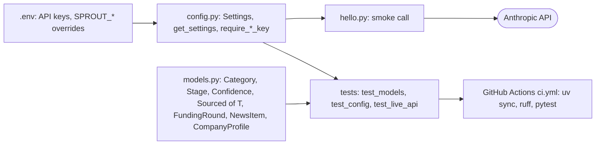
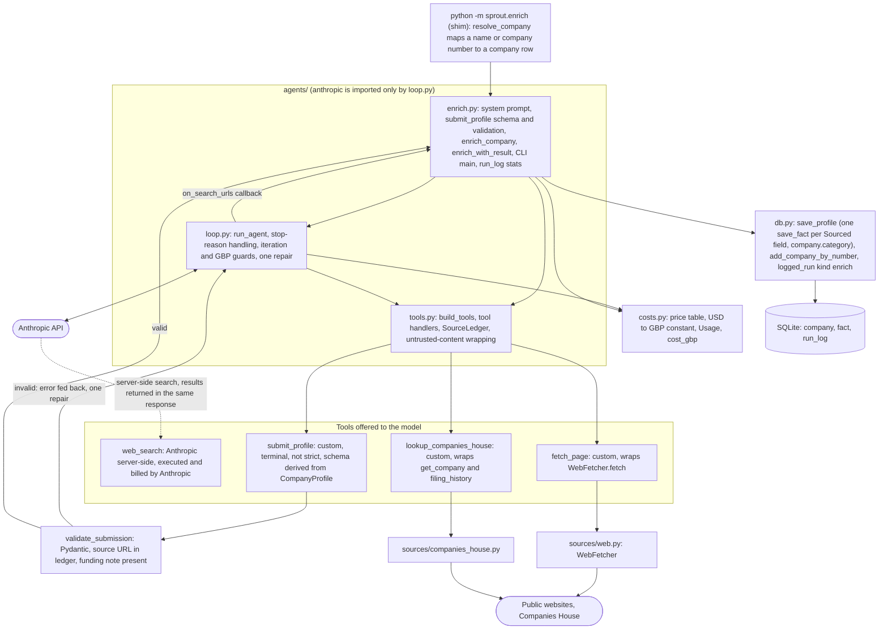
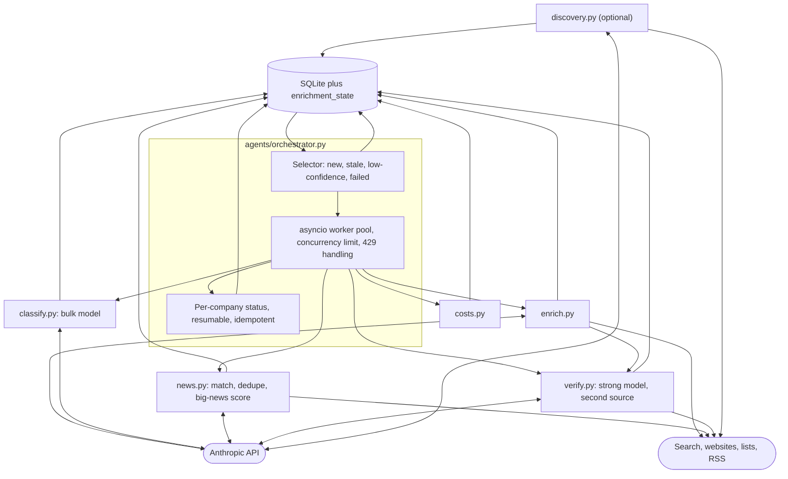
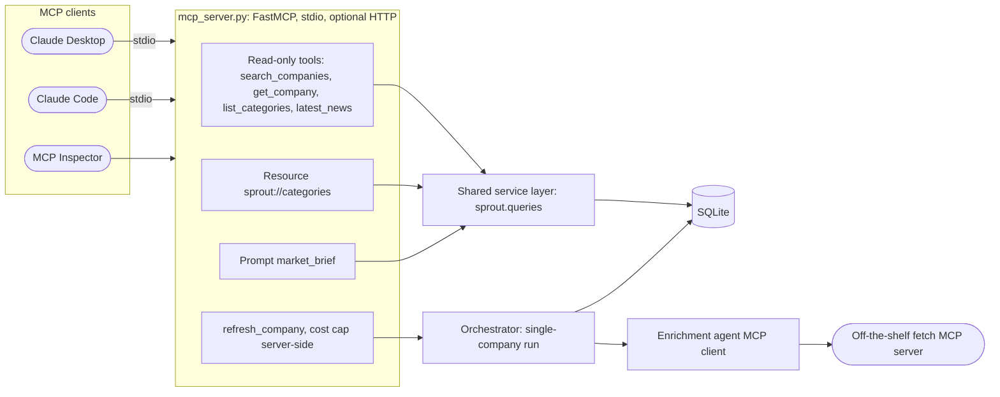
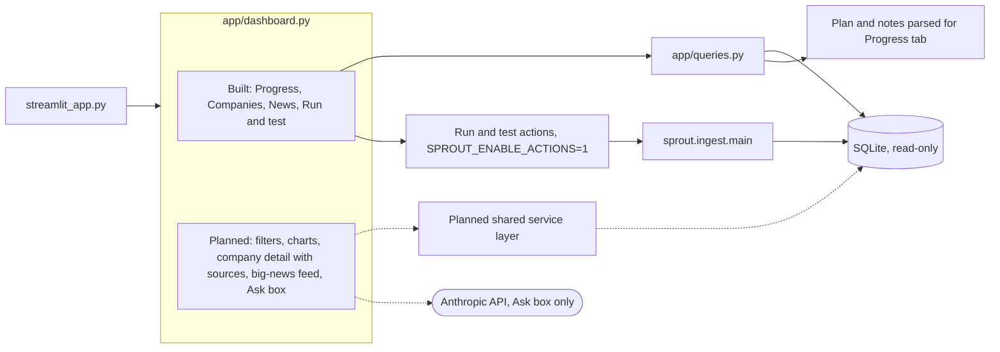
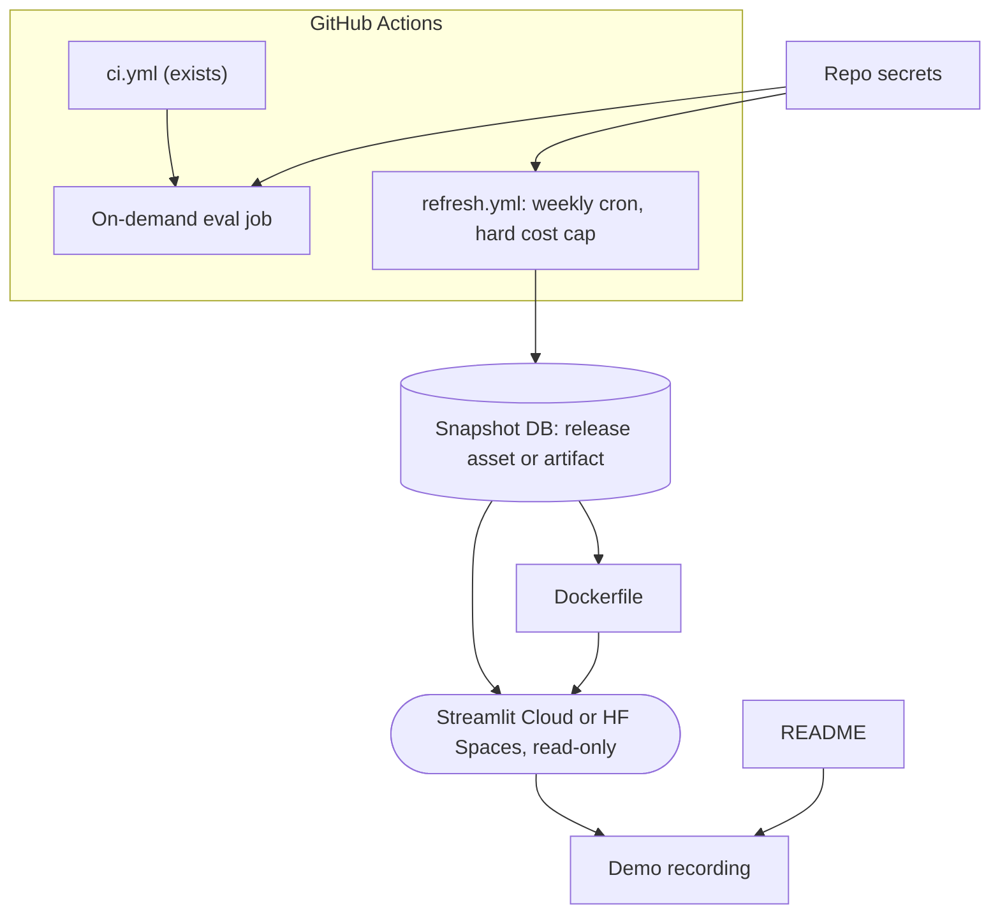
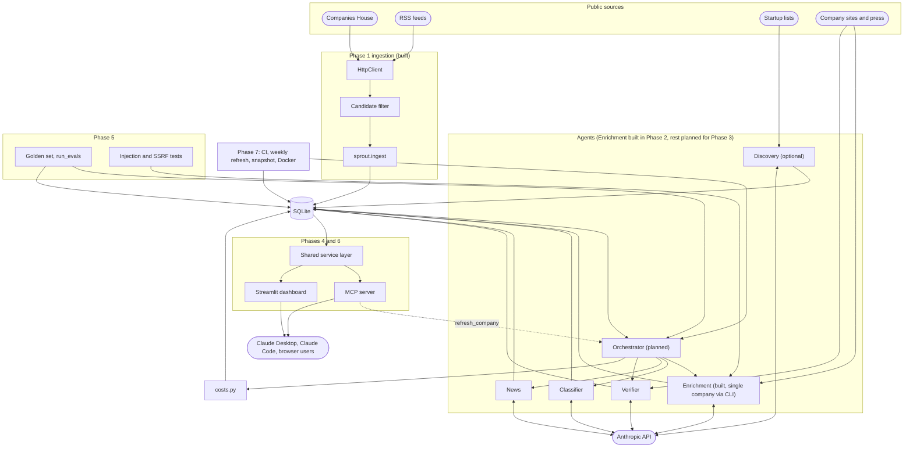
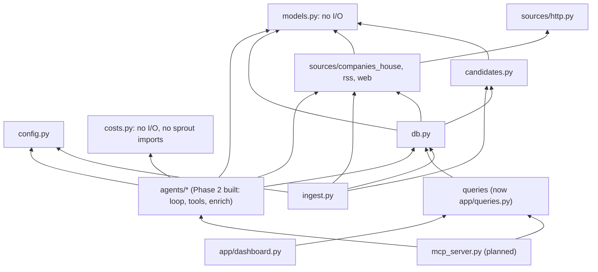
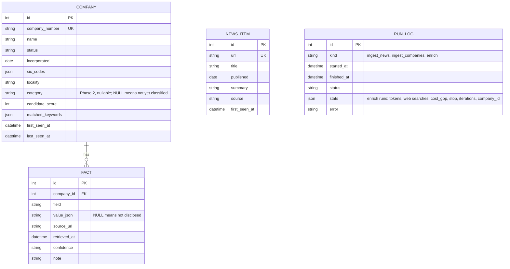
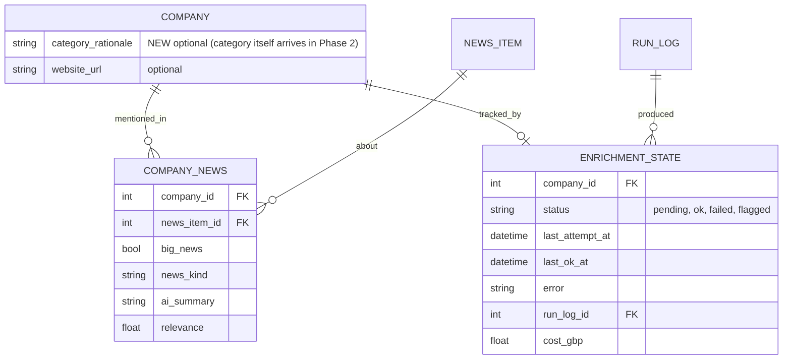

# Sprout Architecture

Sources: `docs/project-plan.md`, `docs/implementation-notes.md`, and the code under `src/sprout/`. Test counts: the end-of-phase sync of 2026-10-19 re-ran the suite (169 passed, `ruff check` clean). **[AMBIGUOUS]** marks unclear or conflicting parts of the plan. **[DRIFT]** marks places where code differs from the plan or from an earlier version of this document.

Phase 2 (single-company enrichment) was synced against the code on 2026-10-19: sections 2.3, 3.1 to 3.4, 4.x, D13-D18, 6.x and 7 describe built code unless marked otherwise. Phase 3 onward is still design.

## 1. Overview and goals

Sprout discovers UK AI startups, groups them by a fixed 16-category taxonomy, and keeps a sourced profile for each (funding, stage, business model, target user, recent news). Data is served through a Streamlit dashboard and an MCP server.

**Goals**
- About 150 sourced profiles; quality measured on a hand-labelled golden set of 30.
- Provenance over completeness. Every fact carries `source_url`, `retrieved_at`, `confidence`. "Not disclosed" is valid. A non-null value without a source is rejected in code.
- Budgeted: about £20 total API spend, under about £10 per full run, a cap on every run, cost logged.
- Scraped content is untrusted data, never instructions.

**Non-goals:** embeddings / "similar companies"; complete UK coverage; real-time freshness (weekly refresh).

**Constraints:** one developer, about 45 hours, Python 3.12, SQLite, no paid data vendors. Cut order if behind: embeddings, discovery agent, MCP HTTP transport, Docker/hosting. Never cut provenance, evals, or the MCP server.

**Style:** a batch pipeline writes to one SQLite file; two read-mostly front ends (Streamlit, MCP) sit on top. All external I/O goes through narrow adapters (`sources/*`, later the LLM client) so tests mock at those seams.

Legend: cylinders are storage, rounded boxes are external services, dotted arrows are planned (in 2.3 only, a dotted arrow instead marks work done by Anthropic's servers rather than our code).

## 2. Diagrams by phase

### 2.1 Phase 0: Setup and definitions (done, one criterion unverified)



The taxonomy, stage enum, `Sourced[T]` and `CompanyProfile` are the contract every later phase depends on.

### 2.2 Phase 1: Data foundations (done)


`WebFetcher` is not used by ingest; since Phase 2 it is called by the enrichment agent's `fetch_page` tool (2.3). Ingest writes two registry-sourced facts per company (`hq`, `founded`, confidence medium).

### 2.3 Phase 2: Single-company enrichment agent (done, with caveats)



- **Search backend (resolves A1 and D13 for Phase 2, built as designed): Anthropic server-side `web_search_20260209` (`max_uses` 3); custom `fetch_page` and `lookup_companies_house`; no server-side `web_fetch`.** Server-side `web_fetch` would fetch pages from Anthropic's side and bypass the robots, SSRF, size and cache protections of `WebFetcher`. Server-side `web_search` only returns result URLs and snippets; any page the agent then reads goes through our `fetch_page`, so the protections still apply. It also needed no new key, dependency or adapter. The SDK also ships `web_search_20260318`, not documented in the `claude-api` skill and not adopted.
- Options compared (verdicts updated with the Phase 2 outcome):

| Option | For | Against | Verdict |
|---|---|---|---|
| Server-side `web_search` (type string `web_search_20260209`, confirmed by live calls) | No extra key, adapter or tests; results are in the same response; `max_uses` is a hard cap | Billed per search on top of tokens (USD 10 per 1,000 is assumed from the `claude-api` skill and not yet checked against an invoice); results come back in blocks we do not wrap; adds `server_tool_use` and `pause_turn` handling; results arrive encrypted so snippet-only claims cannot be audited by us; not cacheable by us | Built. Measured average GBP 0.0105 per company against the GBP 0.05 target; search is about 70 percent of that |
| Custom search tool (Brave or Tavily) | Our own cache and rate limit; results wrapped as untrusted; cost may be lower | New key, adapter, tests and a pricing check | Not needed: cost is far below target. Reconsider only if auditability of snippets matters more than the extra adapter |
| Server-side `web_fetch` | Zero code | Bypasses `WebFetcher` protections | Rejected |

- **Swap point:** the tool list is built in one function, `build_tools(fetcher, ch, ledger)` in `agents/tools.py`; replacing the search entry with a custom handler touches that function, the price table and nothing else. The lever for lowering cost is `WEB_SEARCH_MAX_USES` (or caching search results), not the model.
- **Server-side tool mechanics the loop handles:** the response may contain `server_tool_use` and `web_search_tool_result` blocks, which are appended to the history unchanged (they carry encrypted content needed on the next turn). `stop_reason: "pause_turn"` appends the assistant content and calls again without a user message, and counts as an iteration (covered by a scripted-client test only; not seen in the live runs recorded in the notes). Search errors (`max_uses_exceeded`, `unavailable`, and similar) arrive as result blocks, not exceptions; one live Tractable run had search unavailable and the model submitted honest nulls. `usage.server_tool_use.web_search_requests` is added to cost. URLs in search results reach the seen-URL ledger through the `on_search_urls` callback passed to `run_agent` (the loop stays generic; `enrich.py` supplies the callback).
- **Model facts carried into Phase 2 (verified live on Haiku 5.5):** bulk `claude-haiku-5-5` is the default enrichment model, `claude-sonnet-5-5` is selectable (`--strong`, not tested live). The loop sends `tool_choice: {"type": "auto"}`, and the system prompt names `submit_profile` as the required final step. Forced `tool_choice` was reported to return 400 and was not re-tested. `submit_profile` is **not** `strict`: the API rejected the derived schema ("29 parameters with type arrays or anyOf, limit 16"), so Pydantic validation plus one repair attempt is the enforcement (the fallback the design allowed; see D18). Thinking tokens are billed as output, so they are inside `usage.output_tokens` and the GBP budget. Effort is passed as `output_config={"effort": ...}`, default `low` (CLI `--effort low|medium|high`).
- **Prompt caching (confirmed live):** the system block carries `cache_control: ephemeral` and so does a top-level `cache_control` on `messages.create`, which caches the growing conversation so each iteration re-reads earlier turns at the read price. Across the live runs about 455k tokens were written and 1.50M read, so `cache_creation_input_tokens > 0` holds. The tool list order is fixed because tool definitions sit at the start of the cached prefix.
- **Prompt injection:** every custom tool result (page text, Companies House data) is wrapped in `<untrusted_content source="URL">...</untrusted_content>`, any opening or closing delimiter inside the text is neutralised before wrapping, results are truncated to 8,000 characters with a `[truncated]` marker, and the system prompt states that anything inside is data and never instructions. Search snippets arrive outside our wrapping, so the same system-prompt rule covers them. No tool the model can call writes anything; DB writes happen in our code after validation. Residual risk: `fetch_page` takes a model-chosen URL, so injected text could try to leak context through a query string. There are no secrets in context; an allow/deny list is Phase 5. No injection fixtures exist yet (Phase 5).
- **Provenance enforced in code, beyond Pydantic (D16, built in `validate_submission`):** `retrieved_at` is not model output. The submit schema omits it and our code stamps it from the ledger (time the URL was fetched or seen in search). A `source_url` must be a URL the tools actually returned; matching ignores tracking params, fragments, host case and a trailing slash (a plain `https://x.com` versus `https://x.com/` mismatch caused false rejections before this was fixed). A URL the model produced from memory is rejected and fed back as a repair whose message lists up to 25 citable URLs. A funding fact (`total_raised_gbp`, `last_round`) must carry a `note` with the original figure and currency. A source seen only in a search snippet and never fetched caps confidence at `medium`. The check applies to non-null values only; a null value with no source always passes.
- **[AMBIGUOUS], resolved:** `submit_profile`'s schema is generated from `CompanyProfile` (`submit_profile_schema()`): `$ref`s are inlined, `name`, `news` and `retrieved_at` are removed, all remaining properties are made required, and the keywords `title`, `default`, `minimum`, `maximum`, `minLength`, `format` and `description` are dropped, so numeric bounds on `founded` and `amount_gbp` are enforced by Pydantic only. Because strict mode refused the schema anyway, nothing relies on the API enforcing it.
- **Caveats on the pilot:** the 10-company result (10/10 `submitted`, average GBP 0.0105) is the final pass; the first pass was 6/10 and the review of the profiles was done by the implementing agent, not the user. Non-determinism remains: an occasional run ends `invalid` or `refused`, and the model sometimes leaves `amount_gbp` null for non-GBP rounds despite the prompt (safe but understates funding coverage). The `Stage` enum has no Series D, E or F, so the model maps them to "Series C+" or "Growth" and says so in the note.

### 2.4 Phase 3: Multi-agent pipeline (planned)



- The orchestrator is deterministic scheduling code, not an LLM supervisor (D4).
- `HttpClient` is synchronous and not thread-safe: one client per worker, locking, or `asyncio.to_thread`.
- **[AMBIGUOUS]** Verifier ordering: run after the enricher, only for companies with a funding or stage claim.
- **[AMBIGUOUS]** "Add an agent only if evals improve" but evals arrive in Phase 5. Pull a minimal eval harness forward (D9).

### 2.5 Phase 4: MCP server (planned)



- A stdio server must never write to stdout; log to stderr.
- **[AMBIGUOUS]** Replacing `fetch_page` with a third-party MCP server discards `WebFetcher` protections. Wrap `WebFetcher`, or keep the replacement behind a flag.
- **[AMBIGUOUS]** `refresh_company` is a model-invoked paid write. Keep it on the MCP server only, never in the enrichment agent's tools. Add a cooldown and return status plus cost rather than blocking.

### 2.6 Phase 5: Evals and guardrails (planned)


Much of the SSRF and size-limit work already exists in `sources/web.py`; Phase 5 mostly adds tests and an explicit allow/deny list.

### 2.7 Phase 6: Dashboard (partial: progress and test console exists)



### 2.8 Phase 7: Automation, deployment, docs (planned)



### 2.9 End to end



## 3. Module boundaries and interfaces

### 3.1 Dependency direction



Rules: `models.py` and `costs.py` depend on nothing in `sprout`; `sources/*` never import `db`; front ends never import agents except via the single `refresh_company` path. Within `agents/`, only `loop.py` imports `anthropic` (so SDK drift, error types and the test seam live in one file); `tools.py` builds plain-dict tool specs and never imports the SDK; `agents/enrich.py` is the only agent module that touches `db` (confirmed from the imports). `tools.py` imports `loop.py` only for the `Tool` and `ToolOutcome` types. `hello.py` is a standalone smoke script and also imports `anthropic`; the rule covers pipeline code. `src/sprout/enrich.py` is a three-line `python -m sprout.enrich` shim over `agents.enrich.main`.

**[DRIFT]** `db.py` imports `CompanyHit`, `parse_hit`, `Assessment` and `assess` (`src/sprout/db.py:17-19`), tying storage to one source and filter. Phase 2 added a second use: `add_company_by_number` turns a Companies House response into a row through `parse_hit` and `assess`, so the earlier advice to keep Phase 2 write helpers free of source-specific types was not followed for that one helper. `save_profile` is clean (models only). Acceptable at this size; move `add_company_by_number` next to the ingest code if a second source appears.

### 3.2 Built modules

| Module | Responsibility | Interface | Errors |
|---|---|---|---|
| `config.py` | Env and `.env` into frozen `Settings` | `get_settings()`, `require_*_key()` | `MissingConfigError` |
| `models.py` | Taxonomy, `Sourced[T]`, `CompanyProfile` (`extra="forbid"`) | Pydantic classes | `ValidationError` for unsourced values, naive datetimes |
| `sources/http.py` | Single network entry point | `HttpClient.get`, `DiskCache`, rate limiters | `FetchError`; 4xx (not 429) no retry; 429/5xx retry 4 times with backoff |
| `sources/companies_house.py` | Registry client | `search`, `advanced_search`, `get_company`, `filing_history` | `FetchError` |
| `sources/rss.py` | Feeds to `NewsItem` | `fetch_feed`, `parse_feed`, `normalise_url` | One bad feed doesn't stop others |
| `sources/web.py` | Polite, safe page fetch | `WebFetcher.fetch`, `html_to_text` | `FetchBlockedError` |
| `candidates.py` | Name and SIC heuristic | `assess()` | none |
| `db.py` | SQLModel tables and writes | `init_db` (create tables, then additive `ALTER TABLE` for missing nullable columns), `upsert_company`, `save_fact`, `add_news_items`, `logged_run`, `save_profile`, `add_company_by_number` | failures logged in `run_log`, re-raised; non-additive schema change raises `RuntimeError` telling you to reset the DB |
| `ingest.py` | Phase 1 orchestration | `python -m sprout.ingest` | exit code 1 on failed feeds |
| `costs.py` | Price table, USD to GBP, `Usage`, GBP cost (pure) | `PRICES`, `USD_TO_GBP`, `WEB_SEARCH_USD_EACH`, `Usage`, `cost_usd`, `cost_gbp` | `UnknownModelError` for an unpriced model (fails closed) |
| `agents/loop.py` | Generic tool-use loop; the only pipeline module importing `anthropic` | `run_agent`, `make_client`, `Budget`, `Tool`, `ToolOutcome`, `LoopResult` | never raises for API, tool or model problems: returns a `LoopResult.stop` code; `ValueError` from `Budget` for bad caps; `UnknownModelError` before the first call |
| `agents/tools.py` | Tool specs, handlers, seen-URL ledger, untrusted wrapping | `build_tools`, `SourceLedger`, `wrap_untrusted` | handlers return error outcomes, never raise into the loop |
| `agents/enrich.py` | Prompt, `submit_profile` schema and validation, persistence, `enrich` run_log row, CLI | `enrich_company`, `enrich_with_result`, `validate_submission`, `submit_profile_schema`, `resolve_company`, `main` | `EnrichmentFailed(stop, cost_gbp)` on any non-success; `CompanyNotFound` for the CLI; exit 0 ok, 1 any skip or failure, 2 missing Anthropic key |
| `enrich.py` | `python -m sprout.enrich` shim | `main` re-export | see `agents/enrich.py` |
| `app/queries.py` | Streamlit-free read queries | `search_companies`, `company_facts`, `search_news`, `parse_phases` | none |

**[DRIFT]** Files not in the plan layout: `candidates.py`, `ingest.py`, `hello.py`, `app/queries.py`, `streamlit_app.py`, and from Phase 2 `agents/tools.py` and the `enrich.py` shim (the plan names `costs.py`, `agents/loop.py` and `agents/enrich.py`). `agents/enrich.py` also carries the CLI and `resolve_company` (about 460 lines in all); acceptable now, split the CLI out when Phase 3 adds an orchestrator entry point.

### 3.3 Phase 2 interfaces (built) and planned modules

#### Phase 2 (built; signatures as in the code)

```python
# costs.py - pure: no I/O, no imports from sprout
USD_TO_GBP = Decimal("0.76")   # approximation dated 2026-10-19, rounded up (see D14)
@dataclass(frozen=True)
class Price: input: Decimal; output: Decimal; cache_write: Decimal; cache_read: Decimal  # USD per million tokens
PRICES: dict[str, Price]       # keyed by exact model ID (haiku-5-5, sonnet-5-5); WEB_SEARCH_USD_EACH = Decimal("0.01")
@dataclass
class Usage:                   # supports +, accumulated per run
    input_tokens: int; output_tokens: int; cache_read_tokens: int; cache_write_tokens: int; web_searches: int
def cost_usd(model: str, usage: Usage) -> Decimal
def cost_gbp(model: str, usage: Usage) -> Decimal   # raises UnknownModelError for an unpriced model

# agents/loop.py - the only pipeline module importing anthropic
class MessagesClient(Protocol):            # what the loop needs; the test seam
    messages: Any                          # .create(**kwargs) -> response with .content, .stop_reason, .usage
def make_client(api_key: str) -> MessagesClient       # real anthropic.Anthropic, 120 s timeout, SDK retries on
@dataclass(frozen=True)
class Budget: max_iterations: int; max_gbp: Decimal; max_repairs: int = 1   # validated: iterations >= 1, gbp > 0
@dataclass(frozen=True)
class Tool:
    spec: dict                             # sent to the API (custom tool or server-side tool type)
    handler: Callable[[dict], ToolOutcome] | None = None   # None for server-side tools
    terminal: bool = False                 # submit_profile
@dataclass(frozen=True)
class ToolOutcome: text: str; is_error: bool = False; payload: Any = None   # payload set => accepted submission
@dataclass
class LoopResult:
    payload: Any | None; usage: Usage; cost_gbp: Decimal; iterations: int; repairs: int; tool_calls: dict[str, int]
    stop: Literal["submitted","invalid","max_iter","budget","no_submit","truncated","refused","error"]
    error: str | None
def run_agent(client, *, model, system, messages, tools, budget, max_tokens, effort,
              on_search_urls: Callable[[list[str]], None] | None = None) -> LoopResult

# agents/tools.py - plain dicts and handlers; no SDK import
def build_tools(fetcher: WebFetcher, ch: CompaniesHouseClient | None, ledger: SourceLedger) -> list[Tool]
    # web_search (server-side, max_uses 3), fetch_page, lookup_companies_house (only if ch is not None); submit_profile is added by enrich.py
class SourceLedger:                               # URLs the tools returned, with first-seen time and fetched-or-snippet
    def add(url, *, fetched: bool, at: datetime | None = None); def get(url) -> LedgerEntry | None; def urls() -> list[str]
def wrap_untrusted(source_url: str, text: str, max_chars: int = 8_000) -> str    # delimiters, neutralise tags, truncate

# agents/enrich.py
DEFAULT_BUDGET = Budget(max_iterations=12, max_gbp=Decimal("0.10"))   # kept after the live run; MAX_OUTPUT_TOKENS = 6_000
@dataclass(frozen=True)
class Deps: client; fetcher; ch; settings; model: str; effort: str = "low"
def enrich_company(session, company, deps, budget=DEFAULT_BUDGET) -> CompanyProfile   # raises EnrichmentFailed(stop, cost)
def enrich_with_result(session, company, deps, budget=DEFAULT_BUDGET) -> tuple[CompanyProfile, LoopResult]
def main(argv) -> int        # python -m sprout.enrich NAME_OR_NUMBER...  --strong  --max-gbp  --max-iterations  --effort  --show

# db.py additions
def save_profile(session, company, profile: CompanyProfile) -> None     # save_fact per Sourced field; company.category
def add_company_by_number(session, number: str, data: dict) -> Company   # for pilot companies absent from the 876
```

**[DRIFT]** against the earlier design of this section: `build_tools(fetcher, ch, ledger)` replaces `build_tools(deps, ledger)` (so `tools.py` does not import `Deps` from `enrich.py`); `Deps` gained `model` and `effort`; `run_agent` gained `on_search_urls` and `LoopResult` gained `repairs`; `enrich_with_result` was added because `enrich_company` returns only the profile and the CLI needs cost and iterations; `cost_usd` is exposed; `SourceLedger.add` takes an optional `at` so a fetched page keeps the fetcher's `retrieved_at`; the CLI gained `--effort` and `--show` and a Companies House name search for "did you mean" hints. `Deps.ch` is `CompaniesHouseClient | None` and is dropped for a company with no number (`lookup_companies_house` is then absent from the tool list).

**Loop contract (stop-reason handling; built as designed, covered by scripted-client tests).** Each iteration: check the guards, call `messages.create`, add `usage` to the running total, then act on `stop_reason`.

| Condition | Action |
|---|---|
| `tool_use` | Run each custom `tool_use` block; return all results in one user message (`tool_result`, `is_error` for failures). Handler exceptions become error strings, never raised. A terminal tool that returns a payload ends the run (`submitted`). A terminal tool that returns `is_error` is the repair path: one allowed (`max_repairs`), a second failure ends the run (`invalid`). |
| `pause_turn` | Append the assistant content unchanged and call again; counts as an iteration. |
| `end_turn` without a submission (also `tool_use` with no `tool_use` block) | One reminder to call `submit_profile`, otherwise `no_submit`. Any other unknown stop reason gives `error`. |
| `max_tokens` | `truncated` (a cut-off `tool_use` input is not trusted). |
| `refusal` | `refused`. |
| SDK `APIError` after the SDK's own retries | `error`; usage so far is still returned. |
| Guards | Checked before every call: iterations used >= `max_iterations` gives `max_iter`; spent >= `max_gbp` gives `budget`. On the last allowed iteration, or once spend reaches 80 percent of the cap, the next user message adds "budget nearly used, call submit_profile now". The GBP cap is soft by at most one response (cost is known only after a call); `max_tokens` bounds that overshoot, and tests assert the exact call count with a tiny cap. |

Only a validated `submit_profile` carries facts, so on any non-`submitted` stop nothing is written to `fact` or `category`; the cost is still recorded. The only per-run caps are iterations, GBP, search `max_uses` (3) and the tool-result character cap.

**[DRIFT]** Earlier text in this document (4.2, 4.7) also promised a per-run fetch cap and 4.3 promised "partial" facts on a cap stop. Neither exists: page fetches are bounded only by the iteration cap, and no partial profile is ever written. There is also no batch-level GBP cap: the CLI enforces `--max-gbp` per company and only prints the total, so a long target list can spend `n * max_gbp`. Add a batch cap in Phase 3's orchestrator.

**Other planned modules (Phases 3 and 4):**

```python
# agents/classify.py
def classify(company, deps) -> Classification
# agents/news.py
def collect_news(company, deps) -> list[ScoredNews]
# agents/verify.py
def verify_funding(company, claims, deps) -> list[Verification]
# agents/orchestrator.py
async def run(limit, concurrency, budget, force=False) -> RunSummary
# sprout/queries.py (extracted from app/queries.py)
search_companies(...); get_company(name); latest_news(...)
```

- Agents receive a client through a `Deps` dataclass; tests inject a scripted fake client (see 4.4).
- Tool handlers return error outcomes and never raise into the loop (`run_agent` also catches any handler exception and turns it into an error result).
- `enrich_with_result` writes facts and the `enrich` run_log row in one session: it assigns `run.stats` and **commits before raising** on failure, because `logged_run` rolls back on exceptions and would otherwise discard the stats that record what a failed run cost; on success it then calls `save_profile`. On failure `logged_run` also marks the row `status="error"` with the exception text, while the stats stay on the row. Note the status therefore means "run did not produce a profile", and `stats.stop` says why.
- Move `app/queries.py` to `sprout/queries.py` (keep a re-export) before Phase 4 so MCP does not import from the UI package.

### 3.4 Data model

Built:



`fact` is unique on `(company_id, field, source_url)`. `news_item` has no company link; `run_log` has no company link (the enrich link is `stats.company_id`, inside the JSON).

Phase 2 added exactly one schema change, `company.category` (shown in the diagram above), plus `run_log` rows of `kind="enrich"`.

- **`company.category`** is `str | None`, not a SQL enum (an enum adds a CHECK constraint, which complicates additive `ALTER`). It is validated back to `Category` on read. It is not indexed (about 150 enriched rows). `save_profile` sets it from `CompanyProfile.category`; a company the agent never finished keeps `NULL`.
- **How the existing dev DB gets the column (D15, built):** `init_db` runs `create_all`, then `_add_missing_columns`: for each existing table it compares `sqlalchemy.inspect(engine).get_columns(...)` with the model and runs `ALTER TABLE ... ADD COLUMN` for each missing column. Only a plain nullable column is added; a missing column that is non-nullable, a primary key or unique raises `RuntimeError` telling the developer to delete the database and re-ingest. **[DRIFT]** the design also allowed columns "with a constant default"; the code is stricter (nullable only), which is enough for `category`, `category_rationale` and `website_url` but not for a NOT NULL column with a default. Covered by `test_init_db_adds_new_columns_to_an_old_database_and_keeps_rows`. Fallback for a non-additive change: delete `data/sprout.db` and re-run ingest (the Companies House cache max age is 7 days, so an old cache means about 25 fresh requests, not a problem).
- **`run_log` for enrich** (`kind="enrich"`, one row per company attempt, via `logged_run`). `stats` is assigned as a whole dict. Costs are stored as floats rounded to 6 places (observability only; caps use `Decimal` in memory). `repairs` is 0 or 1 and an allowed repair is not a failure. `error` is the loop's error text or null:

```json
{"company_id": 12, "company_number": "09999999", "model": "claude-haiku-5-5", "effort": "low",
 "stop": "submitted", "iterations": 6, "repairs": 0,
 "input_tokens": 0, "output_tokens": 0, "cache_read_tokens": 0, "cache_write_tokens": 0,
 "web_searches": 0, "tool_calls": {"fetch_page": 0, "lookup_companies_house": 0},
 "cost_gbp": 0.0, "usd_to_gbp": 0.76, "budget": {"max_iterations": 12, "max_gbp": 0.10},
 "error": null}
```

  Thinking tokens are inside `output_tokens`. Average cost per company is `SELECT avg(json_extract(stats, '$.cost_gbp')) FROM run_log WHERE kind='enrich'`; note that the dev DB also holds 8 `error` rows from the iteration phase, so filter on `stats.stop = 'submitted'` for the headline figure (measured: GBP 0.0105 over the final 10-company run, GBP 0.0102 over 22 successful runs). Per-company status is not a column until `enrichment_state` (Phase 3, which will reference `run_log.id`).
- **Profile persistence (built as designed):** `save_profile` iterates `CompanyProfile.model_fields`, calling `save_fact` for every `Sourced` field (`website`, `hq`, `founded`, `stage`, `total_raised_gbp`, `last_round`, `business_model`, `target_user`, `one_liner`), so a new `Sourced` field persists with no db change. "Not disclosed" is stored as a NULL-value fact so the dashboard can tell "researched, nothing found" from "never tried"; the winning-value rule (4.1) must ignore a NULL fact when a valued one exists. `news` is not persisted in Phase 2 (`news_item` has no company link until Phase 3) and `name` is ignored (identity is the row). A re-run overwrites facts from the same URL and adds facts from new URLs; older facts from URLs the new run no longer cites remain. **[DRIFT]** consequence not stated before: a field that was valued in run 1 and null in run 2 ends with both a valued fact and a NULL-value fact, and `company.category` is simply overwritten, so the winning-value rule (4.1) is needed before any front end reads facts. `load_profile` is deferred to Phase 3 or 4; Phase 2 tests read back through `fact` rows.

Planned additions (Phase 3 and later):



- `category` is a plain column (built in Phase 2, above). `company_news` links news to companies. `enrichment_state` gives per-company status, error and cost (needed for resumability). `fact` may need a `verification` column.
- `CompanyProfile` is the agent output contract; storage flattens each `Sourced` field into `fact` rows (built in Phase 2, `save_profile`). A `load_profile(session, company_id)` must still be written. `FundingRound` is stored as JSON in `value_json`.

## 4. Cross-cutting concerns

### 4.1 Sourcing and provenance
- `Sourced[T]` rejects a non-null value with no `source_url`. `value=None` means "not disclosed" and must render as such, never zero or blank.
- Per-fact `retrieved_at` (UTC) supports the staleness policy; registry facts can lag up to 7 days via the HTTP cache.
- Multiple sources per field coexist, which lets the verifier record disagreement.
- Not provenance-bearing: `category`, `news_item` (source is the feed), free-text fields.
- **[AMBIGUOUS]** No rule for which value wins when a field has several facts. Proposed: highest confidence, then most recent, and surface "sources disagree". Put it in the service layer.
- **[AMBIGUOUS]** Same-source re-extraction overwrites; no history. Phase 6 "funding history" needs a `funding_round` table or list, or should be cut.
- SQLite treats NULLs as distinct in UNIQUE constraints; `save_fact` dedupes in application code. Do not rely on the constraint alone.

### 4.2 Agent orchestration
- Deterministic supervisor selects companies and runs workers with `asyncio` under a concurrency limit.
- Per company: enrich, then classify (bulk model), news, then verify (only for funding or stage claims). Classifier and news can run in parallel.
- Models: bulk `claude-haiku-5-5` for extraction/classification; strong `claude-sonnet-5-5` for verification/synthesis; overridable via `SPROUT_BULK_MODEL` / `SPROUT_STRONG_MODEL`. IDs were taken from the `claude-api` skill on 2026-10-06; live Phase 2 calls succeeded with `claude-haiku-5-5` (the default). `claude-sonnet-5-5` (`--strong`) is priced but was not run live. Any unpriced override fails closed in `costs.py`.
- Loop (built in Phase 2, see 2.3 and 3.3): `tool_choice: auto` plus a prompt instruction naming `submit_profile`, explicit effort, thinking tokens in budget, prompt-cached prefix and conversation, `pause_turn` and `server_tool_use` handled, per-run caps of iterations, GBP and searches (`max_uses`). No per-run fetch cap and no batch-level cap (see the [DRIFT] note in 3.3).
- Resume: the unit of work is a company; one transaction per company; fresh `ok` rows are skipped.
- A company failure sets status `failed` and the run continues. Target at least 85% `ok`.

### 4.3 Error handling

| Boundary | Failure | Behaviour |
|---|---|---|
| Companies House / RSS | 429 or 5xx | Retry with backoff and `Retry-After`, then `FetchError` |
| Companies House | 404 | Cached, treated as no result |
| RSS | One feed broken | Reported in `failed_feeds`, exit 1, others continue |
| Web fetch | robots, private IP, content type | `FetchBlockedError`, returned to the model as a tool error |
| Web fetch | robots.txt unreachable | Refuse |
| Web fetch | Page larger than the tool-result cap | Truncate to 8,000 characters (`TOOL_RESULT_MAX_CHARS`) with a "[truncated]" marker; `WebFetcher` already caps at 20,000 characters |
| Companies House tool | 404 or invalid number | `None` becomes a "no such company" error string; not retried |
| Server-side search | `max_uses_exceeded`, `unavailable`, rate limit | Arrives as an error result block (the loop's URL extraction tolerates a non-list result); the model continues without search; not an exception. Seen live once (Tractable, search unavailable): honest nulls |
| LLM | `pause_turn` | Resend the history including `server_tool_use` blocks; counts as an iteration |
| LLM | `refusal`, `max_tokens`, `end_turn` with no submission | Stop codes `refused`, `truncated`, `no_submit` (one reminder first); nothing persisted. `refused` was seen live once on Cleo and was transient |
| LLM | SDK `APIError` after SDK retries (429/5xx) | Stop `error`; usage so far logged; the `run_log` row is `status=error` and the CLI continues with the next target |
| LLM | Invalid structured output | One repair attempt (Pydantic errors as compact field paths and messages, not the whole input echoed), else stop `invalid`; nothing persisted |
| LLM | `source_url` not in the seen-URL ledger, funding fact without a `note` | Treated as invalid output: same single repair attempt, and the error lists up to 25 citable URLs. Seen live: invented homepages were rejected and repaired |
| LLM | Iteration or £ cap | Stop with `max_iter` or `budget`; nothing is persisted (no partial profile); `run_log` row keeps stats and cost. **[DRIFT]** the earlier "keep partial facts, mark `partial`" is not implemented. Phase 3 `enrichment_state` will need to decide whether to retry or accept partial results |
| LLM | Sources disagree | Record both, lower confidence, flag |
| MCP tool | Bad input or DB error | Compact actionable text; never write to stdout |

### 4.4 Testing
- Unit tests for models, candidates, DB helpers. Adapter tests with `httpx.MockTransport`. `streamlit.testing` smoke tests. 169 tests pass (re-run 2026-10-19); the only live test (`-m live`, `tests/test_live_api.py`) is the Phase 0 hello call and is skipped without a key.
- **Fake-client seam (built):** `run_agent` takes any object with `messages.create(**kwargs)`, and reads only `content[*].type/id/name/input/text`, `stop_reason` and `usage.*` (including `server_tool_use.web_search_requests`). `tests/fakes.py` provides a `ScriptedClient` that returns queued responses (or raises a queued exception) built from `SimpleNamespace` objects with helpers (`text_turn`, `tool_use_turn`, `server_search_turn`, `pause_turn`, plus `response`, `usage`, `search_blocks`) and records every request, with a snapshot of the message list, so tests can assert on cache markers, `tool_choice` and message history. It raises if the loop makes more calls than scripted. The loop appends `response.content` to history unchanged, which works for both SDK and fake objects. Tool handlers are tested with the existing `httpx.MockTransport` fixtures through `WebFetcher` and `CompaniesHouseClient`.
- **Phase 2 tests (built):** `test_costs.py` (exact Decimal arithmetic, fail-closed unknown model, usage addition), `test_agent_loop.py` (cache markers, repair path, second invalid gives `invalid`, exact iteration cap with wrap-up notice, tiny GBP cap, 80 percent wrap-up, `pause_turn`, `end_turn` reminder, terminal stop reasons, truncated `tool_use` not executed, handler errors and unknown tools, `APIError` keeps usage, unpriced model fails before any call, budget validation), `test_agent_tools.py` (wrapper, ledger, tool order, server-side search entry, fetch and Companies House tools), `test_enrich.py` (schema derivation, provenance checks, happy path, repair, no persistence on failure with cost recorded, caps, re-run overwrite, `resolve_company`, CLI), and `test_db.py` additions (`save_profile`, `add_company_by_number`, additive `init_db`).
- **[DRIFT]** the planned `-m live` single-company enrichment test was deliberately not added, so a plain `pytest` with a key never spends money. Live behaviour (prompt caching, schema rejection, the 10-company run) is evidenced only by the manual runs in the implementation notes; `--strong`, forced `tool_choice` and `pause_turn` have no live evidence.
- Planned later: MCP tools tested directly on a temp DB; injection and SSRF fixtures as plain pytest cases.
- Golden-set evals run on demand, not per push (cost).
- Gap: CI action versions were written from memory; first green run unconfirmed.

### 4.5 Configuration
- Env plus `.env` via `get_settings()`: `ANTHROPIC_API_KEY`, `COMPANIES_HOUSE_API_KEY`, `SPROUT_BULK_MODEL`, `SPROUT_STRONG_MODEL`, `SPROUT_DB_PATH`, `SPROUT_CACHE_DIR`, `SPROUT_ENABLE_ACTIONS`.
- Secrets never committed; `.env`, `*.db`, `.cache/` are gitignored.
- Phase 2 added per-run £ and iteration caps (`--max-gbp`, `--max-iterations`, defaults GBP 0.10 and 12 in `agents/enrich.py`), `--effort` and `--strong`, and a price table and USD to GBP constant in `costs.py` (code, not env, so a run is reproducible from the commit). No new env vars or dependencies. No search-backend setting: Phase 2 hard-wires server-side search (D13) and the swap point is `build_tools`.
- No migrations framework. Phase 2 added additive-column handling in `init_db` (D15, nullable columns only); delete `data/sprout.db` for non-additive changes, or adopt Alembic by the end of Phase 3 if one is needed.

### 4.6 Security
- Fetched content and Companies House data are wrapped in `<untrusted_content>` delimiters (closing tag neutralised), the system prompt says it is data, and model output is validated and treated as untrusted. Search snippets are covered by the system-prompt rule only.
- Source URLs and `retrieved_at` are controlled by code (seen-URL ledger), so injected text cannot make the model cite an invented page.
- `WebFetcher` is SSRF-aware; residual DNS-rebinding risk is accepted.
- The enrichment agent has no write or refresh tools; DB writes happen in our code after validation.
- Streamlit actions are off unless `SPROUT_ENABLE_ACTIONS=1`; public deployments are read-only with no keys.

### 4.7 Cost and observability
- `costs.py` (built) converts API `usage` (input, output including thinking, cache read, cache write, plus per-search charges for server-side `web_search`) to GBP with a documented USD to GBP constant (0.76, an approximation dated 2026-10-19). It computes cost only; the caps are enforced in `loop.py` (`Budget`) against the running `Usage` total. Haiku 5.5 is priced at the lower rate card; its prompts over 100K tokens would double, which per-call prompts stay well below because tool results are capped (not exercised live).
- Search is billed separately from tokens, so `web_searches` is its own `stats` field and `max_uses` is a hard per-run cap. Measured: about 70 percent of a run's cost is the single search at an assumed US$0.01. That rate is not yet confirmed against a console invoice, so the GBP figures inherit that uncertainty.
- `run_log.stats` is today's observability record (shape in 3.4). Add structured logging to stderr.

## 5. Key design decisions

| # | Decision | Why | Cost / rules out |
|---|---|---|---|
| D1 | SQLite single file, SQLModel, no migrations | Zero infrastructure, snapshot-friendly | One writer; manual reset on schema change |
| D2 | Provenance enforced in `Sourced[T]` validator | Hallucinated funding is the top risk | A wrong but real URL still passes; verifier and evals catch it |
| D3 | `category` is a plain enum, not `Sourced` | Classification, not a fact at a URL | No per-label provenance |
| D4 | Deterministic orchestrator, not an LLM supervisor | Selection is rule-based | Departs from the plan's wording |
| D5 | Hand-written agent loop, no framework | Plan wants the mechanics | You own retries, caps, parsing |
| D6 | One HTTP entry point | Idempotent, polite, tested once | Sync and not thread-safe |
| D7 | Candidates by name and SIC heuristic (876) | Free; no description search | Many shells; misses oddly named startups |
| D8 | Identity is the Companies House number | Numbers are stable | Other sources need a secondary dedupe key (website domain) |
| D9 | Specialised agents only if evals show gain | Each hand-off costs money | Pull a minimal eval harness forward |
| D10 | Shared service layer for dashboard and MCP | One rule set for winning value and "not disclosed" | Requires extracting `queries` |
| D11 | Read-only deployments ship a snapshot DB | Free hosts lack persistent disk | Delivery mechanism must be agreed (A9) |
| D12 | `refresh_company` is the only model-invokable write, capped | Limits blast radius | Needs cooldown and status response |
| D13 | Phase 2: server-side `web_search`; custom `fetch_page` (wraps `WebFetcher`) and `lookup_companies_house`; no server-side `web_fetch` | Keeps robots, SSRF, size and cache protections on every page read; no new key or adapter | Search is billed per query and returns unwrapped, encrypted snippets. **Built; holds** after the 10-company run (average GBP 0.0105, search about 70 percent of it), so no fallback to a custom backend. Phase 4's MCP swap of `fetch_page` stays open (A1) |
| D14 | `costs.py` is a pure module (price table keyed by exact model ID, per-search price, `Usage`, `cost_gbp`). USD to GBP is one constant in that file, dated in a comment, rounded up so caps are not under-counted, and written to `run_log.stats` on every run. Caps are enforced in `loop.py`, not `costs.py` | Prices change with model IDs, so they are code that is tested and reviewed, not env; the rate moves slowly relative to the GBP 0.05 target | A stale rate drifts; no live FX lookup (a network call in the cost path is worse). Unpriced model fails closed. **Built:** `USD_TO_GBP = 0.76` is an unsourced approximation dated 2026-10-19, and the US$0.01 per search is unconfirmed against an invoice |
| D15 | Additive-column step in `init_db` instead of deleting the DB or adding Alembic now | Keeps ingest data and paid enrichment output; about 20 lines; covers Phase 3 additive changes | Cannot rename, retype or add constraints; those need a reset or Alembic. **Built**, but nullable columns only (the design also allowed a constant default) |
| D16 | Provenance is stamped by code: `retrieved_at` from the seen-URL ledger, `source_url` must be a URL a tool returned, funding facts need a `note` | The prompt cannot be the only defence against invented sources or timestamps (top risk) | A real but wrong URL still passes; verifier and evals cover that (a claimed website can be wrong, e.g. Airborne Robotics). Slightly stricter than the plan. **Built** in `validate_submission`; ledger matching ignores trailing slash, host case, fragments and tracking params |
| D17 | `loop.py` is generic: terminal tools, handler callbacks, duck-typed client protocol; `enrich.py` owns the profile-specific checks | One loop can serve classifier, news and verifier agents in Phase 3 | The generic `Tool` and `ToolOutcome` types are an abstraction paid for before the second user; kept because the fake-client seam needs the boundary anyway. **Built.** The `on_search_urls` callback is the one place `enrich.py` reaches into the loop; no second user exists yet |
| D18 | `submit_profile` is not `strict`: the schema is derived from `CompanyProfile` and validated by Pydantic with one repair attempt | The API rejected the derived schema (29 anyOf or type-array parameters, limit 16), and simplifying `CompanyProfile` to fit would distort the shared contract | The API does not enforce the shape, so enforcement costs a possible repair round trip; numeric bounds and formats are Pydantic-only. Revisit if the strict limit rises or `CompanyProfile` slims |

## 6. Risks and open questions

### 6.1 Risks

| Risk | Severity | Mitigation |
|---|---|---|
| Hallucinated or misattributed funding | High | Code-enforced sources, verifier, fabricated-funding gate at most 3%, pass the company number for disambiguation |
| Candidate pool noise inflates cost | High | Rank by `candidate_score`, cheap pre-screen, pilot 10-20 companies first |
| Cost overrun (measured GBP 0.0105 per company in Phase 2 against a GBP 0.05 target; under £10 for 150 in Phase 3; £20 total) | Medium (was High) | Hard caps per company, bulk routing, prompt caching. No batch-level cap yet (see 3.3 [DRIFT]); add one before the orchestrator runs 150 companies. Measurement rests on an unconfirmed search price and an approximate FX rate |
| Prompt injection via pages | High | Delimiters, no write tools, validation, fixtures, existing size/type limits |
| Runaway agent loops | Medium | Iteration and £ caps, per-run `max_uses` and fetch limits, last-iteration wrap-up message, tested with a tiny cap |
| Server-side search billing eats the per-company target | Low (measured) | `max_uses` is 3, searches are counted in `stats`; search is about 70 percent of cost but the total is a fifth of target. Check the first console invoice for the US$10 per 1,000 assumption |
| `pause_turn` or `server_tool_use` blocks mishandled (dropped blocks give API 400s or lost context) | Medium | Append `response.content` unchanged; scripted-client tests for pause and search turns. `server_tool_use` blocks worked live; `pause_turn` has not been seen live |
| Same-name company confusion | High | Pass company number, incorporation date, SIC codes and locality in the user message; `lookup_companies_house` result is the identity anchor; prompt says to reject pages that do not match |
| Large pages or long loops inflate input cost | Medium | Tool-result character cap, prompt caching of the growing conversation, cached-token counts in `stats` |
| Pilot companies absent from the 876 candidates | Low (mitigated) | CLI accepts a company number and creates the row from Companies House (`add_company_by_number`, built; 9 pilot companies were added this way) |
| `fetch_page` URL chosen by the model can carry context to an attacker | Low | No secrets in context; allow/deny list in Phase 5 |
| Non-deterministic model output: an occasional run ends `invalid` (invented homepage, correctly rejected) or `refused` (transient) | Medium | Single repair attempt; Phase 3 needs retries and `enrichment_state`. 8 `error` rows from the iteration phase remain in `run_log` |
| Snippet-only claims cannot be audited (search results arrive encrypted) | Medium | Code caps them at `medium` confidence and requires a note; the Phase 3 verifier is the real check |
| Funding coverage understated: the model sometimes leaves `amount_gbp` null for non-GBP rounds; `Stage` has no Series D, E or F | Low | Null is the safe failure; the note carries the original figure; decide whether to extend `Stage` (A16) |
| `data/sprout.db` is tracked by git despite `*.db` in `.gitignore` | Low | Decide to commit or untrack (open item for you) |
| Sparse funding data | Medium | "Not disclosed" valid; report coverage, never plot as zero |
| Scraping ToS and robots | Medium | Honour robots, per-host limits, store snippets and links; recheck before publishing |
| SDK and model drift | Medium | Pin versions; Haiku 5.5 model ID and the `web_search_20260209` type confirmed by live Phase 2 calls (a newer `web_search_20260318` exists in the SDK, not adopted); Sonnet 5.5 not yet run live |
| Schema change without migrations | Medium | Reset during development; Alembic before the weekly job |
| Unattended weekly spend | Medium | Hard cap, console spend limit, failure notification |
| Small golden set (one company is about 3 points) | Medium | Report counts and percentages; record label date and source |
| CI never run green | Low | Confirm on first push |

### 6.2 Plan ambiguities
- **A1** Search/fetch tooling differs across Phases 1, 2 and 4. **Phase 2 part resolved and built (D13):** server-side search only, all page reads through `WebFetcher`. Still open for Phase 4: replacing `fetch_page` with an MCP server (see 2.5).
- **A2** Candidates: "~200" vs "at least 200" vs 876 loaded vs 150 enriched; no rule for choosing the 150.
- **A3** Cost arithmetic leaves no budget for evals (LLM judge, repeated runs) or prompt iteration. Phase 2 evidence: all live development spend was about GBP 0.32 (30 enrich runs) against the roughly GBP 3 ceiling, so the proposed split leaves room; the GBP 4 eval and GBP 3 reserve lines still need your confirmation.
- **A4** Phase 3 per-company status has no home in the Phase 1 schema (`enrichment_state`).
- **A5** News has no company link, big-news score or type (`company_news`).
- **A6** Phase 6 "funding history" is not supported by the model.
- **A7** `CompanyProfile.stage` and `last_round.stage` can disagree; define precedence.
- **A8** Classifier "sub-category" has no schema field; the taxonomy is flat and frozen.
- **A9** Snapshot delivery: Phase 6 "bundled", Phase 7 "don't commit", `.gitignore` excludes `*.db`.
- **A10** Dashboard is "read-only" but the console can spend API quota; separate or remove before deploy.
- **A11** Evals (Phase 5) are needed to judge the Phase 3 split.
- **A12** The optional Ask box duplicates MCP access and needs a read-only guarantee and rate limit.
- **A13** Phase 5 "restricted tools" is consistent with `refresh_company` only if the latter is never in the agent's tool set.
- **A14** `refresh_company` sync/async, cooldown and payer are unspecified.
- **A15** Discovery-agent output has no dedupe key when `company_number` is NULL.
- **A16** (new, Phase 2) `Stage` has no Series D, E or F; the agent maps them to "Series C+" or "Growth" and says so in the note. Extending the enum changes the shared contract and the golden-set vocabulary, so it needs your decision before Phase 5.
- **A17** (new, Phase 2) A re-run that returns null for a previously valued field leaves both facts; the winning-value rule (4.1) must treat a NULL fact as lower priority than any valued one.

### 6.3 To resolve, by phase
1. **Phase 2 (done; items below were open before it):**
   - *Resolved and built:* search backend (A1, D13); costs and FX constant (D14); `category` reaching the dev DB (D15); provenance enforced in code (D16); fake-client seam and loop contract (3.3, 4.4); injection handling (2.3, 4.6); `strict` schema question (not accepted, D18); `tool_choice: auto`, effort shape (`output_config`), top-level `cache_control` and the `web_search_20260209` type string, all confirmed by live calls on Haiku 5.5; model IDs `claude-haiku-5-5` confirmed live.
   - *Settled with a proposal (D9):* no eval harness in Phase 2. The 10-company check was a manual review recorded in `implementation-notes.md`. A minimal harness is pulled forward to the start of Phase 3, before the multi-agent split is judged.
   - *Still needs you:* review the 10 profiles yourself (the existing review was by the implementing agent); check the first console invoice against US$10 per 1,000 searches; confirm or source `USD_TO_GBP = 0.76`; decide whether `data/sprout.db` stays tracked by git; decide on `Stage` Series D+ (A16); confirm the GBP split for A3. The Phase 0 hello and `pytest -m live` criterion is not recorded as run in the notes (live enrichment calls did succeed with the configured key and model).
   - *Not tested live:* `--strong` (Sonnet 5.5), forced `tool_choice` on Haiku 5.5, the over-100K-token price tier, `pause_turn`, and the minimum cacheable prefix (caching did work in practice).
2. **Before Phase 3:** schema additions (`enrichment_state`, `company_news`); a batch-level GBP cap and retry policy; the winning-value rule (A17); candidate pre-screen and selection of 150 (A2); concurrency model for the sync client; migration approach.
3. **Before Phase 4:** extract the service layer; define the winning-value rule; define `refresh_company` (A14).
4. **Before Phases 6-7:** snapshot delivery (A9); data licensing and robots recheck.

## 7. Status per phase

| Phase | Hours | Status | Outstanding |
|---|---|---|---|
| 0 Setup and definitions | 2 | Done, one criterion unverified | Claude hello call unverified (no key then); CI action versions unconfirmed |
| 1 Data foundations | 6 | Done (876 candidates, 115 news items, second run made 0 HTTP requests; the DB inspected in Phase 2 held 305 companies, now 314, see notes) | Candidate quality review |
| 2 Single-company enrichment | 8 | Done, with caveats (169 tests pass, ruff clean; 10/10 live pilot, average GBP 0.0105 per company) | Your review of the 10 profiles; invoice check of the search price and FX constant; tiny-cap criterion verified with mocks only; no `-m live` enrichment test; `--strong` untested live; `Stage` lacks Series D+ (A16); no batch-level cap; `data/sprout.db` tracked by git |
| 3 Multi-agent pipeline | 8 | Not started | Everything plus schema additions; `loop.py`, `tools.py` pattern and `costs.py` are ready to reuse (D17) |
| 4 MCP server | 6 | Not started (`mcp` dependency installed) | Everything; `app/queries.py` seeds the shared layer |
| 5 Evals and guardrails | 6 | Not started (partial SSRF protections in `web.py`) | Golden set, `run_evals`, fixtures, allow/deny list, judge |
| 6 Dashboard | 5 | Partial: progress and test console only | Filters, charts, company detail, big-news feed, snapshot DB, deployment |
| 7 Automation, deployment, docs | 4 | Not started (basic CI exists) | `refresh.yml`, eval job, Dockerfile, README, hosting, demo |
