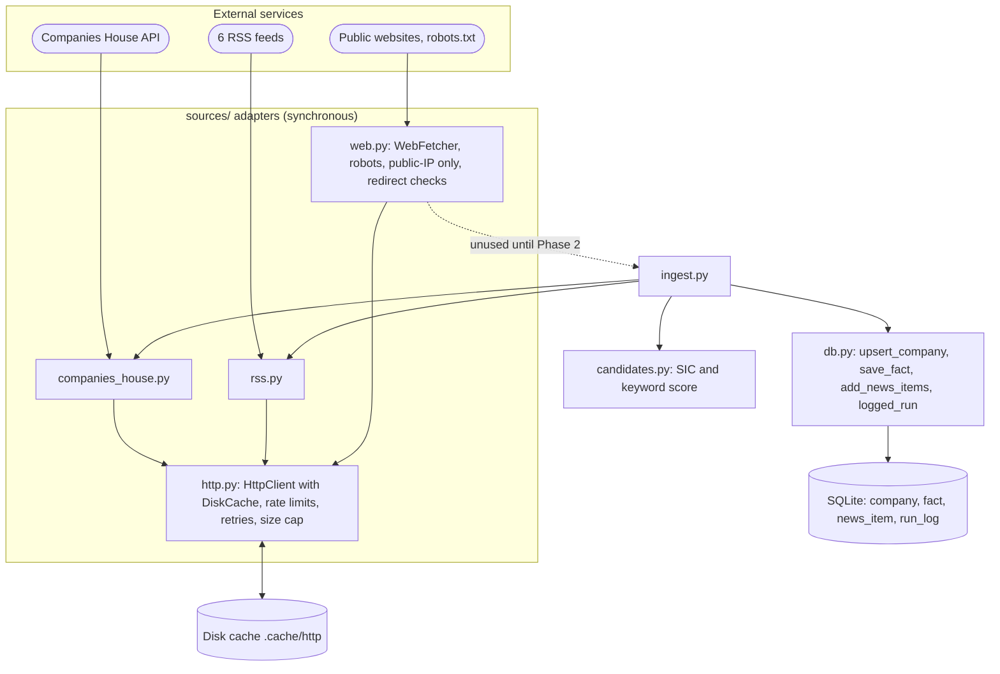
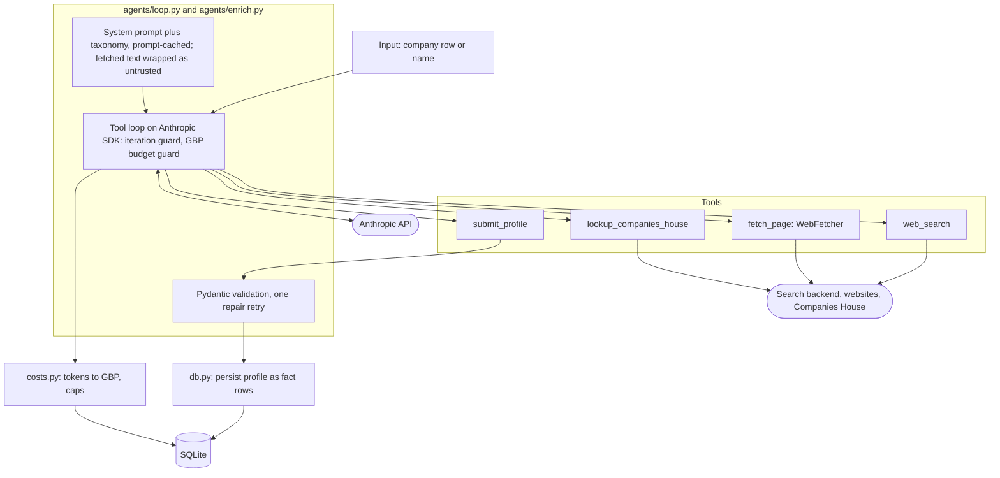
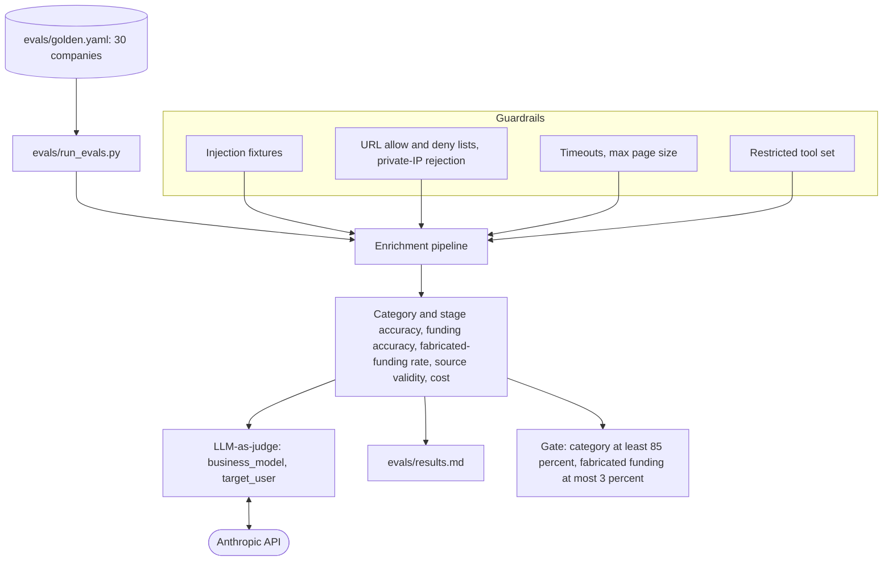
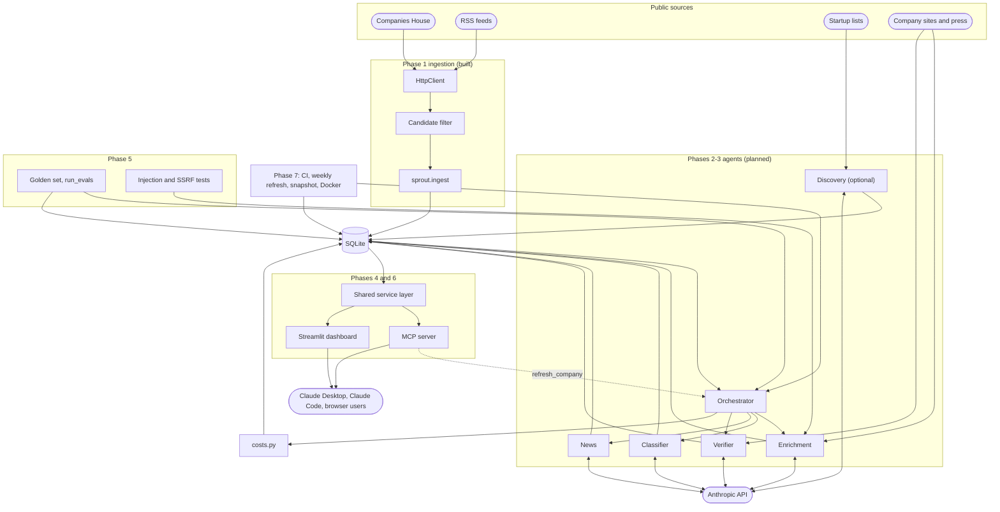
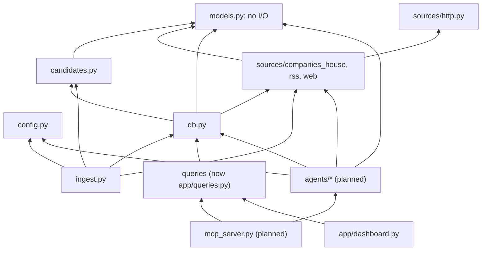
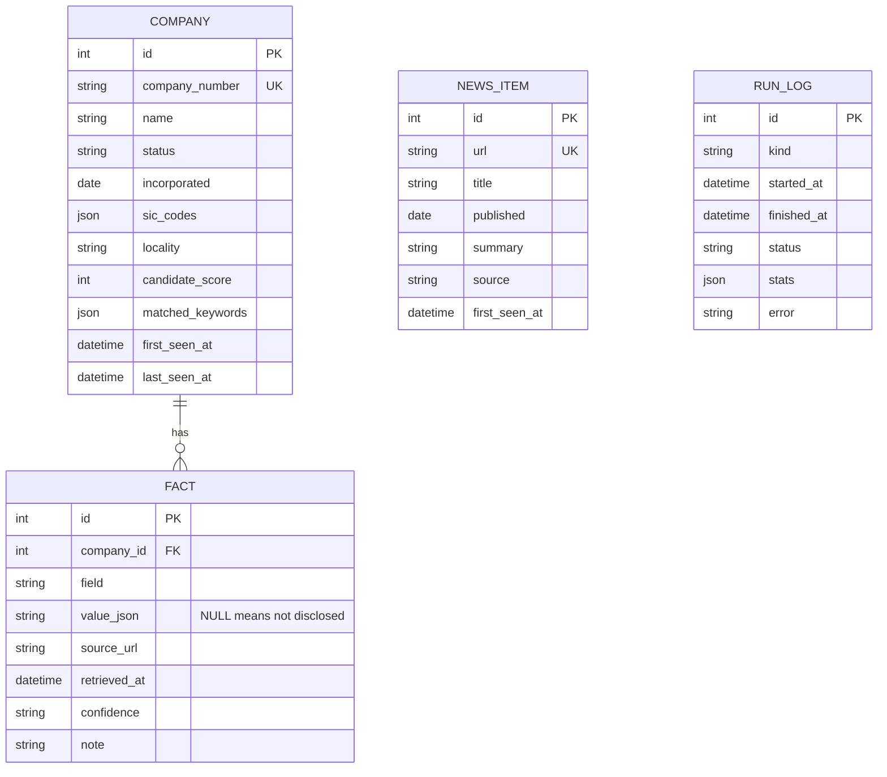
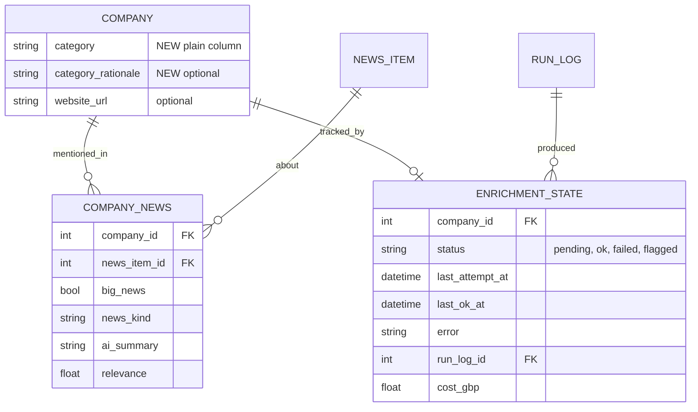

# Sprout Architecture

Sources: `docs/project-plan.md`, `docs/implementation-notes.md`, and the code under `src/sprout/`. Test counts come from the implementation notes; the suite was not re-run for this document. **[AMBIGUOUS]** marks unclear or conflicting parts of the plan. **[DRIFT]** marks places where code differs from the plan.

## 1. Overview and goals

Sprout discovers UK AI startups, groups them by a fixed 16-category taxonomy, and keeps a sourced profile for each (funding, stage, business model, target user, recent news). Data is served through a Streamlit dashboard and an MCP server.

**Goals**
- About 150 sourced profiles; quality measured on a hand-labelled golden set of 30.
- Provenance over completeness. Every fact carries `source_url`, `retrieved_at`, `confidence`. "Not disclosed" is valid. A non-null value without a source is rejected in code.
- Budgeted: about £20 total API spend, under about £10 per full run, a cap on every run, cost logged.
- Scraped content is untrusted data, never instructions.

**Non-goals:** embeddings / "similar companies"; complete UK coverage; real-time freshness (weekly refresh).

**Constraints:** one developer, about 45 hours, Python 3.12, SQLite, no paid data vendors. Cut order if behind: embeddings, discovery agent, MCP HTTP transport, Docker/hosting. Never cut provenance, evals, or the MCP server.

**Style:** a batch pipeline writes to one SQLite file; two read-mostly front ends (Streamlit, MCP) sit on top. All external I/O goes through narrow adapters (`sources/*`, later the LLM client) so tests mock at those seams.

Legend: cylinders are storage, rounded boxes are external services, dotted arrows are planned.

## 2. Diagrams by phase

### 2.1 Phase 0: Setup and definitions (done, one criterion unverified)


The taxonomy, stage enum, `Sourced[T]` and `CompanyProfile` are the contract every later phase depends on.

### 2.2 Phase 1: Data foundations (done)



`WebFetcher` is built and tested but no pipeline calls it yet. Ingest writes two registry-sourced facts per company (`hq`, `founded`, confidence medium).

### 2.3 Phase 2: Single-company enrichment agent (planned)



- Forced `tool_choice` returns 400 on the 5.x models. Use `tool_choice: auto` plus a prompt instruction, with `strict: true` or `output_config.format`.
- Thinking tokens count against `max_tokens` and the budget.
- **[AMBIGUOUS]** Server-side `web_search`/`web_fetch` bypass our `WebFetcher` protections (robots, SSRF, cache). Recommendation: custom `fetch_page`; pick the cheaper search backend per measured query.

### 2.4 Phase 3: Multi-agent pipeline (planned)


- The orchestrator is deterministic scheduling code, not an LLM supervisor (D4).
- `HttpClient` is synchronous and not thread-safe: one client per worker, locking, or `asyncio.to_thread`.
- **[AMBIGUOUS]** Verifier ordering: run after the enricher, only for companies with a funding or stage claim.
- **[AMBIGUOUS]** "Add an agent only if evals improve" but evals arrive in Phase 5. Pull a minimal eval harness forward (D9).

### 2.5 Phase 4: MCP server (planned)


- A stdio server must never write to stdout; log to stderr.
- **[AMBIGUOUS]** Replacing `fetch_page` with a third-party MCP server discards `WebFetcher` protections. Wrap `WebFetcher`, or keep the replacement behind a flag.
- **[AMBIGUOUS]** `refresh_company` is a model-invoked paid write. Keep it on the MCP server only, never in the enrichment agent's tools. Add a cooldown and return status plus cost rather than blocking.

### 2.6 Phase 5: Evals and guardrails (planned)



Much of the SSRF and size-limit work already exists in `sources/web.py`; Phase 5 mostly adds tests and an explicit allow/deny list.

### 2.7 Phase 6: Dashboard (partial: progress and test console exists)


### 2.8 Phase 7: Automation, deployment, docs (planned)


### 2.9 End to end



## 3. Module boundaries and interfaces

### 3.1 Dependency direction



Rules: `models.py` depends on nothing; `sources/*` never import `db`; front ends never import agents except via the single `refresh_company` path.

**[DRIFT]** `db.py` imports `CompanyHit` and `Assessment` (`src/sprout/db.py:15-17`), tying storage to one source and filter. Acceptable now; keep Phase 2 write helpers free of source-specific types.

### 3.2 Built modules

| Module | Responsibility | Interface | Errors |
|---|---|---|---|
| `config.py` | Env and `.env` into frozen `Settings` | `get_settings()`, `require_*_key()` | `MissingConfigError` |
| `models.py` | Taxonomy, `Sourced[T]`, `CompanyProfile` (`extra="forbid"`) | Pydantic classes | `ValidationError` for unsourced values, naive datetimes |
| `sources/http.py` | Single network entry point | `HttpClient.get`, `DiskCache`, rate limiters | `FetchError`; 4xx (not 429) no retry; 429/5xx retry 4 times with backoff |
| `sources/companies_house.py` | Registry client | `search`, `advanced_search`, `get_company`, `filing_history` | `FetchError` |
| `sources/rss.py` | Feeds to `NewsItem` | `fetch_feed`, `parse_feed`, `normalise_url` | One bad feed doesn't stop others |
| `sources/web.py` | Polite, safe page fetch | `WebFetcher.fetch`, `html_to_text` | `FetchBlockedError` |
| `candidates.py` | Name and SIC heuristic | `assess()` | none |
| `db.py` | SQLModel tables and writes | `init_db`, `upsert_company`, `save_fact`, `add_news_items`, `logged_run` | failures logged in `run_log`, re-raised |
| `ingest.py` | Phase 1 orchestration | `python -m sprout.ingest` | exit code 1 on failed feeds |
| `app/queries.py` | Streamlit-free read queries | `search_companies`, `company_facts`, `search_news`, `parse_phases` | none |

**[DRIFT]** Files not in the plan layout: `candidates.py`, `ingest.py`, `hello.py`, `app/queries.py`, `streamlit_app.py`. `costs.py` is not yet created.

### 3.3 Planned modules (proposed interfaces)

```python
# agents/loop.py - the only module importing anthropic
@dataclass
class Budget: max_iterations: int; max_gbp: Decimal   # counts thinking tokens
@dataclass
class LoopResult: output: dict | None; usage: Usage; cost_gbp: Decimal; stop: Literal["submitted","max_iter","budget","error"]
def run_agent(client, model, system, tools, budget) -> LoopResult

# agents/enrich.py
def enrich_company(company, deps, budget) -> CompanyProfile
# agents/classify.py
def classify(company, deps) -> Classification
# agents/news.py
def collect_news(company, deps) -> list[ScoredNews]
# agents/verify.py
def verify_funding(company, claims, deps) -> list[Verification]
# agents/orchestrator.py
async def run(limit, concurrency, budget, force=False) -> RunSummary
# sprout/queries.py (extracted from app/queries.py)
search_companies(...); get_company(name); latest_news(...)
```

- Agents receive a client through a `Deps` dataclass (client, `WebFetcher`, `CompaniesHouseClient`, session factory, settings); tests inject a fake client with scripted `tool_use` turns.
- Tool handlers return error strings and never raise into the loop.
- Move `app/queries.py` to `sprout/queries.py` (keep a re-export) before Phase 4 so MCP does not import from the UI package.

### 3.4 Data model

Built:



`fact` is unique on `(company_id, field, source_url)`. `news_item` has no company link; `run_log` has no company link.

Planned additions:



- `category` is a plain column. `company_news` links news to companies. `enrichment_state` gives per-company status, error and cost (needed for resumability). `fact` may need a `verification` column.
- `CompanyProfile` is the agent output contract; storage flattens each `Sourced` field into `fact` rows. A `load_profile(session, company_id)` must be written. `FundingRound` is stored as JSON in `value_json`.

## 4. Cross-cutting concerns

### 4.1 Sourcing and provenance
- `Sourced[T]` rejects a non-null value with no `source_url`. `value=None` means "not disclosed" and must render as such, never zero or blank.
- Per-fact `retrieved_at` (UTC) supports the staleness policy; registry facts can lag up to 7 days via the HTTP cache.
- Multiple sources per field coexist, which lets the verifier record disagreement.
- Not provenance-bearing: `category`, `news_item` (source is the feed), free-text fields.
- **[AMBIGUOUS]** No rule for which value wins when a field has several facts. Proposed: highest confidence, then most recent, and surface "sources disagree". Put it in the service layer.
- **[AMBIGUOUS]** Same-source re-extraction overwrites; no history. Phase 6 "funding history" needs a `funding_round` table or list, or should be cut.
- SQLite treats NULLs as distinct in UNIQUE constraints; `save_fact` dedupes in application code. Do not rely on the constraint alone.

### 4.2 Agent orchestration
- Deterministic supervisor selects companies and runs workers with `asyncio` under a concurrency limit.
- Per company: enrich, then classify (bulk model), news, then verify (only for funding or stage claims). Classifier and news can run in parallel.
- Models: bulk `claude-haiku-5-5` for extraction/classification; strong `claude-sonnet-5-5` for verification/synthesis; overridable via `SPROUT_BULK_MODEL` / `SPROUT_STRONG_MODEL`. Reconfirm IDs before Phase 2.
- Loop: `tool_choice: auto`, explicit effort, thinking tokens in budget, prompt-cached static prompt.
- Resume: the unit of work is a company; one transaction per company; fresh `ok` rows are skipped.
- A company failure sets status `failed` and the run continues. Target at least 85% `ok`.

### 4.3 Error handling

| Boundary | Failure | Behaviour |
|---|---|---|
| Companies House / RSS | 429 or 5xx | Retry with backoff and `Retry-After`, then `FetchError` |
| Companies House | 404 | Cached, treated as no result |
| RSS | One feed broken | Reported in `failed_feeds`, exit 1, others continue |
| Web fetch | robots, private IP, content type | `FetchBlockedError`, returned to the model as a tool error |
| Web fetch | robots.txt unreachable | Refuse |
| LLM | Invalid structured output | One repair attempt, else `failed` |
| LLM | Iteration or £ cap | Stop; keep only validated, sourced partial facts; mark `failed` or `partial` |
| LLM | Sources disagree | Record both, lower confidence, flag |
| MCP tool | Bad input or DB error | Compact actionable text; never write to stdout |

### 4.4 Testing
- Unit tests for models, candidates, DB helpers. Adapter tests with `httpx.MockTransport`. `streamlit.testing` smoke tests. 110 tests per the notes; the live test (`-m live`) is skipped without a key.
- Planned: a fake Anthropic client with scripted turns (iteration cap, tiny £ cap, repair path); MCP tools tested directly on a temp DB; injection and SSRF fixtures as plain pytest cases.
- Golden-set evals run on demand, not per push (cost).
- Gap: CI action versions were written from memory; first green run unconfirmed.

### 4.5 Configuration
- Env plus `.env` via `get_settings()`: `ANTHROPIC_API_KEY`, `COMPANIES_HOUSE_API_KEY`, `SPROUT_BULK_MODEL`, `SPROUT_STRONG_MODEL`, `SPROUT_DB_PATH`, `SPROUT_CACHE_DIR`, `SPROUT_ENABLE_ACTIONS`.
- Secrets never committed; `.env`, `*.db`, `.cache/` are gitignored.
- Phase 2 adds per-run £ and iteration caps, a price table in `costs.py` (not env), and search backend selection.
- No migrations: delete `data/sprout.db` after model changes, or adopt Alembic by the end of Phase 3.

### 4.6 Security
- Fetched content is wrapped in delimiters, the system prompt says it is data, and model output is validated and treated as untrusted.
- `WebFetcher` is SSRF-aware; residual DNS-rebinding risk is accepted.
- The enrichment agent has no write or refresh tools; DB writes happen in our code after validation.
- Streamlit actions are off unless `SPROUT_ENABLE_ACTIONS=1`; public deployments are read-only with no keys.

### 4.7 Cost and observability
- `costs.py` converts API `usage` (input, output including thinking, cache read/write) to GBP, enforces caps, records per-run and per-company cost.
- `run_log.stats` is today's observability record. Add structured logging to stderr.

## 5. Key design decisions

| # | Decision | Why | Cost / rules out |
|---|---|---|---|
| D1 | SQLite single file, SQLModel, no migrations | Zero infrastructure, snapshot-friendly | One writer; manual reset on schema change |
| D2 | Provenance enforced in `Sourced[T]` validator | Hallucinated funding is the top risk | A wrong but real URL still passes; verifier and evals catch it |
| D3 | `category` is a plain enum, not `Sourced` | Classification, not a fact at a URL | No per-label provenance |
| D4 | Deterministic orchestrator, not an LLM supervisor | Selection is rule-based | Departs from the plan's wording |
| D5 | Hand-written agent loop, no framework | Plan wants the mechanics | You own retries, caps, parsing |
| D6 | One HTTP entry point | Idempotent, polite, tested once | Sync and not thread-safe |
| D7 | Candidates by name and SIC heuristic (876) | Free; no description search | Many shells; misses oddly named startups |
| D8 | Identity is the Companies House number | Numbers are stable | Other sources need a secondary dedupe key (website domain) |
| D9 | Specialised agents only if evals show gain | Each hand-off costs money | Pull a minimal eval harness forward |
| D10 | Shared service layer for dashboard and MCP | One rule set for winning value and "not disclosed" | Requires extracting `queries` |
| D11 | Read-only deployments ship a snapshot DB | Free hosts lack persistent disk | Delivery mechanism must be agreed (A9) |
| D12 | `refresh_company` is the only model-invokable write, capped | Limits blast radius | Needs cooldown and status response |
| D13 | Server-side vs custom search/fetch (open) | See 2.3 | Server-side bypasses Phase 1 safety |

## 6. Risks and open questions

### 6.1 Risks

| Risk | Severity | Mitigation |
|---|---|---|
| Hallucinated or misattributed funding | High | Code-enforced sources, verifier, fabricated-funding gate at most 3%, pass the company number for disambiguation |
| Candidate pool noise inflates cost | High | Rank by `candidate_score`, cheap pre-screen, pilot 10-20 companies first |
| Cost overrun (about £0.05 per company in Phase 2; under £10 for 150 in Phase 3; £20 total) | High | Hard caps, bulk routing, prompt caching, measure before scaling |
| Prompt injection via pages | High | Delimiters, no write tools, validation, fixtures, existing size/type limits |
| Runaway agent loops | Medium | Iteration and £ caps, tested with a tiny cap |
| Sparse funding data | Medium | "Not disclosed" valid; report coverage, never plot as zero |
| Scraping ToS and robots | Medium | Honour robots, per-host limits, store snippets and links; recheck before publishing |
| SDK and model drift | Medium | Pin versions, confirm model IDs before Phase 2 |
| Schema change without migrations | Medium | Reset during development; Alembic before the weekly job |
| Unattended weekly spend | Medium | Hard cap, console spend limit, failure notification |
| Small golden set (one company is about 3 points) | Medium | Report counts and percentages; record label date and source |
| CI never run green | Low | Confirm on first push |

### 6.2 Plan ambiguities
- **A1** Search/fetch tooling differs across Phases 1, 2 and 4; decide where robots/SSRF/cache apply.
- **A2** Candidates: "~200" vs "at least 200" vs 876 loaded vs 150 enriched; no rule for choosing the 150.
- **A3** Cost arithmetic leaves no budget for evals (LLM judge, repeated runs) or prompt iteration.
- **A4** Phase 3 per-company status has no home in the Phase 1 schema (`enrichment_state`).
- **A5** News has no company link, big-news score or type (`company_news`).
- **A6** Phase 6 "funding history" is not supported by the model.
- **A7** `CompanyProfile.stage` and `last_round.stage` can disagree; define precedence.
- **A8** Classifier "sub-category" has no schema field; the taxonomy is flat and frozen.
- **A9** Snapshot delivery: Phase 6 "bundled", Phase 7 "don't commit", `.gitignore` excludes `*.db`.
- **A10** Dashboard is "read-only" but the console can spend API quota; separate or remove before deploy.
- **A11** Evals (Phase 5) are needed to judge the Phase 3 split.
- **A12** The optional Ask box duplicates MCP access and needs a read-only guarantee and rate limit.
- **A13** Phase 5 "restricted tools" is consistent with `refresh_company` only if the latter is never in the agent's tool set.
- **A14** `refresh_company` sync/async, cooldown and payer are unspecified.
- **A15** Discovery-agent output has no dedupe key when `company_number` is NULL.

### 6.3 To resolve, by phase
1. **Before Phase 2:** search backend (A1); eval harness timing (D9); budget split (A3); verify the API key and hello call; confirm model IDs and `tool_choice` behaviour.
2. **Before Phase 3:** schema additions; candidate pre-screen and selection of 150 (A2); concurrency model for the sync client; migration approach.
3. **Before Phase 4:** extract the service layer; define the winning-value rule; define `refresh_company` (A14).
4. **Before Phases 6-7:** snapshot delivery (A9); data licensing and robots recheck.

## 7. Status per phase

| Phase | Hours | Status | Outstanding |
|---|---|---|---|
| 0 Setup and definitions | 2 | Done, one criterion unverified | Claude hello call unverified (no key then); CI action versions unconfirmed |
| 1 Data foundations | 6 | Done (876 candidates, 115 news items, second run made 0 HTTP requests) | Candidate quality review; `WebFetcher` not yet used |
| 2 Single-company enrichment | 8 | Not started | Everything; needs API key and A1 decision |
| 3 Multi-agent pipeline | 8 | Not started | Everything plus schema additions |
| 4 MCP server | 6 | Not started (`mcp` dependency installed) | Everything; `app/queries.py` seeds the shared layer |
| 5 Evals and guardrails | 6 | Not started (partial SSRF protections in `web.py`) | Golden set, `run_evals`, fixtures, allow/deny list, judge |
| 6 Dashboard | 5 | Partial: progress and test console only | Filters, charts, company detail, big-news feed, snapshot DB, deployment |
| 7 Automation, deployment, docs | 4 | Not started (basic CI exists) | `refresh.yml`, eval job, Dockerfile, README, hosting, demo |
