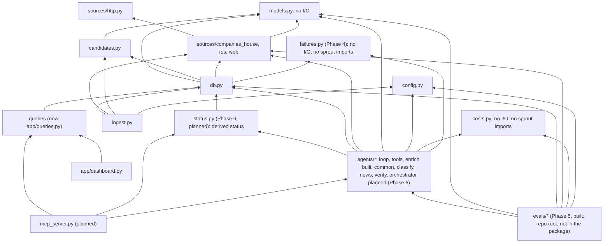
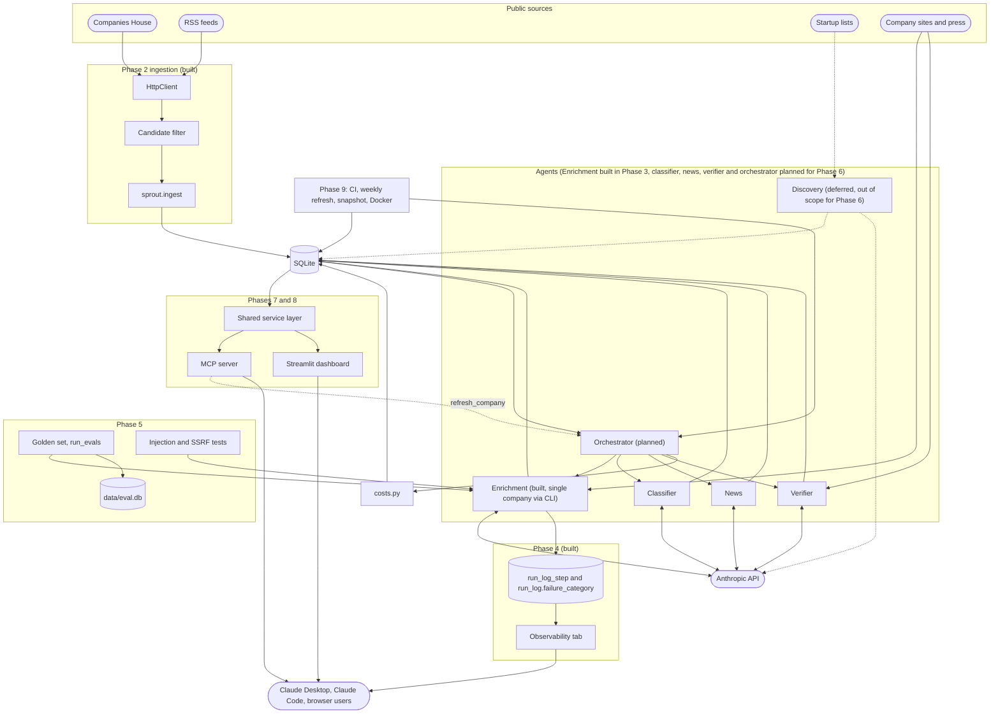

# Overview and modules

Part of the [Sprout architecture docs](README.md). See the [built modules](3.%20built-modules.md), [data model](2.%20data-model.md), [cross-cutting concerns](4.%20cross-cutting.md), [decisions](6.%20decisions.md), [risks](5.%20risks.md) and [status](7.%20status.md) for the rest of what used to be this one page, and the phase pages for diagrams and phase-specific design detail.

## 1. Overview and goals

Sprout discovers UK AI startups, groups them by a fixed 20-category taxonomy, and keeps a sourced profile for each (funding, stage, business model, target user, recent news). Data is served through a Streamlit dashboard and an MCP server.

**Goals**
- Company count and golden-set targets: see [project-plan.md](../project-plan.md).
- Provenance over completeness. Every fact carries `source_url`, `retrieved_at`, `confidence`. "Not disclosed" is valid. A non-null value without a source is rejected in code.
- Budgeted: about US$26 total API spend, under about US$13 per full run, a cap on every run, cost logged.
- Scraped content is untrusted data, never instructions.

**Non-goals:** embeddings / "similar companies"; complete UK coverage; real-time freshness (weekly refresh).

**Constraints:** one developer, about 50 hours, Python 3.12, SQLite, no paid data vendors. Never cut provenance, evals, or the MCP server.

**Style:** a batch pipeline writes to one SQLite file; two read-mostly front ends (Streamlit, MCP) sit on top. All external I/O goes through narrow adapters (`sources/*`, later the LLM client) so tests mock at those seams.

## 2. Dependency direction

Rules:

| Rule | Detail |
|---|---|
| Leaf modules | `models.py` and `costs.py` depend on nothing in `sprout`. |
| Sources isolation | `sources/*` never import `db`. |
| Front end to agents | Front ends never import agents except via the single `refresh_company` path. |
| `anthropic` import | Within `agents/`, only `loop.py` imports `anthropic`, so SDK drift, error types and the test seam live in one file. `hello.py` is a standalone smoke script that also imports `anthropic`; the rule covers pipeline code. |
| `tools.py` | Builds plain-dict tool specs, never imports the SDK; imports `loop.py` only for the `Tool` and `ToolOutcome` types. |
| Agent persistence | `agents/enrich.py` is the only agent module that touches `db` today. From Phase 6 each agent module (`classify`, `news`, `verify`), `agents/common.py` and `orchestrator.py` do too; `loop.py` and `tools.py` never do. |
| `status.py` (Phase 6) | Reads `db` only; the orchestrator, Phase 7 and the Phase 8 cooldown share it, so front ends need no agent import for status. |
| `src/sprout/enrich.py` | A three-line `python -m sprout.enrich` shim over `agents.enrich.main`. |
| `failures.py` (Phase 4) | A pure leaf module imported by `db.py` and `agents/enrich.py`; `loop.py` stays DB-free. |
| `evals/` (Phase 5) | Sits above the package and may import any `sprout` module; nothing in `sprout` imports `evals` (tests do). |

`db.py` imports `CompanyHit`, `parse_hit`, `Assessment` and `assess` (`src/sprout/db.py:17-19`), tying storage to one source and filter: `add_company_by_number` turns a Companies House response into a row through `parse_hit` and `assess`. `save_profile` stays clean (models only).

## 3. End to end

Composite diagram across all phases; see each phase's own page for detail.

