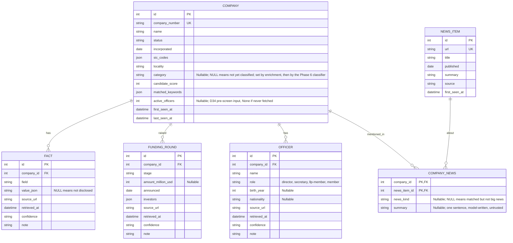
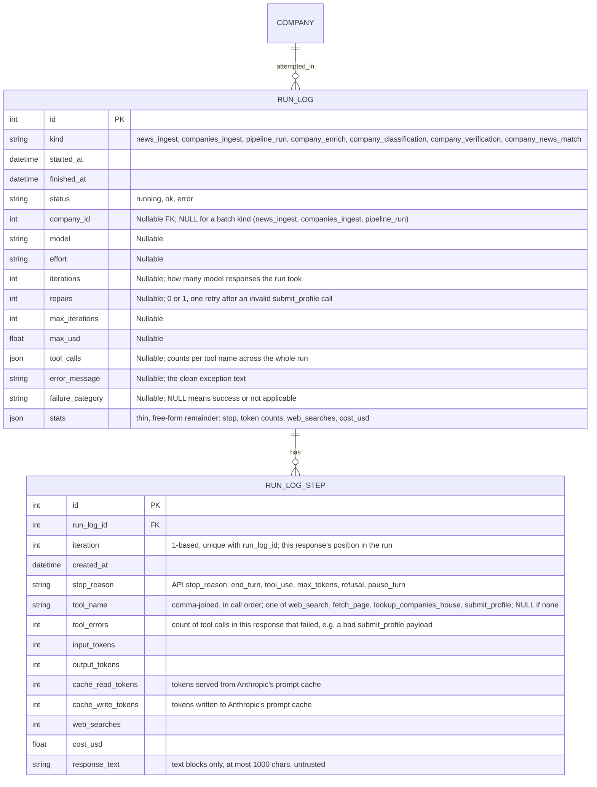

# Data model

Part of the [Sprout architecture docs](README.md). See the [overview](1.%20overview.md) for the modules that read and write these tables.

Built (through Phase 5). Phase 6 adds no tables or columns; its data lands in the tables below.

`fact` is unique on `(company_id, field, source_url)`. `company_news` links `news_item` to `company`; the Phase 6 news agent is its writer (below). `fact.company_id` and `funding_round.company_id` are indexed. `fact.field` is a `CompanyProfile` `Sourced` field name or, from Phase 6, `verification:<claim>` (`stage`, `latest_round`, `total_raised`; value `{verdict, observed}`, sourced to the second URL).

Run logging, one row per pipeline run (`run_log`) and, for `company_enrich` runs, one row per model response (`run_log_step`):

`run_log.company_id` is indexed; it is set for every per-company `kind` and stays `NULL` for the three batch kinds. `run_log_step` relies on its `(run_log_id, iteration)` unique index for the drill-down lookup.

### Field and column notes

- **`company.category`**: plain string, not a SQL enum, so adding a category never needs a migration. Enforced as `Category` in Python, not in the DB.
- **`run_log.kind`**: plain string for the same reason. Vocabulary is `RunKind` in `db.py`: `news_ingest`, `companies_ingest`, `pipeline_run` (batch, no `company_id`; one per orchestrator invocation, spend under `stats.spent_usd`), `company_enrich`, `company_classification`, `company_verification`, `company_news_match`.
- **`run_log.tool_calls`**: call counts per tool, summed across the run.
- **`run_log.stats`**: JSON catch-all for fields that haven't earned a column (`stop`, token counts, `web_searches`, `cost_usd`). The 40 oldest `company_enrich` rows hold `cost_gbp`/`usd_to_gbp` instead; `app/queries.py` converts them.
- **`failure_category`**: `NULL` means success. Otherwise one of:

  | Category | Meaning |
  |---|---|
  | `invalid_output` | model's output didn't match the required schema |
  | `iteration_cap` | hit the max-iterations limit without submitting |
  | `budget_cap` | hit the max-cost limit |
  | `no_submission` | model stopped without calling `submit_profile` |
  | `output_truncated` | response was cut off |
  | `refusal` | model refused the task |
  | `api_error` | the model API call failed |
  | `internal_error` | anything else (bug, unhandled exception) |

- **`run_log_step`**: one row per model response, not per tool call. Only exists from Phase 4 onward; older runs have no step rows.

### Schema migrations

`init_db` creates missing tables, adds missing nullable columns via `ALTER TABLE`, and runs one-time backfills. Non-additive changes (drop, rename, retype, add a constraint) aren't supported by this process; those mean wiping `data/sprout.db` and re-ingesting. `data/sprout_snapshot.db` is a committed copy the dashboard falls back to; refresh it by hand after a schema change.

### Concurrency

SQLite has one writer. From Phase 6, `get_engine` sets `journal_mode=WAL`, `synchronous=NORMAL` and a 30 s busy timeout on every connection (a read-only file such as the snapshot keeps its mode), so readers never block the orchestrator's workers and writers queue for short commits only (D38). Each worker uses its own `Session`; no write transaction is held across a model call. WAL leaves `-wal` and `-shm` sidecar files while a connection is open (gitignored); a clean close checkpoints them.

### Profile persistence

- `save_profile` writes one `fact` row per `Sourced` field on `CompanyProfile`; "not disclosed" is stored as a NULL-value fact (distinct from never having tried).
- `business_status` is one such field (see [phase 2](phases/phase-3-enrichment.md#business-status)), not to be confused with `company.status`, the Companies House legal status.
- `CompanyProfile.news` is not produced by the enrichment agent and is not stored; news lives in `news_item` and `company_news`, written by the Phase 6 news agent.
- A re-run adds facts from new source URLs and keeps old ones, so a field can end up with both a valued and a NULL-value fact; `winning_facts` picks one.
- The Phase 6 classifier overwrites `company.category` after each ok enrichment (D41); enrichment's own category survives only as `stats.previous_category` on the classification run. The verifier edits `confidence` and `note` of existing `fact` and `funding_round` rows in place and adds `verification:<claim>` facts (D40).
- `funding_rounds` are replaced wholesale on every save (no history across runs).
- `delete_profile` clears `fact` and `funding_round` rows and the category (the CLI's `--reset`).

### `company_news` (schema built; written by the Phase 6 news agent)

- Many-to-many: one article can cover several companies.
- `news_kind`: funding, acquisition, partnership, regulatory, leadership, or other; `NULL` means matched but not big news.
- `summary`: a model-written one-sentence reason, separate from the raw feed summary.
- Written by `agents/news.py`: upsert on `(company_id, news_item_id)`, never deleted by a re-run; at most 5 entries per company per run. Items found by web search get a new `news_item` row (`source="web_search"`, empty summary); RSS items reuse theirs.

### Reading side

`app/queries.py` has `company_facts`, `company_funding_rounds` and winning-value helpers for stage and business status. `status.py` (Phase 6, planned) is the read side for per-company status. A full profile read, a company-news join and verification verdicts are Phase 7's shared layer (D29).

## What later phases need from the schema

Everything regenerable (re-enriching a company costs about US$0.03) can be added later, so only non-additive needs get built early. Both of those (`run_log.company_id`, `company_news`) are already built, above, and Phase 6 needs nothing more.

| Phase | Needs from the schema | Covered by |
|---|---|---|
| 5 Evals | Per-company run outcome, cost and the cited-source list; a clean DB per run | `run_log` columns (`failure_category`, `repairs`, `iterations`) and `stats` (+ additive `sources`), `data/eval.db`; no schema change |
| 6 Orchestrator | "New, stale, failed, low-confidence" selection, resume after interruption, per-company status and cost | `run_log.company_id`, derived status query (below), `pipeline_run` batch row |
| 6 News agent | Which news mentions which company, whether it is big news, a short summary | `company_news` (built, above) |
| 6 Classifier / verifier | Write a category and rationale; record a second source or a disagreement | `company.category` and the classification run's `stats`; `verification:<claim>` facts plus in-place `confidence`/`note` (D40) |
| 7 Dashboard | Winning value per field, funding history, news timeline, "not disclosed" | `fact`, `funding_round`, `company_news`, service layer (A6) |
| 8 MCP | Same reads, plus a `refresh_company` cooldown ("when was this company last run") | `run_log.company_id` + `started_at` |
| 9 Automation | A snapshot file, stale-company selection | Snapshot via the SQLite backup API (below), derived status query |

### Per-company status: derived, not stored

Status is a query over `run_log`, not a stored column, and is kept per step: the four pipeline steps map to the kinds `company_enrich`, `company_classification`, `company_news_match` and `company_verification`. Thresholds and the selector are on the [Phase 6 page](phases/phase-6-multi-agent.md#selector-status-and-retry).

| Term | Definition |
|---|---|
| Latest attempt | Newest `run_log` row for the company and `kind` |
| `ok` | `failure_category IS NULL` and `status='ok'` |
| `last_ok_at` | Newest `finished_at` among `ok` rows |
| Stale | `last_ok_at` older than the step's TTL (or, for classify and verify, older than the newest ok enrich), or absent |
| Failed | Latest attempt has a `failure_category` |
| `failed_attempts` | Failed rows newer than `last_ok_at`, excluding `api_error` |
| Abandoned | A `running` row older than the timeout; turned into an `error` / `internal_error` row at the next orchestrator start |
| Cost | Sum of `stats.cost_usd` over the company's rows |

### Open questions

- **Is a candidate a real startup?** Resolved by the D34 pre-screen (active officer count of at least 2, `company.active_officers`), unvalidated until the Phase 6 pilot; genuine single-officer startups are accepted false negatives.
- **Snapshot of a WAL database.** A raw `cp` can miss the `-wal` file; use `VACUUM INTO` or the backup API (Phase 9, A28).
