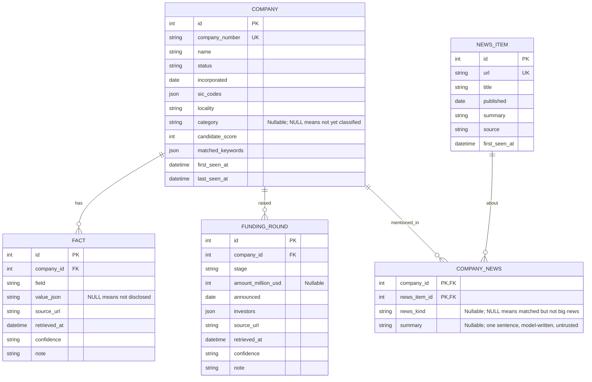
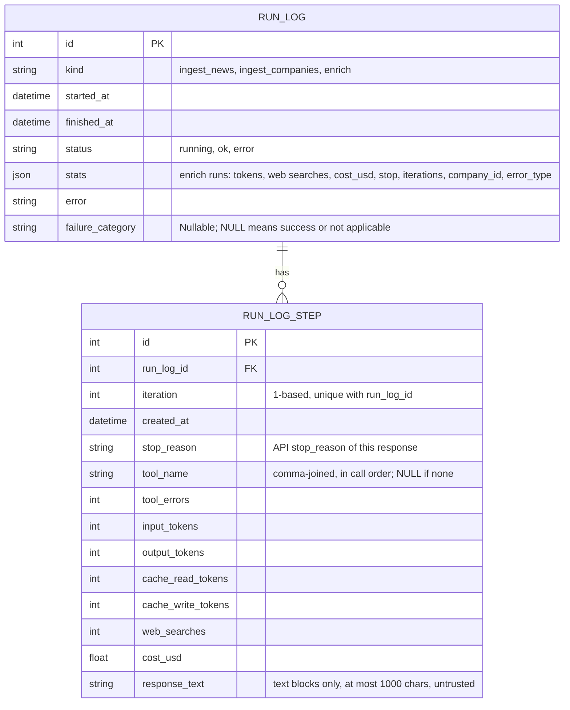
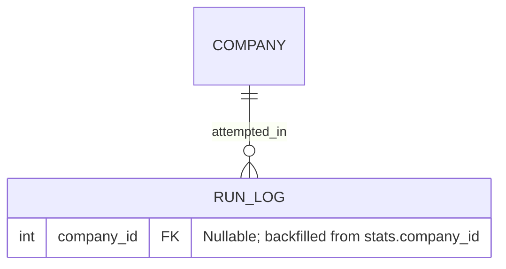

# Data model

Part of the [Sprout architecture docs](README.md). See the [overview](1.%20overview.md) for the modules that read and write these tables.

Built (Phases 1 to 3):



`fact` is unique on `(company_id, field, source_url)`. `company_news` links `news_item` to `company` but nothing writes it yet (below). `fact.company_id` and `funding_round.company_id` are indexed.

Run logging, one row per pipeline run (`run_log`) and, for `enrich` runs, one row per model response (`run_log_step`):



`run_log` has no company link (the enrich link is `stats.company_id`, inside the JSON). `run_log_step` relies on its `(run_log_id, iteration)` unique index for the drill-down lookup.

- **`company.category`** is `str | None`, not a SQL enum (an enum adds a CHECK constraint, which complicates additive `ALTER`). It is validated back to `Category` on read and is not indexed. `save_profile` sets it from `CompanyProfile.category`; a company the agent never finished keeps `NULL`.
- **Schema migrations:** `init_db` runs `create_all`, then adds any column present on the model but missing from the table via `ALTER TABLE ... ADD COLUMN`, then runs an idempotent backfill of `run_log.failure_category` for historic `enrich` rows. Only a plain nullable column can be added this way; a missing column that is non-nullable, a primary key or unique raises `RuntimeError` telling the developer to reset the database. A new table needs nothing (`create_all`). `create_all` does not add an index to an existing table either, so `index=True` on a migrated column would exist only on fresh databases; dedupe in application code instead (as `save_fact` does). There is no migrations framework; a non-additive change means deleting `data/sprout.db` and re-ingesting (the Companies House cache keeps re-ingestion cheap). `data/sprout_snapshot.db` is a committed copy that the read-only dashboard falls back to; refresh it by hand after a schema change.
- **`run_log` for enrich** (`kind="enrich"`, one row per company attempt, via `logged_run`). `stats` is a JSON dict with tokens, cost, iterations, stop reason and tool calls; costs are stored as floats rounded to 6 places (caps use `Decimal` in memory). `repairs` is 0 or 1; an allowed repair is not a failure. `error` is the loop's error text or null; `error_type` is the exception class name for an API failure (null otherwise):

```json
{"company_id": 12, "company_number": "09999999", "model": "claude-haiku-5-5", "effort": "low",
 "stop": "submitted", "iterations": 6, "repairs": 0,
 "input_tokens": 0, "output_tokens": 0, "cache_read_tokens": 0, "cache_write_tokens": 0,
 "web_searches": 0, "tool_calls": {"fetch_page": 0, "lookup_companies_house": 0},
 "cost_usd": 0.0, "budget": {"max_iterations": 12, "max_usd": 0.13},
 "error": null, "error_type": null}
```

  Average cost per company: `SELECT avg(json_extract(stats, '$.cost_usd')) FROM run_log WHERE kind='enrich' AND json_extract(stats, '$.stop') = 'submitted'`. The 40 oldest `enrich` rows hold `cost_gbp` and `usd_to_gbp` instead of `cost_usd`; `app/queries.py` converts them, raw SQL does not.
- **Failure and step logging (Phase 3).** `failure_category` is a plain nullable string filled from the eight-value taxonomy in `failures.py` (NULL is success, so `WHERE failure_category IS NOT NULL` is exactly "failed runs"); it is set in the commit `enrich_with_result` already makes before raising, so a failed run keeps it, and `logged_run` falls back to `internal_error` when an exception escapes with the category still NULL. `run_log_step` holds one row per model response (not per tool call): tokens and cost belong to the response and cannot be split per tool. Both are written together with `stats` by `enrich.py`, never by `loop.py`. Runs before Phase 3 have a backfilled category but no step rows. Details on the [Phase 3 page](phases/phase-3-observability.md).
- **Profile persistence:** `save_profile` calls `save_fact` for every `Sourced` field on `CompanyProfile`, so a new `Sourced` field persists with no DB change. "Not disclosed" is stored as a NULL-value fact so the dashboard can tell "researched, nothing found" from "never tried"; the winning-value rule (see [4.1 Sourcing and provenance](4.%20cross-cutting.md#1-sourcing-and-provenance)) must ignore a NULL fact when a valued one exists. `news` is dropped from the agent's output before it ever reaches `save_profile`: `enrich.py`'s `_NOT_MODEL_OUTPUT` strips `news` from the `submit_profile` schema, so the Phase 2 agent never produces it (`CompanyProfile.news` is always empty) and `company_news` stays unpopulated until a news-matching agent exists (Phase 5). `name` is ignored (identity is the row). A re-run overwrites facts from the same URL and adds facts from new URLs; older facts from URLs no longer cited remain, so a field can end up with both a valued fact and a NULL-value fact. `funding_rounds` is `list[Sourced[FundingRound]]`, each round sourced separately and persisted into the `funding_round` table via `save_funding_rounds`, which replaces the company's rounds on every save rather than merging by source (so rounds have no history across runs, unlike scalar facts). `delete_profile` clears both `fact` and `funding_round` rows and the category (the CLI's `--reset`).
- **`company_news` (schema built, unpopulated).** Added early because it is additive and the shape is already settled (D33), not because Phase 2 writes it: nothing currently produces a company-scoped news item to link. Composite primary key `(company_id, news_item_id)`, many-to-many because one article can cover several companies and `news_item.url` is unique. `news_kind` is the big-news rubric (funding, acquisition, partnership, regulatory, leadership, other) as a plain string, NULL when an item is matched but not big news; "big news" is therefore `news_kind IS NOT NULL`, with no separate flag. `summary` is a model-written one-sentence reason, kept apart from `news_item.summary` (the raw feed text). Whoever populates it first, a Phase 5 matcher reading the existing unlinked `news_item` feed, or a later Phase 2 change that lets the enrichment agent report its own news, writes the same two rows.
- **Reading side:** `app/queries.py` has `company_facts` and `company_funding_rounds` (raw rows). Choosing the winning value per field and assembling a profile belongs to the shared service layer (D29, A6); a `load_profile` does not exist yet.

Phase 4 (evals, planned) adds no table or column; its only data change is an additive `sources` list in `run_log.stats` for `enrich` rows (see the [Phase 4 page](phases/phase-4-evals-guardrails.md)).

## What later phases need from the schema

Checked against Phases 4 to 8 of the plan and their architecture pages. Two facts shape every decision below. First, a new table or a plain nullable column is cheap whenever it is added (`create_all` or `ALTER TABLE ADD COLUMN`, D10). Second, all pipeline output is regenerable: re-enriching a company costs about US$0.015 (150 companies about US$2) and ingestion is cached. So a schema item is worth adding early only if it cannot be added additively later (non-null, unique, retyped) or its data cannot be regenerated. None of the items below meets that bar, so **nothing is added to the code now**; each is added when the phase that reads it starts.

| Phase | Needs from the schema | Covered by |
|---|---|---|
| 4 Evals | Per-company run outcome, cost and the cited-source list; a clean DB per run | `run_log.stats` (+ additive `sources`), `data/eval.db`; no schema change |
| 5 Orchestrator | "New, stale, failed, low-confidence" selection, resume after interruption, per-company status and cost | `run_log` rows per attempt, `run_log.company_id` (below), derived status query |
| 5 News agent | Which news mentions which company, whether it is big news, a short summary | `company_news` (built, unpopulated, above) |
| 5 Classifier / verifier | Write a category; record a second source or a disagreement | `company.category`; a second `fact` row for the same field with another `source_url` and a lowered or raised `confidence` |
| 6 Dashboard | Winning value per field, funding history, news timeline, "not disclosed" | `fact`, `funding_round`, `company_news`, service layer (A6) |
| 7 MCP | Same reads, plus a `refresh_company` cooldown ("when was this company last run") | `run_log.company_id` + `started_at` |
| 8 Automation | A snapshot file, stale-company selection | Snapshot via the SQLite backup API (below), derived status query |

### Planned additions (Phase 5)

One addition, additive:



- **`run_log.company_id`** (nullable, FK to `company.id`, added at the start of Phase 5 with an idempotent backfill from `stats.company_id`, the same pattern as the `failure_category` backfill). It replaces the planned `enrichment_state` table: per-company status is derived, not stored. Latest attempt = newest `run_log` row for the company and `kind`; status `ok` = `failure_category IS NULL` and `status='ok'`; `last_ok_at` = newest such `finished_at`; stale = `last_ok_at` older than N days or absent; failed = latest attempt has a category; cost = sum of `stats.cost_usd`. A killed process leaves a `status='running'` row with `stats == {}`, so the selector must treat a `running` row older than a timeout as dead rather than in progress. Two consumers justify the column over JSON extraction: the orchestrator's selector and the Phase 7 `refresh_company` cooldown. Each new agent `kind` (`classify`, `news`, `verify`) sets it the same way. The derived query lives in `queries.py`. This resolves A11 and A23.

`company_news` is already built (above), not planned; only its writer (a Phase 5 news-matching agent) is still open. This resolves A24's schema half; the matching behaviour is still open.

Cut from the earlier plan, and why:

| Item | Why it was cut |
|---|---|
| `enrichment_state` table | Every column is derivable from `run_log` (status from `failure_category`, `last_ok_at` and `last_attempt_at` from `finished_at`, `error`, cost, `run_log_id`). A second table would have to be kept in step with `run_log` by every worker, which is exactly what concurrent writers get wrong. "Pending" is the absence of a run; "flagged" is a property of facts, not of a run |
| `company_news.relevance` and `big_news` | `big_news` is `news_kind IS NOT NULL`. `relevance` has no reader: the matcher either links an item or does not, and a false match is fixed by the matcher, not by a score |
| `company.category_rationale` | The classifier's rationale is a diagnostic. It belongs in the `classify` run's `stats` (and its steps), like every other agent output today. Promote it to a column only if the dashboard shows it |
| `company.website_url` | The website is already a sourced `fact` (`field='website'`). A column would duplicate the winning value and lose its provenance. If the discovery agent is built (first on the plan's cut list), it needs a dedupe key for companies with no number; add a nullable normalised `domain` then and dedupe in code (A26) |
| `fact.verification` | The verifier can record a corroborating source as a second `fact` row for the same field and raise `confidence`, or lower `confidence` and add a `note` on a disagreement; "sources disagree" is two valued facts with different values. Add a column only if the Phase 5 verifier design shows those cannot express its output |

### Prerequisites outside the schema

- **Concurrency.** SQLite has one writer. Before the orchestrator runs workers in parallel, `get_engine` should enable WAL and a busy timeout so the dashboard keeps reading during writes and a worker waits instead of failing with "database is locked". Workers commit per company (and `enrich_with_result` already commits its stats and steps in one short batch). With WAL on, a plain `cp` of `data/sprout.db` can miss the `-wal` file; produce the snapshot with `VACUUM INTO` or the SQLite backup API.
- **Which writer owns `company.category`.** The enrichment agent sets it today. If a separate classifier is kept (D28, only if the evals show a gain), it overwrites the enrichment value; there is no provenance column, since a category is a classification, not a sourced fact (D6).
- **Is a candidate a real startup?** Nothing in the schema says a candidate is not an AI startup (a shell, a consultancy). The Phase 3 findings batch enriched 12 of the 20 highest-scored candidates to `Other` with 2 to 3 sourced facts. Whether Phase 5 pre-screens before spending on enrichment or flags afterwards (and so needs a nullable `company` column) is an open question (A32).
