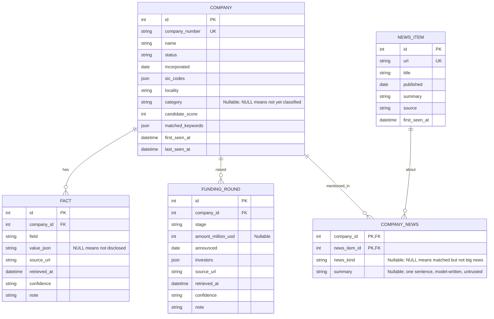
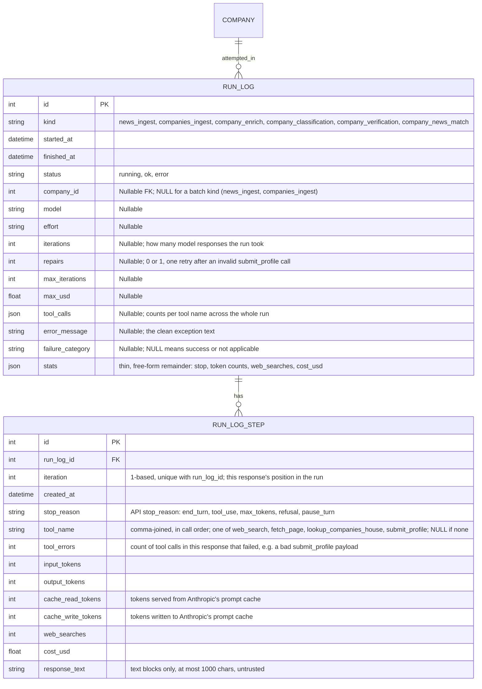

# Data model

Part of the [Sprout architecture docs](README.md). See the [overview](1.%20overview.md) for the modules that read and write these tables.

Built (Phases 2 to 4):

`fact` is unique on `(company_id, field, source_url)`. `company_news` links `news_item` to `company` but nothing writes it yet (below). `fact.company_id` and `funding_round.company_id` are indexed.

Run logging, one row per pipeline run (`run_log`) and, for `company_enrich` runs, one row per model response (`run_log_step`):

`run_log.company_id` is indexed; it is set for every per-company `kind` and stays `NULL` for the two batch kinds. `run_log_step` relies on its `(run_log_id, iteration)` unique index for the drill-down lookup.

### Field and column notes

- **`company.category`**: plain string, not a SQL enum, so adding a category never needs a migration. Enforced as `Category` in Python, not in the DB.
- **`run_log.kind`**: plain string for the same reason. Vocabulary is `RunKind` in `db.py`: `news_ingest`, `companies_ingest` (batch, no `company_id`), `company_enrich`, `company_classification`, `company_verification`, `company_news_match`.
- **`run_log.tool_calls`**: call counts per tool, summed across the run.
- **`run_log.stats`**: JSON catch-all for fields that haven't earned a column (`stop`, token counts, `web_searches`, `cost_usd`). The 40 oldest `company_enrich` rows hold `cost_gbp`/`usd_to_gbp` instead; `app/queries.py` converts them.
- **`failure_category`**: `NULL` means success. Otherwise one of:

  | Category | Meaning |
  |---|---|
  | `invalid_output` | model's output didn't match the required schema |
  | `iteration_cap` | hit the max-iterations limit without submitting |
  | `budget_cap` | hit the max-cost limit |
  | `no_submission` | model stopped without calling `submit_profile` |
  | `output_truncated` | response was cut off |
  | `refusal` | model refused the task |
  | `api_error` | the model API call failed |
  | `internal_error` | anything else (bug, unhandled exception) |

- **`run_log_step`**: one row per model response, not per tool call. Only exists from Phase 4 onward; older runs have no step rows.

### Schema migrations

`init_db` creates missing tables, adds missing nullable columns via `ALTER TABLE`, and runs one-time backfills. Non-additive changes (drop, rename, retype, add a constraint) aren't supported by this process; those mean wiping `data/sprout.db` and re-ingesting. `data/sprout_snapshot.db` is a committed copy the dashboard falls back to; refresh it by hand after a schema change.

### Profile persistence

- `save_profile` writes one `fact` row per `Sourced` field on `CompanyProfile`; "not disclosed" is stored as a NULL-value fact (distinct from never having tried).
- `business_status` is one such field (see [phase 2](phases/phase-3-enrichment.md#business-status)), not to be confused with `company.status`, the Companies House legal status.
- `news` is never produced by the enrichment agent yet, so `company_news` stays empty until Phase 6.
- A re-run adds facts from new source URLs and keeps old ones, so a field can end up with both a valued and a NULL-value fact.
- `funding_rounds` are replaced wholesale on every save (no history across runs).
- `delete_profile` clears `fact` and `funding_round` rows and the category (the CLI's `--reset`).

### `company_news` (schema built, unpopulated)

- Many-to-many: one article can cover several companies.
- `news_kind`: funding, acquisition, partnership, regulatory, leadership, or other; `NULL` means matched but not big news.
- `summary`: a model-written one-sentence reason, separate from the raw feed summary.
- Not written yet; a Phase 6 news-matching agent will populate it.

### Reading side

`app/queries.py` has `company_facts` and `company_funding_rounds`. Picking a winning value per field and assembling a full profile isn't built yet.

## What later phases need from the schema

Everything regenerable (re-enriching a company costs ~US$0.015) can be added later, so only non-additive needs get built early. Both of those (`run_log.company_id`, `company_news`) are already built, above.

| Phase | Needs from the schema | Covered by |
|---|---|---|
| 5 Evals | Per-company run outcome, cost and the cited-source list; a clean DB per run | `run_log` columns (`failure_category`, `repairs`, `iterations`) and `stats` (+ additive `sources`), `data/eval.db`; no schema change |
| 6 Orchestrator | "New, stale, failed, low-confidence" selection, resume after interruption, per-company status and cost | `run_log.company_id`, derived status query (below) |
| 6 News agent | Which news mentions which company, whether it is big news, a short summary | `company_news` (built, unpopulated, above) |
| 6 Classifier / verifier | Write a category; record a second source or a disagreement | `company.category`; a second `fact` row for the same field with another `source_url` and a lowered or raised `confidence` |
| 7 Dashboard | Winning value per field, funding history, news timeline, "not disclosed" | `fact`, `funding_round`, `company_news`, service layer (A6) |
| 8 MCP | Same reads, plus a `refresh_company` cooldown ("when was this company last run") | `run_log.company_id` + `started_at` |
| 9 Automation | A snapshot file, stale-company selection | Snapshot via the SQLite backup API (below), derived status query |

### Per-company status: derived, not stored

Status is a query over `run_log`, not a stored column.

| Term | Definition |
|---|---|
| Latest attempt | Newest `run_log` row for the company and `kind` |
| `ok` | `failure_category IS NULL` and `status='ok'` |
| `last_ok_at` | Newest `finished_at` among `ok` rows |
| Stale | `last_ok_at` older than N days, or absent |
| Failed | Latest attempt has a `failure_category` |
| Cost | Sum of `stats.cost_usd` |

A killed process leaves a `status='running'` row with no stats; the selector treats a stale `running` row as dead, not in progress. `company_news`'s writer is still open (Phase 6).

### Open questions

- **Concurrency.** SQLite has one writer. Before parallel workers, enable WAL + a busy timeout so reads and writes don't block each other.
- **Who owns `company.category`.** The enrichment agent sets it today; a future separate classifier (if evals justify one) would overwrite it.
- **Is a candidate a real startup?** Nothing flags a candidate as not an AI startup (a shell, a consultancy). Whether Phase 6 pre-screens before enrichment or flags afterward is open.
