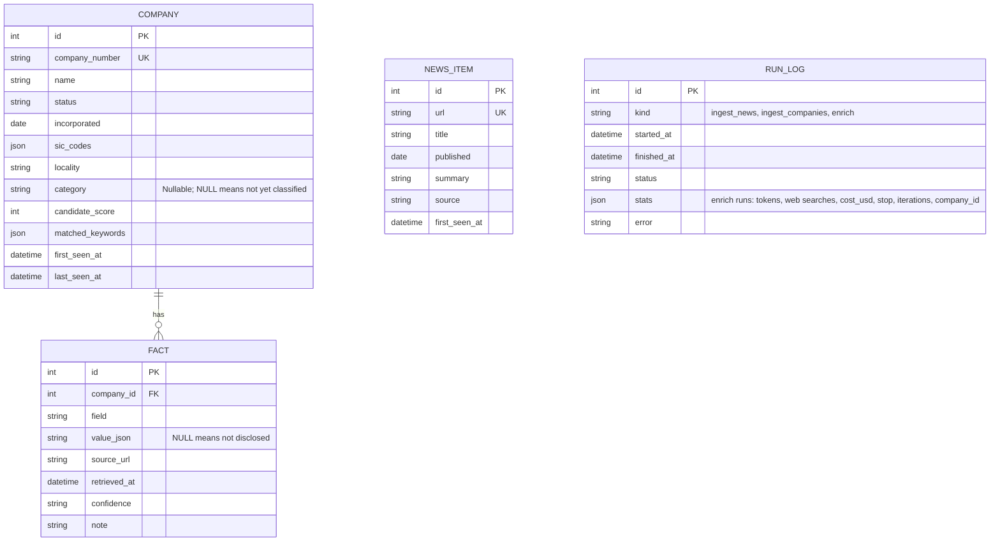
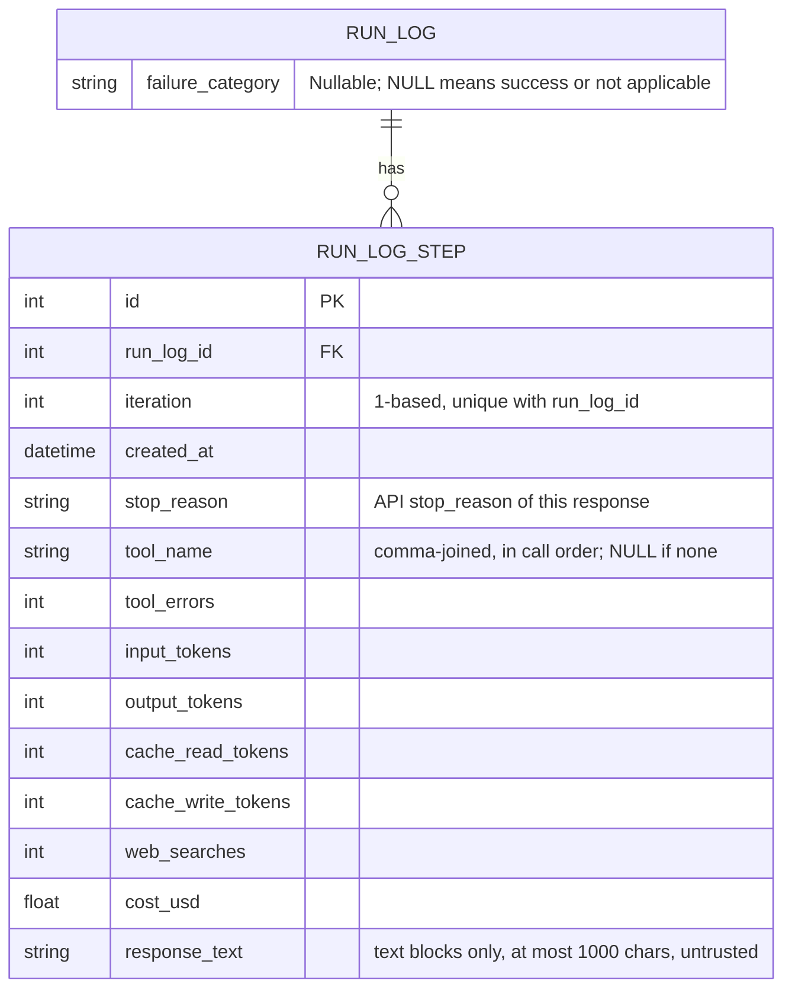
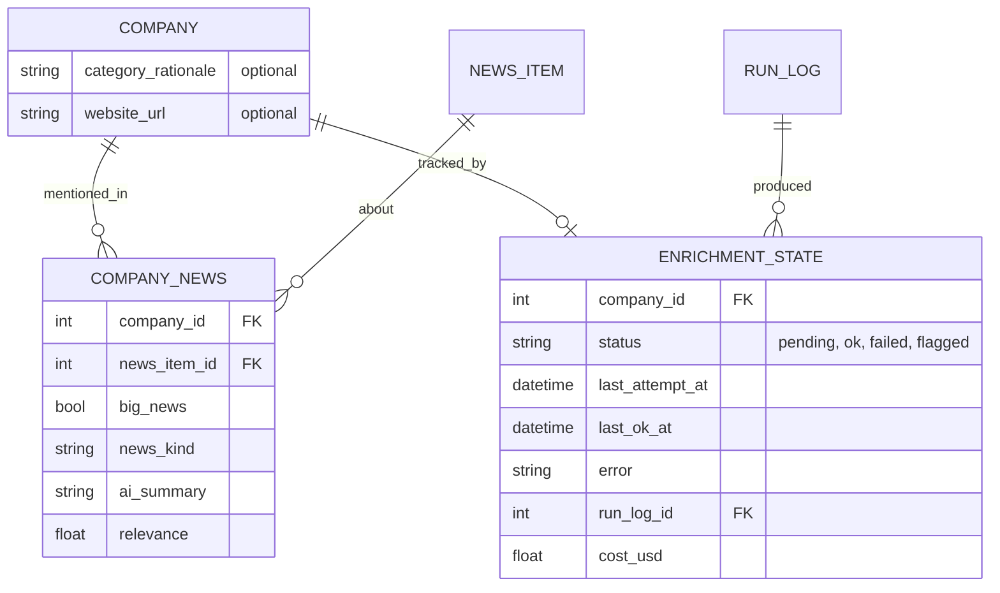

# Data model

Part of the [Sprout architecture docs](README.md). See the [overview](overview.md) for the modules that read and write these tables.

## 3.4 Data model

Built:



`fact` is unique on `(company_id, field, source_url)`. `news_item` has no company link; `run_log` has no company link (the enrich link is `stats.company_id`, inside the JSON).

- **`company.category`** is `str | None`, not a SQL enum (an enum adds a CHECK constraint, which complicates additive `ALTER`). It is validated back to `Category` on read and is not indexed. `save_profile` sets it from `CompanyProfile.category`; a company the agent never finished keeps `NULL`.
- **Schema migrations:** `init_db` runs `create_all`, then adds any column present on the model but missing from the table via `ALTER TABLE ... ADD COLUMN`. Only a plain nullable column can be added this way; a missing column that is non-nullable, a primary key or unique raises `RuntimeError` telling the developer to reset the database. There is no migrations framework; a non-additive change means deleting `data/sprout.db` and re-ingesting (the Companies House cache keeps re-ingestion cheap).
- **`run_log` for enrich** (`kind="enrich"`, one row per company attempt, via `logged_run`). `stats` is a JSON dict with tokens, cost, iterations, stop reason and tool calls; costs are stored as floats rounded to 6 places (caps use `Decimal` in memory). `repairs` is 0 or 1; an allowed repair is not a failure. `error` is the loop's error text or null:

```json
{"company_id": 12, "company_number": "09999999", "model": "claude-haiku-5-5", "effort": "low",
 "stop": "submitted", "iterations": 6, "repairs": 0,
 "input_tokens": 0, "output_tokens": 0, "cache_read_tokens": 0, "cache_write_tokens": 0,
 "web_searches": 0, "tool_calls": {"fetch_page": 0, "lookup_companies_house": 0},
 "cost_usd": 0.0, "budget": {"max_iterations": 12, "max_usd": 0.13},
 "error": null}
```

  Average cost per company: `SELECT avg(json_extract(stats, '$.cost_usd')) FROM run_log WHERE kind='enrich' AND json_extract(stats, '$.stop') = 'submitted'`. Per-company status is not a column until `enrichment_state` (Phase 5, which will reference `run_log.id`).
- **Profile persistence:** `save_profile` calls `save_fact` for every `Sourced` field on `CompanyProfile`, so a new `Sourced` field persists with no DB change. "Not disclosed" is stored as a NULL-value fact so the dashboard can tell "researched, nothing found" from "never tried"; the winning-value rule (see [4.1 Sourcing and provenance](cross-cutting.md#41-sourcing-and-provenance)) must ignore a NULL fact when a valued one exists. `news` is not persisted in Phase 2 (`news_item` has no company link until Phase 5), and `name` is ignored (identity is the row). A re-run overwrites facts from the same URL and adds facts from new URLs; older facts from URLs no longer cited remain, so a field can end up with both a valued fact and a NULL-value fact. `funding_rounds` is `list[Sourced[FundingRound]]`, each round sourced separately and persisted into its own `funding_round` table via `save_funding_rounds`, which replaces the company's rounds on every save rather than merging by source. `delete_profile` clears both `fact` and `funding_round` rows.

Phase 4 (evals, planned) adds no table or column; its only data change is an additive `sources` list in `run_log.stats` for `enrich` rows (see the [Phase 4 page](phase-4-evals-guardrails.md)). Phase 3 (planned) adds `error_type` to the same `stats` dict (see the [Phase 3 page](phase-3-observability.md)).

Phase 3 (planned) adds one table and one column, both additive (`create_all` for the table, an `ALTER TABLE ADD COLUMN` for the nullable column):



Planned additions (Phase 5 and later):



- `company_news` links news to companies. `enrichment_state` gives per-company status, error and cost, needed for resumability. `fact` may need a `verification` column.
- `CompanyProfile` is the agent output contract; storage flattens each `Sourced` field into `fact` rows via `save_profile`. A `load_profile(session, company_id)` must still be written.
