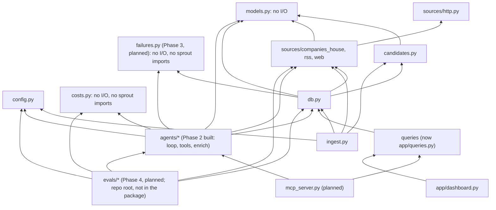

# Overview and modules

Part of the [Sprout architecture docs](README.md). See the [data model](data-model.md), [cross-cutting concerns](cross-cutting.md), [decisions](decisions.md), [risks](risks.md) and [status](status.md) for the rest of what used to be this one page, and the phase pages for diagrams and phase-specific design detail.

## 1. Overview and goals

Sprout discovers UK AI startups, groups them by a fixed 16-category taxonomy, and keeps a sourced profile for each (funding, stage, business model, target user, recent news). Data is served through a Streamlit dashboard and an MCP server.

**Goals**
- About 150 sourced profiles; quality measured on a hand-labelled golden set of 30.
- Provenance over completeness. Every fact carries `source_url`, `retrieved_at`, `confidence`. "Not disclosed" is valid. A non-null value without a source is rejected in code.
- Budgeted: about US$26 total API spend, under about US$13 per full run, a cap on every run, cost logged.
- Scraped content is untrusted data, never instructions.

**Non-goals:** embeddings / "similar companies"; complete UK coverage; real-time freshness (weekly refresh).

**Constraints:** one developer, about 45 hours, Python 3.12, SQLite, no paid data vendors. Never cut provenance, evals, or the MCP server.

**Style:** a batch pipeline writes to one SQLite file; two read-mostly front ends (Streamlit, MCP) sit on top. All external I/O goes through narrow adapters (`sources/*`, later the LLM client) so tests mock at those seams.

## 3.1 Dependency direction

Rules: `models.py` and `costs.py` depend on nothing in `sprout`; `sources/*` never import `db`; front ends never import agents except via the single `refresh_company` path. Within `agents/`, only `loop.py` imports `anthropic` (so SDK drift, error types and the test seam live in one file); `tools.py` builds plain-dict tool specs and never imports the SDK; `agents/enrich.py` is the only agent module that touches `db`. `tools.py` imports `loop.py` only for the `Tool` and `ToolOutcome` types. `hello.py` is a standalone smoke script that also imports `anthropic`; the rule covers pipeline code. `src/sprout/enrich.py` is a three-line `python -m sprout.enrich` shim over `agents.enrich.main`. `failures.py` (Phase 3, planned) is a pure leaf module imported by `db.py` and `agents/enrich.py`; `loop.py` stays DB-free. `evals/` (Phase 4, planned) sits above the package and may import any `sprout` module; nothing in `sprout` imports `evals` (tests do).

`db.py` imports `CompanyHit`, `parse_hit`, `Assessment` and `assess` (`src/sprout/db.py:17-19`), tying storage to one source and filter: `add_company_by_number` turns a Companies House response into a row through `parse_hit` and `assess`. `save_profile` stays clean (models only).

## 3.2 Built modules

| Module | Responsibility | Interface | Errors |
|---|---|---|---|
| `config.py` | Env and `.env` into frozen `Settings` | `get_settings()`, `require_*_key()` | `MissingConfigError` |
| `models.py` | Taxonomy, `Sourced[T]`, `CompanyProfile` (`extra="forbid"`) | Pydantic classes | `ValidationError` for unsourced values, naive datetimes |
| `sources/http.py` | Single network entry point | `HttpClient.get`, `DiskCache`, rate limiters | `FetchError`; 4xx (not 429) no retry; 429/5xx retry 4 times with backoff |
| `sources/companies_house.py` | Registry client | `search`, `advanced_search`, `get_company`, `filing_history` | `FetchError` |
| `sources/rss.py` | Feeds to `NewsItem` | `fetch_feed`, `parse_feed`, `normalise_url` | One bad feed doesn't stop others |
| `sources/web.py` | Polite, safe page fetch | `WebFetcher.fetch`, `html_to_text` (Phase 4 adds `UrlPolicy`, see the [Phase 4 page](phase-4-evals-guardrails.md)) | `FetchBlockedError` |
| `candidates.py` | Name and SIC heuristic | `assess()` | none |
| `db.py` | SQLModel tables and writes | `init_db` (create tables, then additive `ALTER TABLE` for missing nullable columns), `upsert_company`, `save_fact`, `add_news_items`, `logged_run`, `save_profile`, `add_company_by_number` | failures logged in `run_log`, re-raised; non-additive schema change raises `RuntimeError` telling you to reset the DB |
| `ingest.py` | Phase 1 orchestration | `python -m sprout.ingest` | exit code 1 on failed feeds |
| `costs.py` | Price table, `Usage`, USD cost (pure) | `PRICES`, `WEB_SEARCH_USD_EACH`, `Usage`, `cost_usd` | `UnknownModelError` for an unpriced model (fails closed) |
| `agents/loop.py` | Generic tool-use loop; the only pipeline module importing `anthropic` | `run_agent`, `make_client`, `Budget`, `Tool`, `ToolOutcome`, `LoopResult` | never raises for API, tool or model problems: returns a `LoopResult.stop` code; `ValueError` from `Budget` for bad caps; `UnknownModelError` before the first call |
| `agents/tools.py` | Tool specs, handlers, seen-URL ledger, untrusted wrapping | `build_tools`, `SourceLedger`, `wrap_untrusted` | handlers return error outcomes, never raise into the loop |
| `agents/enrich.py` | Prompt, `submit_profile` schema and validation, persistence, `enrich` run_log row, CLI | `enrich_company`, `enrich_with_result`, `validate_submission`, `submit_profile_schema`, `resolve_company`, `main` | `EnrichmentFailed(stop, cost_usd)` on any non-success; `CompanyNotFound` for the CLI; exit 0 ok, 1 any skip or failure, 2 missing Anthropic key |
| `enrich.py` | `python -m sprout.enrich` shim | `main` re-export | see `agents/enrich.py` |
| `app/queries.py` | Streamlit-free read queries | `search_companies`, `company_facts`, `search_news`, `parse_phases` | none |

Phase 2's built interfaces (exact signatures), the loop contract table, and the planned Phase 5/7 module stubs are on the [Phase 2 page](phase-2-enrichment.md) and [Phase 5 page](phase-5-multi-agent.md). The [data model](data-model.md) (section 3.4) covers the SQLite schema these modules read and write.
