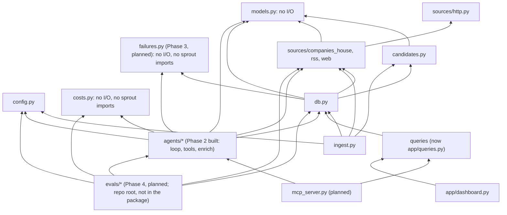
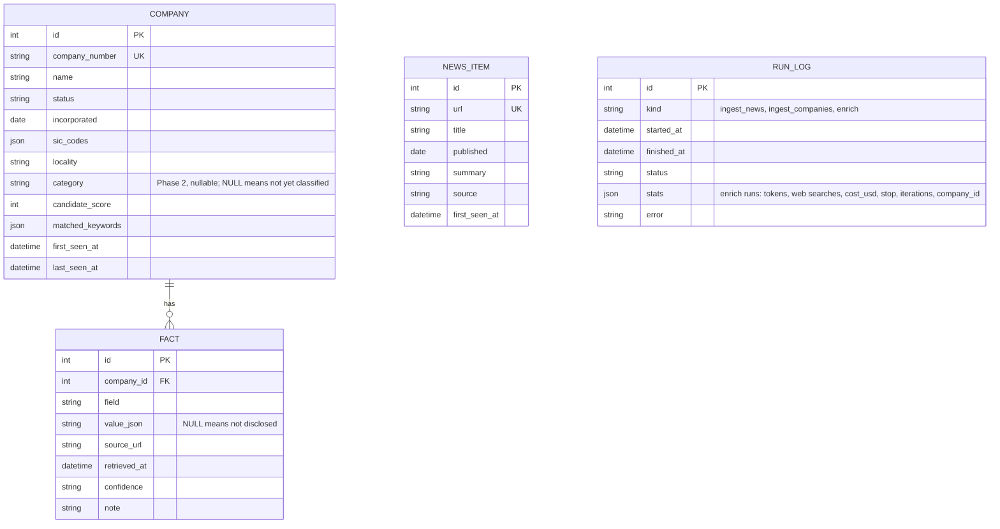
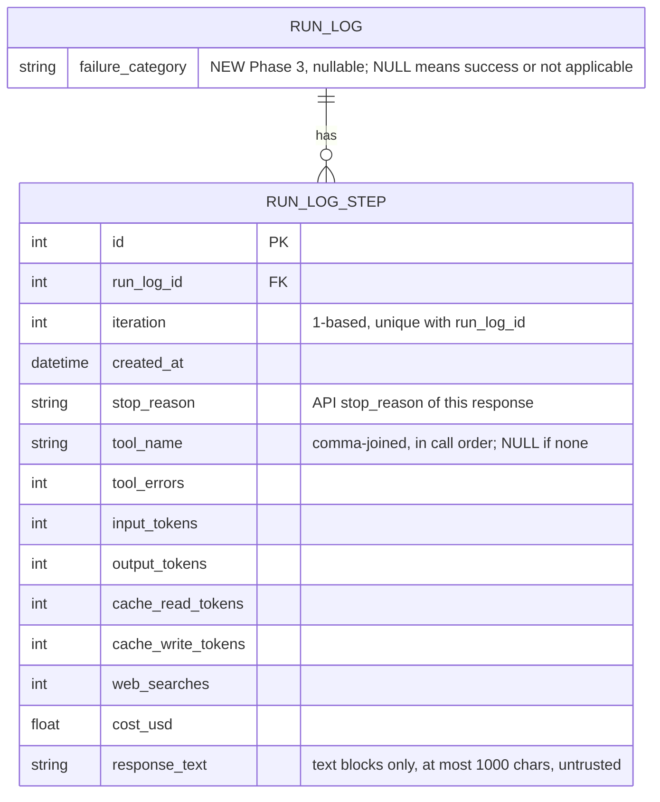
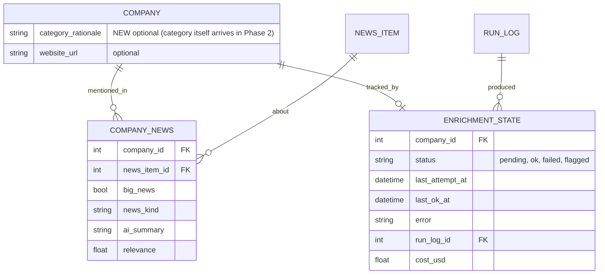

# Overview, modules, data model

Part of the [Sprout architecture docs](README.md). See [cross-cutting concerns](cross-cutting.md), [decisions](decisions.md), [risks](risks.md) and [status](status.md) for the rest of what used to be this one page, and the phase pages for diagrams and phase-specific design detail.

## 1. Overview and goals

Sprout discovers UK AI startups, groups them by a fixed 16-category taxonomy, and keeps a sourced profile for each (funding, stage, business model, target user, recent news). Data is served through a Streamlit dashboard and an MCP server.

**Goals**
- About 150 sourced profiles; quality measured on a hand-labelled golden set of 30.
- Provenance over completeness. Every fact carries `source_url`, `retrieved_at`, `confidence`. "Not disclosed" is valid. A non-null value without a source is rejected in code.
- Budgeted: about US$26 total API spend, under about US$13 per full run, a cap on every run, cost logged.
- Scraped content is untrusted data, never instructions.

**Non-goals:** embeddings / "similar companies"; complete UK coverage; real-time freshness (weekly refresh).

**Constraints:** one developer, about 45 hours, Python 3.12, SQLite, no paid data vendors. Cut order if behind: embeddings, discovery agent, MCP HTTP transport, Docker/hosting. Never cut provenance, evals, or the MCP server.

**Style:** a batch pipeline writes to one SQLite file; two read-mostly front ends (Streamlit, MCP) sit on top. All external I/O goes through narrow adapters (`sources/*`, later the LLM client) so tests mock at those seams.

## 3.1 Dependency direction



Rules: `models.py` and `costs.py` depend on nothing in `sprout`; `sources/*` never import `db`; front ends never import agents except via the single `refresh_company` path. Within `agents/`, only `loop.py` imports `anthropic` (so SDK drift, error types and the test seam live in one file); `tools.py` builds plain-dict tool specs and never imports the SDK; `agents/enrich.py` is the only agent module that touches `db` (confirmed from the imports). `tools.py` imports `loop.py` only for the `Tool` and `ToolOutcome` types. `hello.py` is a standalone smoke script and also imports `anthropic`; the rule covers pipeline code. `src/sprout/enrich.py` is a three-line `python -m sprout.enrich` shim over `agents.enrich.main`. Planned (Phase 3): `failures.py` is a pure leaf module (like `costs.py`) imported by `db.py` (backfill, exception fallback) and `agents/enrich.py`; `loop.py` stays DB-free and does not import it. Planned (Phase 4): `evals/` sits above the package and may import any `sprout` module; nothing in `sprout` imports `evals` (tests do).

**[DRIFT]** `db.py` imports `CompanyHit`, `parse_hit`, `Assessment` and `assess` (`src/sprout/db.py:17-19`), tying storage to one source and filter. Phase 2 added a second use: `add_company_by_number` turns a Companies House response into a row through `parse_hit` and `assess`, so the earlier advice to keep Phase 2 write helpers free of source-specific types was not followed for that one helper. `save_profile` is clean (models only). Acceptable at this size; move `add_company_by_number` next to the ingest code if a second source appears.

## 3.2 Built modules

| Module | Responsibility | Interface | Errors |
|---|---|---|---|
| `config.py` | Env and `.env` into frozen `Settings` | `get_settings()`, `require_*_key()` | `MissingConfigError` |
| `models.py` | Taxonomy, `Sourced[T]`, `CompanyProfile` (`extra="forbid"`) | Pydantic classes | `ValidationError` for unsourced values, naive datetimes |
| `sources/http.py` | Single network entry point | `HttpClient.get`, `DiskCache`, rate limiters | `FetchError`; 4xx (not 429) no retry; 429/5xx retry 4 times with backoff |
| `sources/companies_house.py` | Registry client | `search`, `advanced_search`, `get_company`, `filing_history` | `FetchError` |
| `sources/rss.py` | Feeds to `NewsItem` | `fetch_feed`, `parse_feed`, `normalise_url` | One bad feed doesn't stop others |
| `sources/web.py` | Polite, safe page fetch | `WebFetcher.fetch`, `html_to_text` (Phase 4 adds `UrlPolicy`, see the [Phase 4 page](phase-4-evals-guardrails.md)) | `FetchBlockedError` |
| `candidates.py` | Name and SIC heuristic | `assess()` | none |
| `db.py` | SQLModel tables and writes | `init_db` (create tables, then additive `ALTER TABLE` for missing nullable columns), `upsert_company`, `save_fact`, `add_news_items`, `logged_run`, `save_profile`, `add_company_by_number` | failures logged in `run_log`, re-raised; non-additive schema change raises `RuntimeError` telling you to reset the DB |
| `ingest.py` | Phase 1 orchestration | `python -m sprout.ingest` | exit code 1 on failed feeds |
| `costs.py` | Price table, `Usage`, USD cost (pure) | `PRICES`, `WEB_SEARCH_USD_EACH`, `Usage`, `cost_usd` | `UnknownModelError` for an unpriced model (fails closed) |
| `agents/loop.py` | Generic tool-use loop; the only pipeline module importing `anthropic` | `run_agent`, `make_client`, `Budget`, `Tool`, `ToolOutcome`, `LoopResult` | never raises for API, tool or model problems: returns a `LoopResult.stop` code; `ValueError` from `Budget` for bad caps; `UnknownModelError` before the first call |
| `agents/tools.py` | Tool specs, handlers, seen-URL ledger, untrusted wrapping | `build_tools`, `SourceLedger`, `wrap_untrusted` | handlers return error outcomes, never raise into the loop |
| `agents/enrich.py` | Prompt, `submit_profile` schema and validation, persistence, `enrich` run_log row, CLI | `enrich_company`, `enrich_with_result`, `validate_submission`, `submit_profile_schema`, `resolve_company`, `main` | `EnrichmentFailed(stop, cost_usd)` on any non-success; `CompanyNotFound` for the CLI; exit 0 ok, 1 any skip or failure, 2 missing Anthropic key |
| `enrich.py` | `python -m sprout.enrich` shim | `main` re-export | see `agents/enrich.py` |
| `app/queries.py` | Streamlit-free read queries | `search_companies`, `company_facts`, `search_news`, `parse_phases` | none |

**[DRIFT]** Files not in the plan layout: `candidates.py`, `ingest.py`, `hello.py`, `app/queries.py`, `streamlit_app.py`, and from Phase 2 `agents/tools.py` and the `enrich.py` shim (the plan names `costs.py`, `agents/loop.py` and `agents/enrich.py`). `agents/enrich.py` also carries the CLI and `resolve_company` (about 460 lines in all); acceptable now, split the CLI out when Phase 5 adds an orchestrator entry point.

Phase 2's built interfaces (exact signatures), the loop contract table, and the planned Phase 5/7 module stubs are on the [Phase 2 page](phase-2-enrichment.md) and [Phase 5 page](phase-5-multi-agent.md).

## 3.4 Data model

Built:



`fact` is unique on `(company_id, field, source_url)`. `news_item` has no company link; `run_log` has no company link (the enrich link is `stats.company_id`, inside the JSON).

Phase 2 added exactly one schema change, `company.category` (shown in the diagram above), plus `run_log` rows of `kind="enrich"`.

- **`company.category`** is `str | None`, not a SQL enum (an enum adds a CHECK constraint, which complicates additive `ALTER`). It is validated back to `Category` on read. It is not indexed (about 150 enriched rows). `save_profile` sets it from `CompanyProfile.category`; a company the agent never finished keeps `NULL`.
- **How the existing dev DB gets the column (D15, built):** `init_db` runs `create_all`, then `_add_missing_columns`: for each existing table it compares `sqlalchemy.inspect(engine).get_columns(...)` with the model and runs `ALTER TABLE ... ADD COLUMN` for each missing column. Only a plain nullable column is added; a missing column that is non-nullable, a primary key or unique raises `RuntimeError` telling the developer to delete the database and re-ingest. **[DRIFT]** the design also allowed columns "with a constant default"; the code is stricter (nullable only), which is enough for `category`, `category_rationale` and `website_url` but not for a NOT NULL column with a default. Covered by `test_init_db_adds_new_columns_to_an_old_database_and_keeps_rows`. Fallback for a non-additive change: delete `data/sprout.db` and re-run ingest (the Companies House cache max age is 7 days, so an old cache means about 25 fresh requests, not a problem).
- **`run_log` for enrich** (`kind="enrich"`, one row per company attempt, via `logged_run`). `stats` is assigned as a whole dict. Costs are stored as floats rounded to 6 places (observability only; caps use `Decimal` in memory). `repairs` is 0 or 1 and an allowed repair is not a failure. `error` is the loop's error text or null:

```json
{"company_id": 12, "company_number": "09999999", "model": "claude-haiku-5-5", "effort": "low",
 "stop": "submitted", "iterations": 6, "repairs": 0,
 "input_tokens": 0, "output_tokens": 0, "cache_read_tokens": 0, "cache_write_tokens": 0,
 "web_searches": 0, "tool_calls": {"fetch_page": 0, "lookup_companies_house": 0},
 "cost_usd": 0.0, "budget": {"max_iterations": 12, "max_usd": 0.13},
 "error": null}
```

  Thinking tokens are inside `output_tokens`. Average cost per company is `SELECT avg(json_extract(stats, '$.cost_usd')) FROM run_log WHERE kind='enrich'`; note that the dev DB also holds 8 `error` rows from the iteration phase, so filter on `stats.stop = 'submitted'` for the headline figure (measured: USD 0.0138 over the final 10-company run, USD 0.0134 over 22 successful runs). Per-company status is not a column until `enrichment_state` (Phase 5, which will reference `run_log.id`).
- **Profile persistence (built as designed):** `save_profile` iterates `CompanyProfile.model_fields`, calling `save_fact` for every `Sourced` field (`website`, `hq`, `founded`, `stage`, `total_raised_million_usd`, `valuation_million_usd`, `business_model`, `target_user`, `one_liner`), so a new `Sourced` field persists with no db change. "Not disclosed" is stored as a NULL-value fact so the dashboard can tell "researched, nothing found" from "never tried"; the winning-value rule (see [4.1 Sourcing and provenance](cross-cutting.md#41-sourcing-and-provenance)) must ignore a NULL fact when a valued one exists. `news` is not persisted in Phase 2 (`news_item` has no company link until Phase 5) and `name` is ignored (identity is the row). A re-run overwrites facts from the same URL and adds facts from new URLs; older facts from URLs the new run no longer cites remain. **[DRIFT]** consequence not stated before: a field that was valued in run 1 and null in run 2 ends with both a valued fact and a NULL-value fact, and `company.category` is simply overwritten, so the winning-value rule is needed before any front end reads facts. `load_profile` is deferred to Phase 5; Phase 2 tests read back through `fact` rows. **[DRIFT], later:** `funding_rounds` moved out of this list. It is now `list[Sourced[FundingRound]]`, each round sourced separately, persisted by `save_profile` into its own `funding_round` table (not `fact`) via `save_funding_rounds`, which replaces the company's rounds on every save rather than merging by source. `delete_profile` clears both `fact` and `funding_round` rows.

Phase 4 (evals) adds no table or column; its only data change is an additive `sources` list in `run_log.stats` for `enrich` rows (see the [Phase 4 page](phase-4-evals-guardrails.md)). Phase 3 adds `error_type` to the same `stats` dict (see the [Phase 3 page](phase-3-observability.md)); both edit `_stats` in `agents/enrich.py`, so whichever lands second merges the dict, not a conflict in meaning.

Phase 3 (observability, planned, design on its own page) adds one table and one column, both additive (`create_all` for the table, the D15 `ALTER TABLE ADD COLUMN` for the nullable column):



Planned additions (Phase 5 and later):



- `category` is a plain column (built in Phase 2, above). `company_news` links news to companies. `enrichment_state` gives per-company status, error and cost (needed for resumability). `fact` may need a `verification` column.
- `CompanyProfile` is the agent output contract; storage flattens each `Sourced` field into `fact` rows (built in Phase 2, `save_profile`). A `load_profile(session, company_id)` must still be written. **[DRIFT], later:** `FundingRound` is no longer stored as JSON in `value_json`; each round is its own row in `funding_round`, sourced independently (see [4.1 Sourcing and provenance](cross-cutting.md#41-sourcing-and-provenance) and the Phase 2 profile persistence note above).
