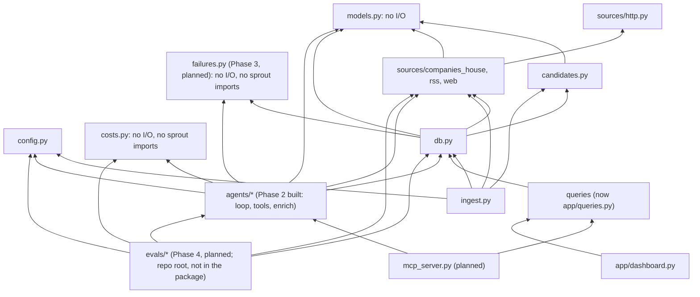
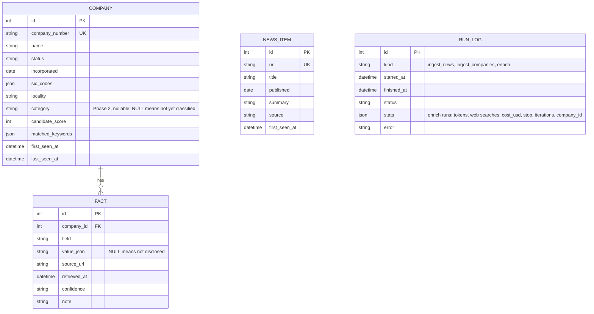
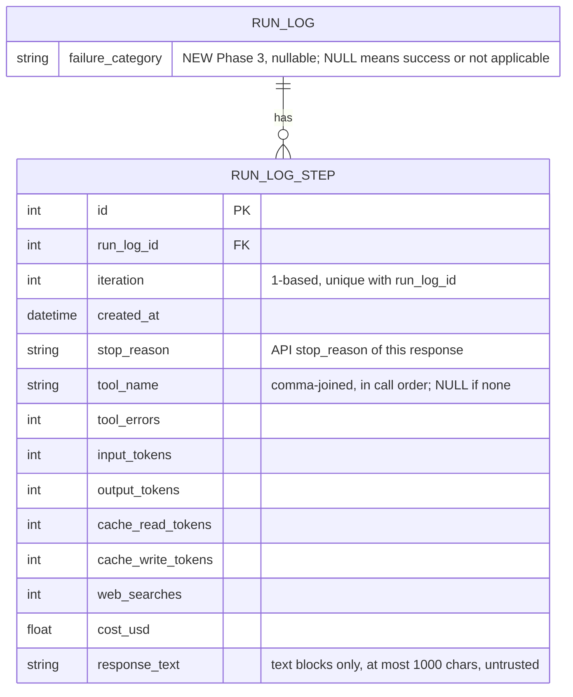
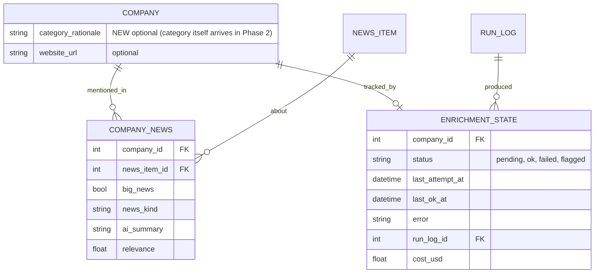

# Overview, modules, cross-cutting concerns, decisions, risks, status

Part of the [Sprout architecture docs](README.md). See the phase pages for diagrams and phase-specific design detail.

## 1. Overview and goals

Sprout discovers UK AI startups, groups them by a fixed 16-category taxonomy, and keeps a sourced profile for each (funding, stage, business model, target user, recent news). Data is served through a Streamlit dashboard and an MCP server.

**Goals**
- About 150 sourced profiles; quality measured on a hand-labelled golden set of 30.
- Provenance over completeness. Every fact carries `source_url`, `retrieved_at`, `confidence`. "Not disclosed" is valid. A non-null value without a source is rejected in code.
- Budgeted: about US$26 total API spend, under about US$13 per full run, a cap on every run, cost logged.
- Scraped content is untrusted data, never instructions.

**Non-goals:** embeddings / "similar companies"; complete UK coverage; real-time freshness (weekly refresh).

**Constraints:** one developer, about 45 hours, Python 3.12, SQLite, no paid data vendors. Cut order if behind: embeddings, discovery agent, MCP HTTP transport, Docker/hosting. Never cut provenance, evals, or the MCP server.

**Style:** a batch pipeline writes to one SQLite file; two read-mostly front ends (Streamlit, MCP) sit on top. All external I/O goes through narrow adapters (`sources/*`, later the LLM client) so tests mock at those seams.

## 3.1 Dependency direction



Rules: `models.py` and `costs.py` depend on nothing in `sprout`; `sources/*` never import `db`; front ends never import agents except via the single `refresh_company` path. Within `agents/`, only `loop.py` imports `anthropic` (so SDK drift, error types and the test seam live in one file); `tools.py` builds plain-dict tool specs and never imports the SDK; `agents/enrich.py` is the only agent module that touches `db` (confirmed from the imports). `tools.py` imports `loop.py` only for the `Tool` and `ToolOutcome` types. `hello.py` is a standalone smoke script and also imports `anthropic`; the rule covers pipeline code. `src/sprout/enrich.py` is a three-line `python -m sprout.enrich` shim over `agents.enrich.main`. Planned (Phase 3): `failures.py` is a pure leaf module (like `costs.py`) imported by `db.py` (backfill, exception fallback) and `agents/enrich.py`; `loop.py` stays DB-free and does not import it. Planned (Phase 4): `evals/` sits above the package and may import any `sprout` module; nothing in `sprout` imports `evals` (tests do).

**[DRIFT]** `db.py` imports `CompanyHit`, `parse_hit`, `Assessment` and `assess` (`src/sprout/db.py:17-19`), tying storage to one source and filter. Phase 2 added a second use: `add_company_by_number` turns a Companies House response into a row through `parse_hit` and `assess`, so the earlier advice to keep Phase 2 write helpers free of source-specific types was not followed for that one helper. `save_profile` is clean (models only). Acceptable at this size; move `add_company_by_number` next to the ingest code if a second source appears.

## 3.2 Built modules

| Module | Responsibility | Interface | Errors |
|---|---|---|---|
| `config.py` | Env and `.env` into frozen `Settings` | `get_settings()`, `require_*_key()` | `MissingConfigError` |
| `models.py` | Taxonomy, `Sourced[T]`, `CompanyProfile` (`extra="forbid"`) | Pydantic classes | `ValidationError` for unsourced values, naive datetimes |
| `sources/http.py` | Single network entry point | `HttpClient.get`, `DiskCache`, rate limiters | `FetchError`; 4xx (not 429) no retry; 429/5xx retry 4 times with backoff |
| `sources/companies_house.py` | Registry client | `search`, `advanced_search`, `get_company`, `filing_history` | `FetchError` |
| `sources/rss.py` | Feeds to `NewsItem` | `fetch_feed`, `parse_feed`, `normalise_url` | One bad feed doesn't stop others |
| `sources/web.py` | Polite, safe page fetch | `WebFetcher.fetch`, `html_to_text` (Phase 4 adds `UrlPolicy`, see the [Phase 4 page](phase-4-evals-guardrails.md)) | `FetchBlockedError` |
| `candidates.py` | Name and SIC heuristic | `assess()` | none |
| `db.py` | SQLModel tables and writes | `init_db` (create tables, then additive `ALTER TABLE` for missing nullable columns), `upsert_company`, `save_fact`, `add_news_items`, `logged_run`, `save_profile`, `add_company_by_number` | failures logged in `run_log`, re-raised; non-additive schema change raises `RuntimeError` telling you to reset the DB |
| `ingest.py` | Phase 1 orchestration | `python -m sprout.ingest` | exit code 1 on failed feeds |
| `costs.py` | Price table, `Usage`, USD cost (pure) | `PRICES`, `WEB_SEARCH_USD_EACH`, `Usage`, `cost_usd` | `UnknownModelError` for an unpriced model (fails closed) |
| `agents/loop.py` | Generic tool-use loop; the only pipeline module importing `anthropic` | `run_agent`, `make_client`, `Budget`, `Tool`, `ToolOutcome`, `LoopResult` | never raises for API, tool or model problems: returns a `LoopResult.stop` code; `ValueError` from `Budget` for bad caps; `UnknownModelError` before the first call |
| `agents/tools.py` | Tool specs, handlers, seen-URL ledger, untrusted wrapping | `build_tools`, `SourceLedger`, `wrap_untrusted` | handlers return error outcomes, never raise into the loop |
| `agents/enrich.py` | Prompt, `submit_profile` schema and validation, persistence, `enrich` run_log row, CLI | `enrich_company`, `enrich_with_result`, `validate_submission`, `submit_profile_schema`, `resolve_company`, `main` | `EnrichmentFailed(stop, cost_usd)` on any non-success; `CompanyNotFound` for the CLI; exit 0 ok, 1 any skip or failure, 2 missing Anthropic key |
| `enrich.py` | `python -m sprout.enrich` shim | `main` re-export | see `agents/enrich.py` |
| `app/queries.py` | Streamlit-free read queries | `search_companies`, `company_facts`, `search_news`, `parse_phases` | none |

**[DRIFT]** Files not in the plan layout: `candidates.py`, `ingest.py`, `hello.py`, `app/queries.py`, `streamlit_app.py`, and from Phase 2 `agents/tools.py` and the `enrich.py` shim (the plan names `costs.py`, `agents/loop.py` and `agents/enrich.py`). `agents/enrich.py` also carries the CLI and `resolve_company` (about 460 lines in all); acceptable now, split the CLI out when Phase 5 adds an orchestrator entry point.

Phase 2's built interfaces (exact signatures), the loop contract table, and the planned Phase 5/7 module stubs are on the [Phase 2 page](phase-2-enrichment.md) and [Phase 5 page](phase-5-multi-agent.md).

## 3.4 Data model

Built:



`fact` is unique on `(company_id, field, source_url)`. `news_item` has no company link; `run_log` has no company link (the enrich link is `stats.company_id`, inside the JSON).

Phase 2 added exactly one schema change, `company.category` (shown in the diagram above), plus `run_log` rows of `kind="enrich"`.

- **`company.category`** is `str | None`, not a SQL enum (an enum adds a CHECK constraint, which complicates additive `ALTER`). It is validated back to `Category` on read. It is not indexed (about 150 enriched rows). `save_profile` sets it from `CompanyProfile.category`; a company the agent never finished keeps `NULL`.
- **How the existing dev DB gets the column (D15, built):** `init_db` runs `create_all`, then `_add_missing_columns`: for each existing table it compares `sqlalchemy.inspect(engine).get_columns(...)` with the model and runs `ALTER TABLE ... ADD COLUMN` for each missing column. Only a plain nullable column is added; a missing column that is non-nullable, a primary key or unique raises `RuntimeError` telling the developer to delete the database and re-ingest. **[DRIFT]** the design also allowed columns "with a constant default"; the code is stricter (nullable only), which is enough for `category`, `category_rationale` and `website_url` but not for a NOT NULL column with a default. Covered by `test_init_db_adds_new_columns_to_an_old_database_and_keeps_rows`. Fallback for a non-additive change: delete `data/sprout.db` and re-run ingest (the Companies House cache max age is 7 days, so an old cache means about 25 fresh requests, not a problem).
- **`run_log` for enrich** (`kind="enrich"`, one row per company attempt, via `logged_run`). `stats` is assigned as a whole dict. Costs are stored as floats rounded to 6 places (observability only; caps use `Decimal` in memory). `repairs` is 0 or 1 and an allowed repair is not a failure. `error` is the loop's error text or null:

```json
{"company_id": 12, "company_number": "09999999", "model": "claude-haiku-5-5", "effort": "low",
 "stop": "submitted", "iterations": 6, "repairs": 0,
 "input_tokens": 0, "output_tokens": 0, "cache_read_tokens": 0, "cache_write_tokens": 0,
 "web_searches": 0, "tool_calls": {"fetch_page": 0, "lookup_companies_house": 0},
 "cost_usd": 0.0, "budget": {"max_iterations": 12, "max_usd": 0.13},
 "error": null}
```

  Thinking tokens are inside `output_tokens`. Average cost per company is `SELECT avg(json_extract(stats, '$.cost_usd')) FROM run_log WHERE kind='enrich'`; note that the dev DB also holds 8 `error` rows from the iteration phase, so filter on `stats.stop = 'submitted'` for the headline figure (measured: USD 0.0138 over the final 10-company run, USD 0.0134 over 22 successful runs). Per-company status is not a column until `enrichment_state` (Phase 5, which will reference `run_log.id`).
- **Profile persistence (built as designed):** `save_profile` iterates `CompanyProfile.model_fields`, calling `save_fact` for every `Sourced` field (`website`, `hq`, `founded`, `stage`, `total_raised_million_usd`, `valuation_million_usd`, `business_model`, `target_user`, `one_liner`), so a new `Sourced` field persists with no db change. "Not disclosed" is stored as a NULL-value fact so the dashboard can tell "researched, nothing found" from "never tried"; the winning-value rule (see 4.1 below) must ignore a NULL fact when a valued one exists. `news` is not persisted in Phase 2 (`news_item` has no company link until Phase 5) and `name` is ignored (identity is the row). A re-run overwrites facts from the same URL and adds facts from new URLs; older facts from URLs the new run no longer cites remain. **[DRIFT]** consequence not stated before: a field that was valued in run 1 and null in run 2 ends with both a valued fact and a NULL-value fact, and `company.category` is simply overwritten, so the winning-value rule is needed before any front end reads facts. `load_profile` is deferred to Phase 5; Phase 2 tests read back through `fact` rows. **[DRIFT], later:** `funding_rounds` moved out of this list. It is now `list[Sourced[FundingRound]]`, each round sourced separately, persisted by `save_profile` into its own `funding_round` table (not `fact`) via `save_funding_rounds`, which replaces the company's rounds on every save rather than merging by source. `delete_profile` clears both `fact` and `funding_round` rows.

Phase 4 (evals) adds no table or column; its only data change is an additive `sources` list in `run_log.stats` for `enrich` rows (see the [Phase 4 page](phase-4-evals-guardrails.md)). Phase 3 adds `error_type` to the same `stats` dict (see the [Phase 3 page](phase-3-observability.md)); both edit `_stats` in `agents/enrich.py`, so whichever lands second merges the dict, not a conflict in meaning.

Phase 3 (observability, planned, design on its own page) adds one table and one column, both additive (`create_all` for the table, the D15 `ALTER TABLE ADD COLUMN` for the nullable column):



Planned additions (Phase 5 and later):



- `category` is a plain column (built in Phase 2, above). `company_news` links news to companies. `enrichment_state` gives per-company status, error and cost (needed for resumability). `fact` may need a `verification` column.
- `CompanyProfile` is the agent output contract; storage flattens each `Sourced` field into `fact` rows (built in Phase 2, `save_profile`). A `load_profile(session, company_id)` must still be written. **[DRIFT], later:** `FundingRound` is no longer stored as JSON in `value_json`; each round is its own row in `funding_round`, sourced independently (see 4.1 below and the Phase 2 profile persistence note above).

## 4. Cross-cutting concerns

### 4.1 Sourcing and provenance
- `Sourced[T]` rejects a non-null value with no `source_url`. `value=None` means "not disclosed" and must render as such, never zero or blank.
- Per-fact `retrieved_at` (UTC) supports the staleness policy; registry facts can lag up to 7 days via the HTTP cache.
- Multiple sources per field coexist, which lets the verifier record disagreement.
- Not provenance-bearing: `category`, `news_item` (source is the feed), free-text fields.
- **[AMBIGUOUS]** No rule for which value wins when a field has several facts. Proposed: highest confidence, then most recent, and surface "sources disagree". Put it in the service layer.
- **[AMBIGUOUS], resolved later:** Same-source re-extraction overwrites; no history. Phase 6 "funding history" needs a `funding_round` table or list, or should be cut. Built: a `funding_round` table, one row per round, each sourced independently; `save_profile` replaces the company's rounds on every save, so there is still no history across runs, only within the latest one.
- SQLite treats NULLs as distinct in UNIQUE constraints; `save_fact` dedupes in application code. Do not rely on the constraint alone.

### 4.2 Agent orchestration
- Deterministic supervisor selects companies and runs workers with `asyncio` under a concurrency limit.
- Per company: enrich, then classify (bulk model), news, then verify (only for funding or stage claims). Classifier and news can run in parallel.
- Models: bulk `claude-haiku-5-5` for extraction/classification; strong `claude-sonnet-5-5` for verification/synthesis; overridable via `SPROUT_BULK_MODEL` / `SPROUT_STRONG_MODEL`. IDs were taken from the `claude-api` skill on 2026-10-06; live Phase 2 calls succeeded with `claude-haiku-5-5` (the default). `claude-sonnet-5-5` (`--strong`) is priced but was not run live. Any unpriced override fails closed in `costs.py`.
- Loop (built in Phase 2, see the [Phase 2 page](phase-2-enrichment.md)): `tool_choice: auto` plus a prompt instruction naming `submit_profile`, explicit effort, thinking tokens in budget, prompt-cached prefix and conversation, `pause_turn` and `server_tool_use` handled, per-run caps of iterations, USD and searches (`max_uses`). No per-run fetch cap and no batch-level cap (see the [DRIFT] note on the Phase 2 page).
- Resume: the unit of work is a company; one transaction per company; fresh `ok` rows are skipped.
- A company failure sets status `failed` and the run continues. Target at least 85% `ok`.

### 4.3 Error handling

| Boundary | Failure | Behaviour |
|---|---|---|
| Companies House / RSS | 429 or 5xx | Retry with backoff and `Retry-After`, then `FetchError` |
| Companies House | 404 | Cached, treated as no result |
| RSS | One feed broken | Reported in `failed_feeds`, exit 1, others continue |
| Web fetch | robots, private IP, content type | `FetchBlockedError`, returned to the model as a tool error |
| Web fetch | robots.txt unreachable | Refuse |
| Web fetch | URL policy violation: scheme, port, credentials, denied name, non-public address (including mapped IPv6 and NAT64), host outside `allow_hosts` (Phase 4, planned) | `FetchBlockedError`, returned to the model as a tool error |
| Web fetch | Response slower than `max_seconds` (Phase 4, planned) | `FetchError`, not retried, returned to the model as a tool error |
| Web fetch | Page larger than the tool-result cap | Truncate to 8,000 characters (`TOOL_RESULT_MAX_CHARS`) with a "[truncated]" marker; `WebFetcher` already caps at 20,000 characters |
| Companies House tool | 404 or invalid number | `None` becomes a "no such company" error string; not retried |
| Server-side search | `max_uses_exceeded`, `unavailable`, rate limit | Arrives as an error result block (the loop's URL extraction tolerates a non-list result); the model continues without search; not an exception. Seen live once (Tractable, search unavailable): honest nulls |
| LLM | `pause_turn` | Resend the history including `server_tool_use` blocks; counts as an iteration |
| LLM | `refusal`, `max_tokens`, `end_turn` with no submission | Stop codes `refused`, `truncated`, `no_submit` (one reminder first); nothing persisted. `refused` was seen live once on Cleo and was transient |
| LLM | SDK `APIError` after SDK retries (429/5xx) | Stop `error`; usage so far logged; the `run_log` row is `status=error` and the CLI continues with the next target |
| LLM | Invalid structured output | One repair attempt (Pydantic errors as compact field paths and messages, not the whole input echoed), else stop `invalid`; nothing persisted |
| LLM | `source_url` not in the seen-URL ledger, funding fact without a `note` | Treated as invalid output: same single repair attempt, and the error lists up to 25 citable URLs. Seen live: invented homepages were rejected and repaired |
| LLM | Iteration or USD cap | Stop with `max_iter` or `budget`; nothing is persisted (no partial profile); `run_log` row keeps stats and cost. **[DRIFT]** the earlier "keep partial facts, mark `partial`" is not implemented. Phase 5 `enrichment_state` will need to decide whether to retry or accept partial results |
| LLM | Sources disagree | Record both, lower confidence, flag |
| Run classification (Phase 3, planned) | Any non-`submitted` stop | `failure_category` set from the fixed taxonomy (see the [Phase 3 page](phase-3-observability.md)) in the same commit as the stats and steps, before `EnrichmentFailed` is raised; raw error text stays on the run and step rows as drill-down only |
| Exception outside the loop (Phase 3, planned) | `save_profile` or a DB error after a `submitted` stop | `logged_run` marks the row `error` and, if the category is still NULL, sets `internal_error`; the earlier commit keeps stats and steps |
| Step logging (Phase 3, planned) | A response lacks optional fields or has no text blocks | Defaults via `getattr` (same style as `_usage_of`); bookkeeping never raises into or alters the loop. A failed step INSERT is a DB error and fails the run loudly |
| Observability tab (Phase 3, planned) | No runs, no failures, a run with no steps, `stats == {}` | An explanatory message for each state (see the [Phase 3 page](phase-3-observability.md)); never an exception |
| Eval run (Phase 4, planned) | A golden company's enrichment fails | Counted as not submitted (visible in the profiles-submitted row), its cost still charged; the run continues |
| Eval run (Phase 4, planned) | Batch cap reached before every entry ran | Remaining entries reported `skipped_budget`; the run is marked incomplete, not gated, exit 2 |
| Eval judge (Phase 4, planned) | No verdict (cap, invalid output, refusal) | Counted as `unjudged`, never as correct |
| MCP tool | Bad input or DB error | Compact actionable text; never write to stdout |

### 4.4 Testing
- Unit tests for models, candidates, DB helpers. Adapter tests with `httpx.MockTransport`. `streamlit.testing` smoke tests. 169 tests pass (re-run 2026-10-19); the only live test (`-m live`, `tests/test_live_api.py`) is the Phase 0 hello call and is skipped without a key.
- **Fake-client seam (built):** `run_agent` takes any object with `messages.create(**kwargs)`, and reads only `content[*].type/id/name/input/text`, `stop_reason` and `usage.*` (including `server_tool_use.web_search_requests`). `tests/fakes.py` provides a `ScriptedClient` that returns queued responses (or raises a queued exception) built from `SimpleNamespace` objects with helpers (`text_turn`, `tool_use_turn`, `server_search_turn`, `pause_turn`, plus `response`, `usage`, `search_blocks`) and records every request, with a snapshot of the message list, so tests can assert on cache markers, `tool_choice` and message history. It raises if the loop makes more calls than scripted. The loop appends `response.content` to history unchanged, which works for both SDK and fake objects. Tool handlers are tested with the existing `httpx.MockTransport` fixtures through `WebFetcher` and `CompaniesHouseClient`.
- **Phase 2 tests (built):** `test_costs.py` (exact Decimal arithmetic, fail-closed unknown model, usage addition), `test_agent_loop.py` (cache markers, repair path, second invalid gives `invalid`, exact iteration cap with wrap-up notice, tiny USD cap, 80 percent wrap-up, `pause_turn`, `end_turn` reminder, terminal stop reasons, truncated `tool_use` not executed, handler errors and unknown tools, `APIError` keeps usage, unpriced model fails before any call, budget validation), `test_agent_tools.py` (wrapper, ledger, tool order, server-side search entry, fetch and Companies House tools), `test_enrich.py` (schema derivation, provenance checks, happy path, repair, no persistence on failure with cost recorded, caps, re-run overwrite, `resolve_company`, CLI), and `test_db.py` additions (`save_profile`, `add_company_by_number`, additive `init_db`).
- **[DRIFT]** the planned `-m live` single-company enrichment test was deliberately not added, so a plain `pytest` with a key never spends money. Live behaviour (prompt caching, schema rejection, the 10-company run) is evidenced only by the manual runs in the implementation notes; `--strong`, forced `tool_choice` and `pause_turn` have no live evidence.
- Planned for Phase 4 (design on the [Phase 4 page](phase-4-evals-guardrails.md)): `UrlPolicy` and SSRF cases against an injected resolver; injection cases through `ScriptedClient` and `fixture_fetcher` (plain pytest, offline, no network); golden loader, metrics, number matcher, `BatchBudget` and the judge against synthetic data and a scripted client; one live-gated parametrised injection test (`SPROUT_RUN_LIVE_INJECTION=1`), so a plain `pytest` never spends money. Planned later: MCP tools tested directly on a temp DB.
- Planned for Phase 3 (design on the [Phase 3 page](phase-3-observability.md)): the same `ScriptedClient` seam proves the step records (count equals iterations, summed usage equals the run total, multi-tool and `server_tool_use` names, `tool_errors`, truncation, unchanged existing tests); `enrich` tests assert steps, category and stats survive every failing stop; `test_db.py` covers the old-DB migration and backfill; `test_app_queries.py` seeds a temp DB; `streamlit.testing` covers the empty, populated, no-steps and failed-run states. No live test.
- Golden-set evals run on demand, not per push (cost).
- Gap: CI action versions were written from memory; first green run unconfirmed.

### 4.5 Configuration
- Env plus `.env` via `get_settings()`: `ANTHROPIC_API_KEY`, `COMPANIES_HOUSE_API_KEY`, `SPROUT_BULK_MODEL`, `SPROUT_STRONG_MODEL`, `SPROUT_DB_PATH`, `SPROUT_CACHE_DIR`, `SPROUT_ENABLE_ACTIONS`.
- Secrets never committed; `.env`, `*.db`, `.cache/` are gitignored.
- Phase 2 added per-run USD and iteration caps (`--max-usd`, `--max-iterations`, defaults USD 0.13 and 12 in `agents/enrich.py`), `--effort` and `--strong`, and a price table in `costs.py` (code, not env, so a run is reproducible from the commit). No new env vars or dependencies. No search-backend setting: Phase 2 hard-wires server-side search (D13) and the swap point is `build_tools`.
- No migrations framework. Phase 2 added additive-column handling in `init_db` (D15, nullable columns only); delete `data/sprout.db` for non-additive changes, or adopt Alembic by the end of Phase 5 if one is needed.
- Phase 3 (planned) adds no environment variables, dependencies or CLI flags; the schema change is additive (D15).
- Phase 4 (planned) adds no environment variables: the eval DB path and the batch cap are `run_evals` flags (see the [Phase 4 page](phase-4-evals-guardrails.md)). `pyyaml` joins the `dev` group (A24); pytest `pythonpath` and ruff `src` gain `.`.

### 4.6 Security
- Fetched content and Companies House data are wrapped in `<untrusted_content>` delimiters (closing tag neutralised), the system prompt says it is data, and model output is validated and treated as untrusted. Search snippets are covered by the system-prompt rule only.
- Source URLs and `retrieved_at` are controlled by code (seen-URL ledger), so injected text cannot make the model cite an invented page.
- `WebFetcher` is SSRF-aware; residual DNS-rebinding risk is accepted.
- The enrichment agent has no write or refresh tools; DB writes happen in our code after validation.
- Streamlit actions are off unless `SPROUT_ENABLE_ACTIONS=1`; public deployments are read-only with no keys.
- **Phase 4 additions (planned, see that page):** (1) `UrlPolicy` in `sources/web.py` applies to the requested URL, every redirect hop and `robots.txt`: http and https only, ports 80 and 443 only, no credentials, a name denylist (`localhost`, `metadata.google.internal`, `.local`, `.internal` and similar), every resolved address must be public after unwrapping IPv4-mapped IPv6 and NAT64 (`64:ff9b::/96`, which Python 3.12 currently reports as global), and an optional `allow_hosts` used only by fixtures. No host allowlist in production, because the agent must read arbitrary company sites. (2) A total fetch deadline (`max_seconds`) next to the existing 5 MB streamed cap. (3) `ALLOWED_ENRICHMENT_TOOLS` is a runtime check in `enrich_with_result` and a test, so a state-changing tool (`refresh_company`, Phase 7) can never join the enrichment tool set unnoticed. (4) A system-prompt sentence that instructions in tool results or snippets are never followed. (5) The injection suite: offline cases for the code-level defences plus a live canary tier for model behaviour. (6) The judge treats the candidate text as untrusted (wrapped), and the eval DB is separate from the live DB.
- **Phase 3 (planned, see that page):** the truncated model text logged per step (and the error text) is untrusted and may echo scraped pages. It is truncated to 1,000 characters, never put into a prompt unwrapped, and rendered in Streamlit only with `st.code`, `st.text` or dataframe cells, never `st.markdown` or `unsafe_allow_html`, so a poisoned page cannot make a viewer's browser fetch an attacker URL.
- **Residual risk after Phase 4:** a real model that obeys an injected "set funding to US$1bn" and cites the injected page passes code-level validation and the number-match check; only the live canary run, the golden comparison and the Phase 5 verifier catch it. A prompt may still push a `fetch_page` call to a public attacker host with context in the query string (no secrets in context limits the damage). DNS rebinding between check and connection remains accepted.

### 4.7 Cost and observability
- `costs.py` (built) converts API `usage` (input, output including thinking, cache read, cache write, plus per-search charges for server-side `web_search`) to USD. It computes cost only; the caps are enforced in `loop.py` (`Budget`) against the running `Usage` total. Haiku 5.5 is priced at the lower rate card; its prompts over 100K tokens would double, which per-call prompts stay well below because tool results are capped (not exercised live).
- Search is billed separately from tokens, so `web_searches` is its own `stats` field and `max_uses` is a hard per-run cap. Measured: about 70 percent of a run's cost is the single search at an assumed US$0.01. That rate is not yet confirmed against a console invoice, so the USD figures inherit that uncertainty.
- `run_log.stats` is today's observability record. Add structured logging to stderr.
- **Phase 3 (planned, see that page):** observability moves from one stats blob per run to queryable rows. `run_log_step` holds one row per iteration (tool names, per-step tokens including cache, per-step USD, truncated response text); `run_log.failure_category` holds the fixed failure taxonomy; the Observability tab reads both. Per-run cost and iteration counts for the trend still come from `stats`, so historical runs appear in the trends but have no steps. Step logging adds one batch INSERT to an existing commit and no API call or I/O to the loop. Structured stderr logging remains optional and is not part of this phase.
- **Phase 4 (planned):** the itemized eval-spend estimate, the distinction between the US$5 proposed allocation and US$1.50 per-invocation cap, and their assumptions are in 4.8 below. `BatchBudget` (D24) charges enrichment, judge, calibration and injection to one object; the cap is soft by at most one response. The judge runs on the strong model, which is the main reason to keep it to free-text fields only.

### 4.8 Phase 4 eval budget (planned)

The following is a planning estimate, not a measured full eval run. Enrichment is based on the Phase 2 average; the other components are estimates. Actual spend depends on model output, retries, and which optional evals are enabled.

| Component | Calculation / basis | Estimated spend per full eval |
|---|---|---:|
| Enrichment | 30 companies × Phase 2 measured average US$0.0138/company | US$0.41 |
| LLM judge | About 60 short calls (two free-text fields per company); US$0.002-0.004/call implies US$0.12-0.24; planning point used below is US$0.15 | US$0.15 (estimate) |
| Calibration | Planning allowance; not measured | US$0.05 (estimate) |
| Live injection tests | About 6 cases × Phase 2 average US$0.0138/company | US$0.08 |
| **Total** | Sum of planning points; varies with actual usage | **About US$0.70** |

| Budget item | Proposed amount | What it means |
|---|---:|---|
| Eval allocation (A3) | US$5 | At US$0.70 average, about 7 full evals; 6 would cost about US$4.20, leaving US$0.80. This is an estimate, not a guaranteed run count. |
| Per-invocation cap (A23 / D24) | US$1.50 | Maximum planned spend for one invocation, not the expected cost. If each invocation reaches the cap, US$5 funds 3 full-cap invocations (US$4.50) and leaves US$0.50 toward another. |
| Reserve (A3) | US$4 | Proposed reserve; intended use is not specified in the current plan. |
| Remainder of the approx. US$26 total | Approx. US$17 | Not itemized in the current plan; requires allocation before the full budget can be audited. |

The per-invocation cap is soft by at most one model response because spend is known only after a response completes. If the batch budget is exhausted before every company runs, remaining entries are skipped and the invocation is incomplete. `--score-only`, `--only`, `--limit` and `--skip-judge` can reduce spend. Using `--strong` as the generator is estimated to cost about five times more and requires a larger cap. The US$5 eval allocation, US$4 reserve, and US$1.50 invocation cap remain proposals pending confirmation (A3, A23).

## 5. Key design decisions

| # | Decision | Why | Cost / rules out |
|---|---|---|---|
| D1 | SQLite single file, SQLModel, no migrations | Zero infrastructure, snapshot-friendly | One writer; manual reset on schema change |
| D2 | Provenance enforced in `Sourced[T]` validator | Hallucinated funding is the top risk | A wrong but real URL still passes; verifier and evals catch it |
| D3 | `category` is a plain enum, not `Sourced` | Classification, not a fact at a URL | No per-label provenance |
| D4 | Deterministic orchestrator, not an LLM supervisor | Selection is rule-based | Departs from the plan's wording |
| D5 | Hand-written agent loop, no framework | Plan wants the mechanics | You own retries, caps, parsing |
| D6 | One HTTP entry point | Idempotent, polite, tested once | Sync and not thread-safe |
| D7 | Candidates by name and SIC heuristic (876) | Free; no description search | Many shells; misses oddly named startups |
| D8 | Identity is the Companies House number | Numbers are stable | Other sources need a secondary dedupe key (website domain) |
| D9 | Specialised agents only if evals show gain | Each hand-off costs money | Evals are now Phase 4, before the Phase 5 split, so nothing is pulled forward |
| D10 | Shared service layer for dashboard and MCP | One rule set for winning value and "not disclosed" | Requires extracting `queries` |
| D11 | Read-only deployments ship a snapshot DB | Free hosts lack persistent disk | Delivery mechanism must be agreed (A9) |
| D12 | `refresh_company` is the only model-invokable write, capped | Limits blast radius | Needs cooldown and status response |
| D13 | Phase 2: server-side `web_search`; custom `fetch_page` (wraps `WebFetcher`) and `lookup_companies_house`; no server-side `web_fetch` | Keeps robots, SSRF, size and cache protections on every page read; no new key or adapter | Search is billed per query and returns unwrapped, encrypted snippets. **Built; holds** after the 10-company run (average USD 0.0138, search about 70 percent of it), so no fallback to a custom backend. Phase 7's MCP swap of `fetch_page` stays open (A1) |
| D14 | `costs.py` is a pure module (price table keyed by exact model ID, per-search price, `Usage`, `cost_usd`), written to `run_log.stats` on every run. Caps are enforced in `loop.py`, not `costs.py` | Prices change with model IDs, so they are code that is tested and reviewed, not env; prices move slowly relative to the USD 0.07 target | Unpriced model fails closed. **Built:** the US$0.01 per search is unconfirmed against an invoice |
| D15 | Additive-column step in `init_db` instead of deleting the DB or adding Alembic now | Keeps ingest data and paid enrichment output; about 20 lines; covers Phase 5 additive changes | Cannot rename, retype or add constraints; those need a reset or Alembic. **Built**, but nullable columns only (the design also allowed a constant default) |
| D16 | Provenance is stamped by code: `retrieved_at` from the seen-URL ledger, `source_url` must be a URL a tool returned, funding facts need a `note` | The prompt cannot be the only defence against invented sources or timestamps (top risk) | A real but wrong URL still passes; verifier and evals cover that (a claimed website can be wrong, e.g. Airborne Robotics). Slightly stricter than the plan. **Built** in `validate_submission`; ledger matching ignores trailing slash, host case, fragments and tracking params |
| D17 | `loop.py` is generic: terminal tools, handler callbacks, duck-typed client protocol; `enrich.py` owns the profile-specific checks | One loop can serve classifier, news and verifier agents in Phase 5 | The generic `Tool` and `ToolOutcome` types are an abstraction paid for before the second user; kept because the fake-client seam needs the boundary anyway. **Built.** The `on_search_urls` callback is the one place `enrich.py` reaches into the loop; no second user exists yet |
| D18 | `submit_profile` is not `strict`: the schema is derived from `CompanyProfile` and validated by Pydantic with one repair attempt | The API rejected the derived schema (29 anyOf or type-array parameters, limit 16), and simplifying `CompanyProfile` to fit would distort the shared contract | The API does not enforce the shape, so enforcement costs a possible repair round trip; numeric bounds and formats are Pydantic-only. Revisit if the strict limit rises or `CompanyProfile` slims |
| D19 | Phase 4 (planned): evals live in a repo-root `evals/` package run with `python -m evals.run_evals`; it imports `sprout`, never the reverse; pytest `pythonpath` and ruff `src` gain `.` | Matches the plan's layout and keeps golden data and results beside the code but out of the shipped package | Two import roots; a new dev dependency for YAML (A24) |
| D20 | Phase 4 (planned): evals run into `data/eval.db`, deleted at the start of each full run, and are scored from the persisted `company`, `fact`, `funding_round` and `run_log` rows; `--score-only` rescoring is free | Never touches the live dataset, one run per company so A17 cannot occur, evaluates the write path too | Seeding each company from Companies House (cached); results depend on the cache state |
| D21 | Phase 4 (planned): "fabricated" means the figure (stored USD millions or an amount parsed from the `note`) is absent from the cited page text as the model saw it (first 8,000 characters), by number match within 1 percent; snippet-only sources are a separate "unverifiable" row | The literal plan definition is always 0 percent because the code already rejects unsourced values; this is exact, free and catches real-but-wrong URLs | Rollout proposal: report findings but do not gate the first baseline; review flags and tune the matcher before considering a gate. False flags for summed totals and spelled-out figures; cannot judge snippet-only claims; an injected page that states the figure passes it |
| D22 | Phase 4 (planned): "last round" is the `funding_round` with the latest `announced`, ties and missing dates by `Stage` order, a null amount still counts; match is exact or within 10 percent of golden USD millions | Gives one unambiguous comparison; 10 percent absorbs the approximate FX rates the prompt uses | A null amount on the latest round is a miss even if an earlier round is right |
| D23 | Phase 4 (planned): the judge is `run_agent` with a single terminal `submit_verdict` tool on the strong model, free-text fields only, three verdicts, calibrated against about 12 user-graded triples (agreement at least 80 percent, else rows are labelled uncalibrated) | Reuses accounting, budget and the fake-client seam; `anthropic` stays in `loop.py`; judge differs from the generator | Sonnet cost per call (about US$0.15 per run); 12 triples is a coarse calibration |
| D24 | Phase 4 (planned): `BatchBudget` in `costs.py` (pure), shared by evals now and the Phase 5 orchestrator later; default eval cap US$1.50; `sprout.enrich` gains `--max-total-usd` | Closes the missing batch-level cap noted in Phase 2 with about 20 lines; one object caps every kind of spend in a run | Soft by one response; not thread-safe until the orchestrator adds a lock |
| D25 | Phase 4 (planned): `UrlPolicy` in `sources/web.py` (schemes, ports, name denylist, credentials, public-address rule with mapped-IPv6 and NAT64 unwrapping, optional `allow_hosts` for fixtures) plus a `max_seconds` deadline in `HttpClient` | Plan step 5 on top of the existing per-hop checks; the allowlist has a real second use (fixtures) | No production host allowlist, so any public host passes; DNS rebinding accepted |
| D26 | Phase 4 (planned): injection tested in two tiers from one case list (`evals/injection/cases.yaml`): offline `ScriptedClient` pytest cases for code-level defences, and a live canary run (`run_evals --injection`, plus a gated live pytest) for model behaviour; `ALLOWED_ENRICHMENT_TOOLS` is checked at runtime and in a test; fixtures are served by `WebFetcher` over `MockTransport` | A scripted model cannot show a real model resists; reuses existing seams, no new production hook beyond `extra_context` | The live tier costs money and is non-deterministic; the suite covers only attacks we thought of |
| D27 | Phase 3 (planned): per-iteration steps go in a new child table `run_log_step` (one row per model response, FK to `run_log`, unique on `(run_log_id, iteration)`), not a JSON list in `run_log.stats` | Drill-down is one indexed lookup; steps stay queryable; matches how `fact` and `funding_round` were split out; additive via `create_all` | A few more columns than the plan listed (cache tokens, per-step USD, `stop_reason`, `tool_errors`) because fresh `input_tokens` alone misrepresents the prompt under caching |
| D28 | Phase 3 (planned): `run_log.failure_category`, a nullable plain column filled from a fixed eight-value taxonomy in a pure `failures.py`; success is NULL; raw error and model text are drill-down only; no index | Dashboard groups and filters with plain SQL or Python; one mapping reused by `enrich.py`, `logged_run` and the historical backfill | Taxonomy lives in code, not the database; `invalid` is not split by sub-reason (A28); NULL cannot tell a success from an old unclassified failure until the backfill runs |
| D29 | Phase 3 (planned): `run_agent` records `StepRecord`s on `LoopResult.steps` (and `error_type`); `enrich.py` persists them in the existing pre-raise commit; no callback and no DB import in `loop.py` | Cannot change loop behaviour; `loop.py` stays DB-free and the only `anthropic` importer; steps survive failed runs because stats already do | A hard process kill mid-run loses that run's steps (as it loses its stats); no live per-iteration progress until Phase 5 adds an `on_step` callback |
| D30 | Phase 3 (planned): logged model text is untrusted: text blocks only, 1,000 characters plus a marker, verbatim, never prompted unwrapped, rendered only through `st.code`, `st.text` or dataframe cells | Bounds size and exposure; avoids Markdown image beacons from a poisoned page | Thinking blocks and tool inputs (for example the fetched URL) are not logged (A27) |
| D31 | Phase 3 (planned): historical `enrich` rows get `failure_category` by an idempotent `init_db` backfill but no steps; the dashboard labels them "predates step logging" | Failure counts and cost trends cover all history; no invented data | The oldest runs cannot be drilled into |

## 6. Risks and open questions

### 6.1 Risks

| Risk | Severity | Mitigation |
|---|---|---|
| Hallucinated or misattributed funding | High | Code-enforced sources, verifier, fabricated-funding gate at most 3%, pass the company number for disambiguation |
| Candidate pool noise inflates cost | High | Rank by `candidate_score`, cheap pre-screen, pilot 10-20 companies first |
| Cost overrun (measured USD 0.0138 per company in Phase 2 against a USD 0.07 target; under US$13 for 150 in Phase 5; US$26 total) | Medium (was High) | Hard caps per company, bulk routing, prompt caching. No batch-level cap yet (see the [Phase 2 page](phase-2-enrichment.md) [DRIFT] note); `BatchBudget` (D24) arrives with the Phase 4 evals and the Phase 5 orchestrator must use it before it runs 150 companies. Measurement rests on an unconfirmed search price |
| Prompt injection via pages | High | Delimiters, no write tools, validation, existing size/type limits; fixtures planned in Phase 4 (offline cases plus a live canary run) |
| Runaway agent loops | Medium | Iteration and USD caps, per-run `max_uses` and fetch limits, last-iteration wrap-up message, tested with a tiny cap |
| Server-side search billing eats the per-company target | Low (measured) | `max_uses` is 3, searches are counted in `stats`; search is about 70 percent of cost but the total is a fifth of target. Check the first console invoice for the US$10 per 1,000 assumption |
| `pause_turn` or `server_tool_use` blocks mishandled (dropped blocks give API 400s or lost context) | Medium | Append `response.content` unchanged; scripted-client tests for pause and search turns. `server_tool_use` blocks worked live; `pause_turn` has not been seen live |
| Same-name company confusion | High | Pass company number, incorporation date, SIC codes and locality in the user message; `lookup_companies_house` result is the identity anchor; prompt says to reject pages that do not match |
| Large pages or long loops inflate input cost | Medium | Tool-result character cap, prompt caching of the growing conversation, cached-token counts in `stats` |
| Pilot companies absent from the 876 candidates | Low (mitigated) | CLI accepts a company number and creates the row from Companies House (`add_company_by_number`, built; 9 pilot companies were added this way) |
| `fetch_page` URL chosen by the model can carry context to an attacker | Low | No secrets in context; `UrlPolicy` in Phase 4 (D25), but a public attacker host still passes |
| Non-deterministic model output: an occasional run ends `invalid` (invented homepage, correctly rejected) or `refused` (transient) | Medium | Single repair attempt; Phase 5 needs retries and `enrichment_state`. 8 `error` rows from the iteration phase remain in `run_log` |
| Snippet-only claims cannot be audited (search results arrive encrypted) | Medium | Code caps them at `medium` confidence and requires a note; the Phase 5 verifier is the real check |
| Funding coverage understated: the model sometimes leaves funding amounts null for non-USD figures | Low | Null is the safe failure; the note carries the original figure |
| `data/sprout.db` is tracked by git despite `*.db` in `.gitignore` | Low | Decide to commit or untrack (open item for you) |
| Sparse funding data | Medium | "Not disclosed" valid; report coverage, never plot as zero |
| Scraping ToS and robots | Medium | Honour robots, per-host limits, store snippets and links; recheck before publishing |
| SDK and model drift | Medium | Pin versions; Haiku 5.5 model ID and the `web_search_20260209` type confirmed by live Phase 2 calls (a newer `web_search_20260318` exists in the SDK, not adopted); Sonnet 5.5 not yet run live |
| Schema change without migrations | Medium | Reset during development; Alembic before the weekly job |
| Unattended weekly spend | Medium | Hard cap, console spend limit, failure notification |
| Small golden set (one company is about 3 points) | Medium | Report counts and percentages; record label date and source; dev and holdout split |
| Golden labels wrong, stale or circular (drafted from the pipeline's own output) | High | Draft from independent sources, user verifies each entry, label date and sources recorded, only verified entries scored |
| Eval gate is flaky: runs vary by 1 to 2 companies at n=30, so an 85 percent gate can flip between identical runs | Medium | Set each gate one company below the baseline; `--only` re-run of failing entries before calling a regression; delta marked as noise under 2 companies |
| Number-match fabrication check gives false flags (summed totals, spelled-out figures) or misses | Medium | Review every flag on the first run and tune before gating; unverifiable reported separately |
| Judge prefers fluent answers or disagrees with the user | Medium | Free text only, judge model differs from generator, reference-first rubric, calibration set, rows marked uncalibrated below 80 percent agreement |
| Passing the injection suite is read as safety | Medium | Documented residual risk (4.6 above); no write tools; the Phase 5 verifier; live canary tier |
| SSRF policy gaps (encoded IPs, NAT64, rebinding) | Medium | Parametrised policy tests through an injected resolver; rebinding accepted |
| Logged model text carries injected content (Phase 3) | Medium | Text blocks only, 1,000-character cap, never prompted unwrapped, rendered without Markdown or HTML (4.6 above, D30) |
| Findings come from a biased sample: the existing runs are mostly the 10 pilot companies and were produced while the prompt was being tuned (Phase 3) | Medium | Run a fresh batch of non-pilot companies with logging on before drawing Phase 4 conclusions (Phase 3 page, step 3c, A30) |
| Failure taxonomy too coarse to guide fixes, `invalid` in particular (Phase 3) | Low | Start at stop and error-type level as the plan says; the step text and `run_log.error` carry the detail; split `invalid` only if the first batch shows it dominates (A28) |
| Schema grows again in Phase 5 for per-company status across workers | Medium | Hooks listed at the end of the Phase 3 page; additive columns and tables only; `enrichment_state` references `run_log.id` |
| CI never run green | Low | Confirm on first push |

### 6.2 Plan ambiguities
- **A1** Search/fetch tooling differs across Phases 1, 2 and 7. **Phase 2 part resolved and built (D13):** server-side search only, all page reads through `WebFetcher`. Still open for Phase 7: replacing `fetch_page` with an MCP server (see the [Phase 7 page](phase-7-mcp-server.md)).
- **A2** Candidates: "~200" vs "at least 200" vs 876 loaded vs 150 enriched; no rule for choosing the 150.
- **A3** Cost arithmetic leaves no budget for evals (LLM judge, repeated runs) or prompt iteration. Phase 2 evidence: all live development spend was about USD 0.42 (30 enrich runs) against the roughly USD 4 ceiling, so the proposed split leaves room. The proposed USD 5 eval and USD 4 reserve allocations still need your confirmation; the reserve's intended use and the remaining roughly USD 17 of the USD 26 total are not itemized here (see 4.8 above).
- **A4** Phase 5 per-company status has no home in the Phase 1 schema (`enrichment_state`).
- **A5** News has no company link, big-news score or type (`company_news`).
- **A6** Phase 6 "funding history" is not supported by the model.
- **A7** `CompanyProfile.stage` and a round's `stage` in `funding_rounds` can disagree; define precedence.
- **A8** Classifier "sub-category" has no schema field; the taxonomy is flat and frozen.
- **A9** Snapshot delivery: Phase 6 "bundled", Phase 8 "don't commit", `.gitignore` excludes `*.db`.
- **A10** Dashboard is "read-only" but the console can spend API quota; separate or remove before deploy.
- **A11** Evals (Phase 4) are needed to judge the Phase 5 split. Resolved by the renumbering: evals now come first.
- **A12** The optional Ask box duplicates MCP access and needs a read-only guarantee and rate limit.
- **A13** Phase 4 "restricted tools" is consistent with `refresh_company` only if the latter is never in the agent's tool set. Designed: `ALLOWED_ENRICHMENT_TOOLS` is checked at runtime and in a test (D26).
- **A14** `refresh_company` sync/async, cooldown and payer are unspecified.
- **A15** Discovery-agent output has no dedupe key when `company_number` is NULL.
- **A16** `Stage` has Series C, D, E and F as distinct values. Funding is tracked in USD: `total_raised_million_usd`, `valuation_million_usd` and each round's `amount_million_usd` in `funding_rounds`, all whole millions of US dollars.
- **A17** (new, Phase 2) A re-run that returns null for a previously valued field leaves both facts; the winning-value rule (4.1 above) must treat a NULL fact as lower priority than any valued one.
- **A18** (Phase 4) The plan defines the fabricated-funding rate as "value present, no supporting source", which is always 0 percent because `Sourced`, the ledger and the note rule already reject such values. Proposed (D21): fabricated means the cited page text does not contain the figure; snippet-only sources are reported as unverifiable; ledger membership stays as a separate 100 percent row. Proposed rollout: report findings but do not gate the first baseline; review flags and tune the matcher before considering a gate. Needs your approval; D21 is the proposed resolution, not an accepted decision.
- **A19** (Phase 4) "Last-round amount" is not defined when a company has several rounds or undated rounds. Proposed (D22): latest announced round, ties by stage order; golden `stage` is the stage of that round; within 10 percent of USD millions.
- **A20** (Phase 4) Acceptance says all injection fixtures leave output unchanged, each a pytest case. With a scripted model a pytest case can only prove the code-level defences. Proposed (D26): offline pytest case per fixture for those, plus a live canary run and a gated live pytest per fixture for model behaviour (about US$0.08). Needs your acceptance of the two tiers.
- **A21** (Phase 4) Labels you create from the web sources the agent also uses can be wrong or circular, and the 10 pilot companies were used to tune the prompt. Proposed: the implementer drafts all 30 entries from independent sources with `verified: false`, you verify each (about 1.5 hours, on the critical path), 10 entries are `holdout`, the pilots are `dev`. Needs you.
- **A22** (Phase 4) "URL allowlist/denylist" cannot mean a production host allowlist for an agent that reads arbitrary sites. Proposed (D25): deny by rule (scheme, port, name, address) in production; `allow_hosts` only for fixtures.
- **A23** (Phase 4) Eval spend against A3: the itemized estimate in 4.8 above is about US$0.70 per full run, while US$1.50 is the proposed maximum per invocation, not the expected spend. The proposed US$5 eval allocation is about seven average-cost runs, but only three invocations that each spend the full cap (with US$0.50 left toward another); actual costs vary. Confirm the US$5 eval allocation and US$1.50 cap, and clarify the US$4 reserve.
- **A24** (Phase 4) `golden.yaml` needs YAML parsing and `pyyaml` is not in `uv.lock`. Proposed: add `pyyaml` to the `dev` group; alternative: `golden.toml` with stdlib `tomllib`. Needs your choice (new dependency).
- **A25** (Phase 4) "Source-URL validity" can mean membership in the run's ledger (free, true by construction after D16) or that the URL is alive. Proposed: report both; liveness is opt-in (`--check-urls`) and uses `WebFetcher` (GET, cached, polite), not HEAD.
- **A26** (Phase 4) The judge model and calibration size. Proposed: Sonnet 5.5 judging Haiku 5.5 output, about 12 graded triples, 80 percent agreement before judge rows are trusted; 12 is coarse, so treat judge rows as a trend, not a gate, until the set is larger.
- **A27** (Phase 3) The plan logs "which tool was called" but not what it was called with. The fetched URL is the most useful diagnostic and also model-chosen untrusted text. Proposed: do not log tool inputs in Phase 3; the Phase 4 `stats.sources` list already records the URLs the tools returned. Add a truncated `tool_input` column later if the first batch cannot be diagnosed without it.
- **A28** (Phase 3) Taxonomy granularity. Proposed: eight categories at the stop and error-type level; `invalid_output` covers invented URLs, missing funding notes and schema errors alike. Splitting it would need the validator to return a code rather than text.
- **A29** (Phase 3) A "step" is one model response, which can call several tools; tokens and cost cannot be split per tool. Proposed: one row per response with comma-joined `tool_name`. Say so if a per-tool-call table is wanted.
- **A30** (Phase 3) Phase 4 was designed before this phase, and the plan's step 4 says Phase 3 findings inform it. Existing data is mostly the pilot set and has no steps. Proposed: a fresh live batch of about 20 non-pilot companies (about US$0.30) after the backend lands, findings written to `implementation-notes.md`, and changes to the Phase 4 page proposed to you rather than applied. Needs your approval of the spend and the company choice.
- **A31** (Phase 3) `run_log` has no company link except `stats.company_id`. Proposed: leave it (the company name is joined in Python), and add a nullable `run_log.company_id` with `enrichment_state` in Phase 5.

### 6.3 To resolve, by phase
1. **Phase 2 (done; items below were open before it):**
   - *Resolved and built:* search backend (A1, D13); costs and FX constant (D14); `category` reaching the dev DB (D15); provenance enforced in code (D16); fake-client seam and loop contract (see the [Phase 2 page](phase-2-enrichment.md) and 4.4 above); injection handling (see the Phase 2 page and 4.6 above); `strict` schema question (not accepted, D18); `tool_choice: auto`, effort shape (`output_config`), top-level `cache_control` and the `web_search_20260209` type string, all confirmed by live calls on Haiku 5.5; model IDs `claude-haiku-5-5` confirmed live.
   - *Settled with a proposal (D9):* no eval harness in Phase 2. The 10-company check was a manual review recorded in `implementation-notes.md`. The eval harness is now Phase 4, preceded by observability (Phase 3) and followed by the multi-agent split (Phase 5).
   - *Still needs you:* review the 10 profiles yourself (the existing review was by the implementing agent); check the first console invoice against US$10 per 1,000 searches; decide whether `data/sprout.db` stays tracked by git; confirm the USD split for A3. The Phase 0 hello and `pytest -m live` criterion is not recorded as run in the notes (live enrichment calls did succeed with the configured key and model).
   - *Not tested live:* `--strong` (Sonnet 5.5), forced `tool_choice` on Haiku 5.5, the over-100K-token price tier, `pause_turn`, and the minimum cacheable prefix (caching did work in practice).
2. **Phase 3 (observability; designed on 2026-10-28, see the [Phase 3 page](phase-3-observability.md)):**
   - *Decided in this design, pending your veto:* step table (D27), `failure_category` column and taxonomy (D28), steps on `LoopResult` persisted by `enrich.py` (D29), truncation and untrusted rendering (D30), backfill without steps (D31); the dashboard page is a new tab in the existing console, not a separate app.
   - *Needs you:* approve the fresh findings batch and its spend (A30); confirm the one-row-per-response step (A29) and not logging tool inputs (A27).
   - *Implementation order:* 3a backend, 3b UI, 3c findings (split and acceptance on the Phase 3 page). 3a must land before the 3c batch so the new runs carry steps.
3. **Before Phase 4 (designed on 2026-10-25; open items need you, see the [Phase 4 page](phase-4-evals-guardrails.md)):**
   - *Needs you:* label and verify the golden set (about 1.5 hours, critical path, A21); approve the fabricated-funding definition (A18), the last-round rule (A19) and the two-tier injection acceptance (A20); choose `pyyaml` or TOML (A24); confirm the eval budget and the default US$1.50 cap (A23, A26).
   - *Decided in this design, pending your veto:* repo-root `evals/` (D19), separate eval DB (D20), number-match fabrication (D21), last-round rule (D22), judge on `run_agent` (D23), `BatchBudget` (D24), `UrlPolicy` (D25), injection design (D26).
   - *Implementation order:* guardrails and injection cases first (no labels needed): `UrlPolicy` and tests, `max_seconds`, `ALLOWED_ENRICHMENT_TOOLS`, prompt sentence, `extra_context`, `fixture_fetcher`, offline injection cases; then `BatchBudget` and `sources` in `run_log.stats`; then golden loader and metrics on synthetic data; then runner and judge once at least 20 entries are verified; then the baseline run, set `GATES` one company below the result, and record it in `evals/results.md`.
4. **Before Phase 5:** schema additions (`enrichment_state`, `company_news`); a retry policy (the batch-level USD cap is `BatchBudget`, to be built in Phase 4, D24); the winning-value rule (A17); candidate pre-screen and selection of 150 (A2); concurrency model for the sync client; migration approach.
5. **Before Phase 6 (dashboard):** define the winning-value rule (A17) and extract the service layer (D10). **Before Phase 7 (MCP):** define `refresh_company` (A14).
6. **Before Phases 6 and 8:** snapshot delivery (A9); data licensing and robots recheck.

## 7. Status per phase

| Phase | Hours | Status | Outstanding |
|---|---|---|---|
| 0 Setup and definitions | 2 | Done, one criterion unverified | Claude hello call unverified (no key then); CI action versions unconfirmed |
| 1 Data foundations | 6 | Done (876 candidates, 115 news items, second run made 0 HTTP requests; the DB inspected in Phase 2 held 305 companies, now 314, see notes) | Candidate quality review |
| 2 Single-company enrichment | 8 | Done, with caveats (169 tests pass, ruff clean; 10/10 live pilot, average USD 0.0138 per company) | Your review of the 10 profiles; invoice check of the search price; tiny-cap criterion verified with mocks only; no `-m live` enrichment test; `--strong` untested live; no batch-level cap; `data/sprout.db` tracked by git |
| 3 Observability | 5 | Design done; not started | `failures.py`, `run_log_step` and `failure_category` migration, `StepRecord` in the loop, enrich wiring, five query functions, Observability tab, a fresh logged batch and the findings note for Phase 4 |
| 4 Evals and guardrails | 6 | Design done; not started; may be adjusted by the Phase 3 findings (A30) | Golden set labels (you), `run_evals`, metrics, judge and calibration, injection suite, `UrlPolicy`, fetch deadline, `BatchBudget`, baseline run and gates; partial SSRF protections already in `web.py` |
| 5 Multi-agent pipeline | 8 | Not started | Everything plus schema additions; `loop.py`, `tools.py` pattern and `costs.py` are ready to reuse (D17); the orchestrator must reuse `BatchBudget` |
| 6 Dashboard | 5 | Partial: progress and test console only | Filters, charts, company detail, big-news feed, snapshot DB, deployment |
| 7 MCP server | 6 | Not started (`mcp` dependency installed) | Everything; `app/queries.py` seeds the shared layer |
| 8 Automation, deployment, docs | 4 | Not started (basic CI exists) | `refresh.yml`, eval job, Dockerfile, README, hosting, demo |
