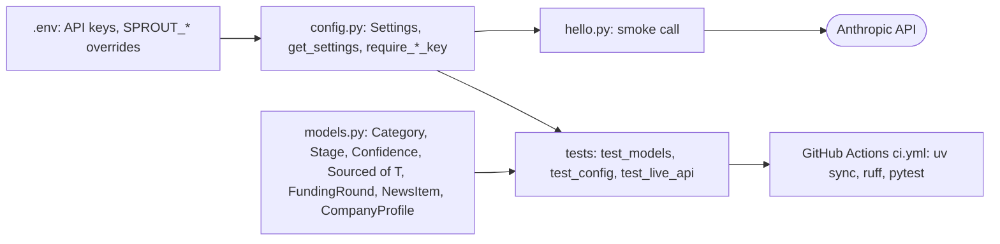

# Phase 0: Setup and definitions

Status: done, one criterion unverified. Part of the [Sprout architecture docs](README.md).

The taxonomy, stage enum, `Sourced[T]` and `CompanyProfile` are the contract every later phase depends on.

See [Status per phase](overview.md#7-status-per-phase) for outstanding items (the Claude hello call and CI action versions are unconfirmed).
