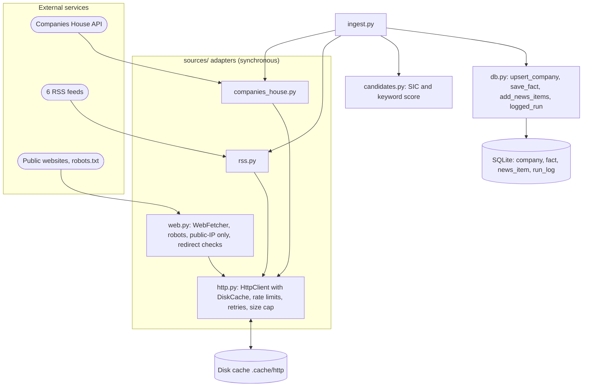

# Phase 1: Data foundations

Status: done. Part of the [Sprout architecture docs](README.md).

`WebFetcher` is not used by ingest; since Phase 2 it is called by the enrichment agent's `fetch_page` tool (see the [Phase 2 page](phase-2-enrichment.md)). Ingest writes two registry-sourced facts per company (`hq`, `founded`, confidence medium).

`candidates.py`'s `assess()` rejects non-active companies and anything incorporated before 2012-01-01, then scores the rest from the company name and SIC codes: 2 points per strong keyword match (`artificial intelligence`, `neural`, `robot*`, etc.), 1 point per weak keyword match (`ai`, `analytics`, `cognitive`, etc., which only qualify a company at all alongside a tech SIC code), plus 1 if any SIC code is in the tech set. The result is a low-cardinality score (most candidates land on 2, 3 or 5), so ties across companies are expected, not a bug.
