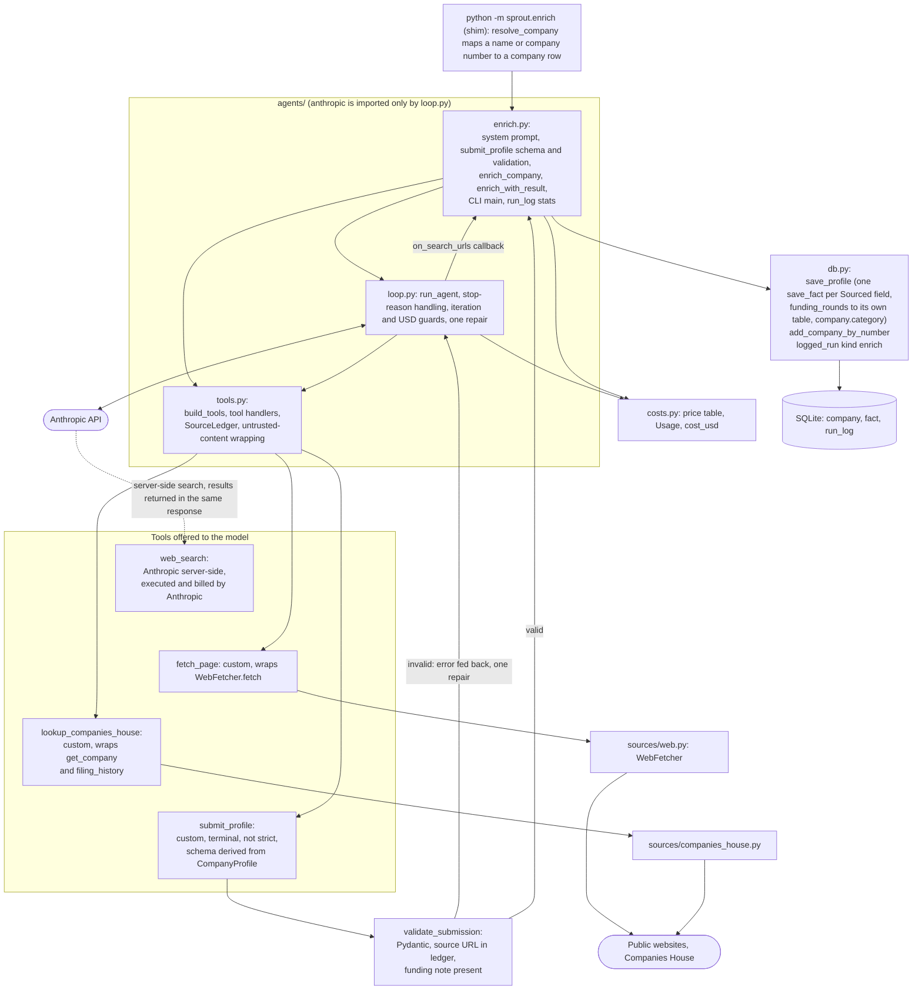
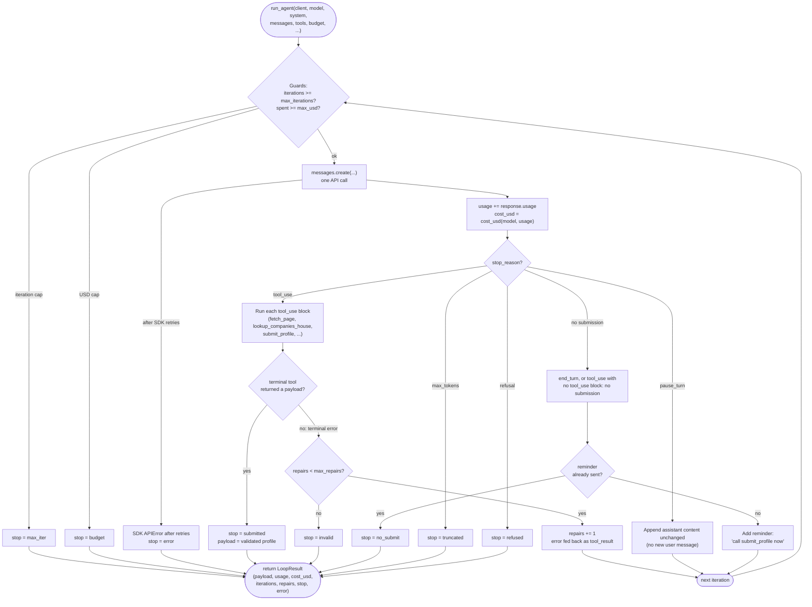

# Phase 2: Single-company enrichment agent

Status: built. Part of the [Sprout architecture docs](README.md).



## Design notes

- **Search backend (A2, D8).** Search is Anthropic's server-side `web_search` (`max_uses` 3). Any page the agent reads is fetched through our own `fetch_page`, so robots/SSRF/size/cache protections still apply; server-side `web_fetch` is not used, since it would bypass them. A custom search backend (Brave/Tavily) isn't needed while search cost stays well under target; the swap point is left open for Phase 7.
- **Swap point.** `build_tools(fetcher, ch, ledger)` in `agents/tools.py` builds the whole tool list in one place. Swapping the search tool touches only that function and the price table. The lever for lowering cost is `WEB_SEARCH_MAX_USES` (or caching search results), not the model.
- **Server-side search mechanics.** `server_tool_use` / `web_search_tool_result` blocks are appended to history unchanged (they carry encrypted content needed next turn). `pause_turn` appends the assistant content and calls again with no new user message, counting as an iteration. Search errors arrive as result blocks, not exceptions, so the model can still submit honest nulls. Search usage is added to cost, and search-result URLs reach the seen-URL ledger via an `on_search_urls` callback (the loop itself stays generic; `enrich.py` supplies the callback).
- **Models.** `claude-haiku-5-5` is the default; `claude-sonnet-5-5` via `--strong`. `tool_choice` is `auto`, with the system prompt naming `submit_profile` as the required final step. `submit_profile` is **not** `strict`, since the derived schema exceeds the API's parameter limit, so enforcement is Pydantic validation plus one repair attempt (D13). Thinking tokens count as output tokens, so they're inside the USD budget. Effort defaults to `low`, overridable with `--effort`.
- **Prompt caching.** The system block and the top-level call both set `cache_control: ephemeral`, so each iteration re-reads the growing conversation at the cheaper read price. The tool list order is fixed because it sits at the start of the cached prefix.
- **Prompt injection.** Every custom tool result is wrapped in `<untrusted_content source="URL">...</untrusted_content>` (delimiters inside the text neutralised, truncated at 8,000 characters), and the system prompt states that wrapped content is data, never instructions. Search snippets arrive unwrapped but are covered by the same system-prompt rule. No tool writes to the DB; that only happens in our code after validation. Open risk: a model-chosen URL in `fetch_page` could be used to leak context via a query string; an allow/deny list and injection fixtures are planned for Phase 4.
- **Provenance, beyond Pydantic (D11, in `validate_submission`).** `retrieved_at` is stamped by our code, never the model. `source_url` must match a URL a tool actually returned (ignoring tracking params, fragments, case, trailing slash); anything else is rejected with one repair attempt that lists citable URLs. Funding facts must carry a `note` with the original figure and currency. A source seen only in a snippet, never fetched, is capped at `medium` confidence. Null values with no source always pass.
- **`submit_profile` schema.** Generated from `CompanyProfile` via `submit_profile_schema()`: `$ref`s inlined, `name`/`news`/`retrieved_at` dropped, remaining fields made required, descriptive keywords (`title`, `default`, bounds, `format`) stripped, so numeric bounds are enforced by Pydantic only, not the schema.
- **Known non-determinism.** Occasional runs end `invalid` or `refused`. The model sometimes leaves non-USD funding amounts null despite the prompt, which is safe but understates funding coverage.

## Built interfaces (signatures as in the code)

```python
# costs.py - pure: no I/O, no imports from sprout
@dataclass(frozen=True)
class Price: input: Decimal; output: Decimal; cache_write: Decimal; cache_read: Decimal  # USD per million tokens
PRICES: dict[str, Price]       # keyed by exact model ID (haiku-5-5, sonnet-5-5); WEB_SEARCH_USD_EACH = Decimal("0.01")
@dataclass
class Usage:                   # supports +, accumulated per run
    input_tokens: int; output_tokens: int; cache_read_tokens: int; cache_write_tokens: int; web_searches: int
def cost_usd(model: str, usage: Usage) -> Decimal   # raises UnknownModelError for an unpriced model

# agents/loop.py - the only pipeline module importing anthropic
class MessagesClient(Protocol):            # what the loop needs; the test seam
    messages: Any                          # .create(**kwargs) -> response with .content, .stop_reason, .usage
def make_client(api_key: str) -> MessagesClient       # real anthropic.Anthropic, 120 s timeout, SDK retries on
@dataclass(frozen=True)
class Budget: max_iterations: int; max_usd: Decimal; max_repairs: int = 1   # validated: iterations >= 1, usd > 0
@dataclass(frozen=True)
class Tool:
    spec: dict                             # sent to the API (custom tool or server-side tool type)
    handler: Callable[[dict], ToolOutcome] | None = None   # None for server-side tools
    terminal: bool = False                 # submit_profile
@dataclass(frozen=True)
class ToolOutcome: text: str; is_error: bool = False; payload: Any = None   # payload set => accepted submission
@dataclass
class LoopResult:
    payload: Any | None; usage: Usage; cost_usd: Decimal; iterations: int; repairs: int; tool_calls: dict[str, int]
    stop: Literal["submitted","invalid","max_iter","budget","no_submit","truncated","refused","error"]
    error: str | None
def run_agent(client, *, model, system, messages, tools, budget, max_tokens, effort,
              on_search_urls: Callable[[list[str]], None] | None = None) -> LoopResult

# agents/tools.py - plain dicts and handlers; no SDK import
def build_tools(fetcher: WebFetcher, ch: CompaniesHouseClient | None, ledger: SourceLedger) -> list[Tool]
    # web_search (server-side, max_uses 3), fetch_page, lookup_companies_house (only if ch is not None); submit_profile is added by enrich.py
class SourceLedger:                               # URLs the tools returned, with first-seen time and fetched-or-snippet
    def add(url, *, fetched: bool, at: datetime | None = None); def get(url) -> LedgerEntry | None; def urls() -> list[str]
def wrap_untrusted(source_url: str, text: str, max_chars: int = 8_000) -> str    # delimiters, neutralise tags, truncate

# agents/enrich.py
DEFAULT_BUDGET = Budget(max_iterations=12, max_usd=Decimal("0.13"))   # MAX_OUTPUT_TOKENS = 6_000
@dataclass(frozen=True)
class Deps: client; fetcher; ch; settings; model: str; effort: str = "low"
def enrich_company(session, company, deps, budget=DEFAULT_BUDGET) -> CompanyProfile   # raises EnrichmentFailed(stop, cost)
def enrich_with_result(session, company, deps, budget=DEFAULT_BUDGET) -> tuple[CompanyProfile, LoopResult]
def main(argv) -> int        # python -m sprout.enrich NAME_OR_NUMBER...  --strong  --max-usd  --max-iterations  --effort  --show

# db.py additions
def save_profile(session, company, profile: CompanyProfile) -> None     # save_fact per Sourced field; company.category
def add_company_by_number(session, number: str, data: dict) -> Company   # for pilot companies absent from the 876
```

`tools.py` does not import `Deps` from `enrich.py`; `build_tools` takes the fetcher, an optional Companies House client and the ledger directly. `SourceLedger.add` takes an optional `at` so a fetched page keeps the fetcher's `retrieved_at`. The CLI also offers `--effort`, `--show` and a Companies House name search for "did you mean" hints. `Deps.ch` is `CompaniesHouseClient | None` and is dropped for a company with no number, which also drops `lookup_companies_house` from the tool list.

## Loop contract (stop-reason handling, covered by scripted-client tests)

Each iteration: check the guards, call `messages.create`, add `usage` to the running total, then act on `stop_reason`.

| Condition | Action |
|---|---|
| `tool_use` | Run each custom `tool_use` block; return all results in one user message (`tool_result`, `is_error` for failures). Handler exceptions become error strings, never raised. A terminal tool that returns a payload ends the run (`submitted`). A terminal tool that returns `is_error` is the repair path: one allowed (`max_repairs`), a second failure ends the run (`invalid`). |
| `pause_turn` | Append the assistant content unchanged and call again; counts as an iteration. |
| `end_turn` without a submission (also `tool_use` with no `tool_use` block) | One reminder to call `submit_profile`, otherwise `no_submit`. Any other unknown stop reason gives `error`. |
| `max_tokens` | `truncated` (a cut-off `tool_use` input is not trusted). |
| `refusal` | `refused`. |
| SDK `APIError` after the SDK's own retries | `error`; usage so far is still returned. |
| Guards | Checked before every call: iterations used >= `max_iterations` gives `max_iter`; spent >= `max_usd` gives `budget`. On the last allowed iteration, or once spend reaches 80 percent of the cap, the next user message adds "budget nearly used, call submit_profile now". The USD cap is soft by at most one response (cost is known only after a call); `max_tokens` bounds that overshoot, and tests assert the exact call count with a tiny cap. |

Only a validated `submit_profile` carries facts, so on any non-`submitted` stop nothing is written to `fact` or `category`; the cost is still recorded. The only per-run caps are iterations, USD, search `max_uses` (3) and the tool-result character cap.

There is no per-run fetch cap beyond the iteration cap, and no partial profile is ever written on a cap stop. There is also no batch-level USD cap yet: the CLI enforces `--max-usd` per company and only prints the total, so a long target list can spend `n * max_usd`. A `BatchBudget` is planned for Phase 4 (see the [Phase 4 page](phase-4-evals-guardrails.md), D24) so the evals have a batch cap, and the Phase 5 orchestrator must reuse it.

## Inside `loop.py`: the iteration state machine

The table above as a flowchart, one pass per iteration; "next iteration" loops back to the guard check at the top.



## Other notes

- Agents receive a client through a `Deps` dataclass; tests inject a scripted fake client (see [Testing](cross-cutting.md#44-testing)).
- Tool handlers return error outcomes and never raise into the loop (`run_agent` also catches any handler exception and turns it into an error result).
- `enrich_with_result` writes facts and the `enrich` run_log row in one session: it assigns `run.stats` and **commits before raising** on failure, because `logged_run` rolls back on exceptions and would otherwise discard the stats that record what a failed run cost; on success it then calls `save_profile`. On failure `logged_run` also marks the row `status="error"` with the exception text, while the stats stay on the row. Note the status therefore means "run did not produce a profile", and `stats.stop` says why.
- Move `app/queries.py` to `sprout/queries.py` (keep a re-export) before Phase 7 so MCP does not import from the UI package.

Planned Phase 5/7 modules that build on this phase are on the [Phase 5 page](phase-5-multi-agent.md).
