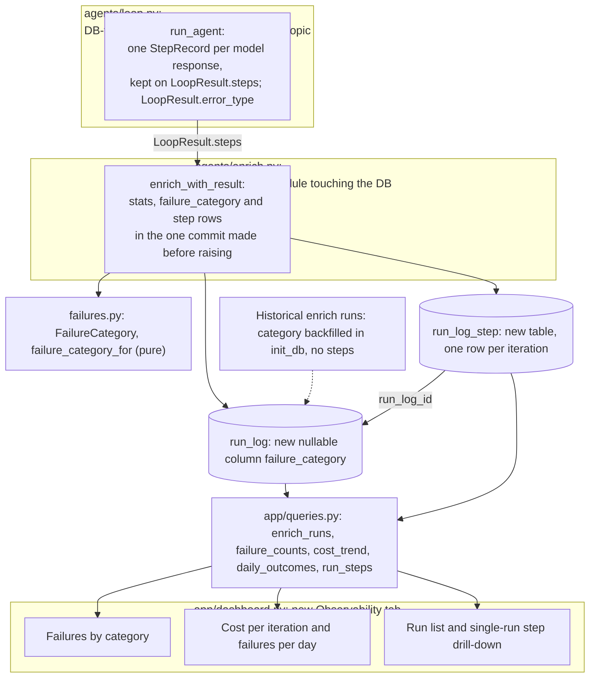

# Phase 3: Observability (design, not built)

Part of the [Sprout architecture docs](README.md). Designed on 2026-10-28 (the plan added this phase after Phase 2 and before Phase 4, so the golden set and thresholds can be informed by real failure patterns). Nothing here exists in code; the implementation split is at the end of this page. The phase is three independently verifiable pieces: (a) backend (schema, `failures.py`, loop and enrich wiring), (b) UI (queries and the dashboard tab), (c) an analysis step that uses a fresh batch of logged runs to review the [Phase 4](phase-4-evals-guardrails.md) design.



- **Shape in one paragraph:** `loop.py` records one `StepRecord` per model response in memory and returns the list on `LoopResult`; it still imports no database code and the loop never reads the records, so behaviour cannot change. `enrich.py` persists them as `run_log_step` rows, together with the stats and a new `run_log.failure_category`, in the single commit it already makes before raising, so steps survive a failed run. The dashboard reads both tables through five new `app/queries.py` functions.
- **Options compared:**

| Decision | Option | For | Against | Verdict |
|---|---|---|---|---|
| Where steps live | JSON list in `run_log.stats` | No new table | Dashboard must load and parse a growing blob to show one run; cannot filter by tool or aggregate tokens in SQL; blob grows with Phase 5 workers | Rejected (plan's fallback) |
| | New `run_log_step` child table | Drill-down is one indexed lookup; steps stay queryable; consistent with `fact` and `funding_round` being split out; additive (`create_all`) | One more table and a few more columns | Recommended (D27) |
| How the loop emits steps | Optional `on_step` callback persisting each iteration | Survives a process crash mid-run; foundation for live per-worker progress | Loop behaviour now depends on a caller callback that can raise or block on SQLite; a mid-run DB write per iteration for no Phase 3 need; the stats row is written only at the end anyway, so a crashed run would have steps but no stats | Not now: add it in Phase 5 if live progress is needed (an additive parameter) |
| | `LoopResult.steps` list built in memory, persisted by `enrich.py` after `run_agent` returns | No new parameter or callback; cannot change loop behaviour; steps and stats land in one commit so they are consistent; trivially testable with `ScriptedClient` | A hard process kill mid-run loses that run's steps, as it already loses its stats | Recommended (D29) |
| | `loop.py` imports `db` and writes rows | Simplest wiring | Breaks the DB-free loop and the single-`anthropic`-import layering; the Phase 4 judge and Phase 5 agents would write rows too | Rejected |
| Failure grouping | Value only inside `stats` JSON | No schema change | Every dashboard grouping parses JSON; no cheap filter | Rejected |
| | Real nullable column `run_log.failure_category` | Plain `GROUP BY` and filter; works for every `kind` | One more additive column; taxonomy lives in code, not the database | Recommended (D28) |

- **Ordering note:** [Phase 4](phase-4-evals-guardrails.md) was designed before this phase. Step (c) of the plan may therefore reopen parts of it (golden-set stratification, the profiles-submitted floor, the `GATES` values). Do not edit those numbers from findings without the user; record the proposal in `implementation-notes.md` and A30 (see [Plan ambiguities](risks.md#62-plan-ambiguities)).

## Design: files that change

| File | Change |
|---|---|
| `src/sprout/failures.py` (new, pure) | `FailureCategory` and `failure_category_for(stop)` (below) |
| `src/sprout/agents/loop.py` | `StepRecord`, `LOGGED_TEXT_MAX_CHARS`, `LoopResult.steps` and `LoopResult.error_type`; step bookkeeping inside `run_agent`. No new import beyond `datetime`; no new parameter |
| `src/sprout/db.py` | `RunLog.failure_category`; `RunLogStep` table; backfill step in `init_db`; `logged_run` fallback to `internal_error` |
| `src/sprout/agents/enrich.py` | `_stats` gains `error_type`; set `run.failure_category`; build and add `RunLogStep` rows before the existing pre-raise `session.commit()` |
| `src/sprout/app/queries.py` | five read functions (below) |
| `src/sprout/app/dashboard.py` | `render_observability` and the new tab |
| Tests | `test_failures.py` (new), additions to `test_agent_loop.py`, `test_enrich.py`, `test_db.py`, `test_app_queries.py`, `test_dashboard.py` (the tab-label assertion changes) |

## Failure taxonomy (`failures.py`)

Eight fixed values, one per non-success outcome. The plan's "stop reason, error type" are the only two dimensions; `invalid` is deliberately not split by sub-reason (A28). A success is **NULL**, not a `'none'` value: `WHERE failure_category IS NOT NULL` is then exactly "failed runs", a `GROUP BY` never charts a fake "none" bar, and `ingest_*` runs (which have no failure concept) need no value. The cost is that a historical failed row and a success are both NULL until the backfill runs, which is why `init_db` backfills (below).

| `LoopResult.stop` or event | `failure_category` | Meaning and usual remedy | `stats.error_type` |
|---|---|---|---|
| `submitted` | NULL | success (a repair that succeeded is still success; see `stats.repairs`) | null |
| `invalid` | `invalid_output` | validation failed twice (invented source URL, missing funding note, schema); prompt or validator | null |
| `max_iter` | `iteration_cap` | agent still researching at the cap; prompt, cap or tool design | null |
| `budget` | `budget_cap` | USD cap reached; cap or effort | null |
| `no_submit` | `no_submission` | stopped without calling `submit_profile` after one reminder; prompt | null |
| `truncated` | `output_truncated` | response hit `max_tokens`; `MAX_OUTPUT_TOKENS` or effort | null |
| `refused` | `refusal` | model declined (often transient) | null |
| `error` from an `anthropic.APIError` | `api_error` | infrastructure after SDK retries (429, 5xx, timeout, 400) | exception class name, e.g. `RateLimitError` |
| `error` from an unrecognised `stop_reason` | `api_error` | SDK or API drift the loop does not handle | `unexpected_stop_reason` |
| an exception outside the loop (for example `save_profile` or a DB error) | `internal_error` | our bug; set by `logged_run` when the category is still NULL | exception class name (also in `run_log.error`) |

```python
# failures.py - pure, no sprout imports
class FailureCategory(StrEnum):   # values as in the table
    INVALID_OUTPUT = "invalid_output"; ITERATION_CAP = "iteration_cap"; BUDGET_CAP = "budget_cap"
    NO_SUBMISSION = "no_submission"; OUTPUT_TRUNCATED = "output_truncated"; REFUSAL = "refusal"
    API_ERROR = "api_error"; INTERNAL_ERROR = "internal_error"
def failure_category_for(stop: str) -> FailureCategory | None   # "submitted" -> None; an unknown stop -> INTERNAL_ERROR (visible, not silent)
```

The column is `str | None`, not a SQL enum (the same reasoning as `company.category`, D15 and the [data model](overview.md#34-data-model): no CHECK constraint to fight `ALTER`). New categories in Phase 5 (for example a rate-limit category when the worker pool retries 429s) are code-only additions. The dashboard iterates the distinct values found, ordered by `FailureCategory` declaration order with unknown values last, so an old DB or a new value never breaks the page. **No index** on `failure_category`: `create_all` does not add indexes to an existing table, so `index=True` would exist on fresh DBs and not on migrated ones, and at a few hundred rows an index is pointless (the same call as `company.category`).

**Error text and the model's response are drill-down only:** the full `run_log.error`, `stats.error`, and `run_log_step.response_text` are shown on the single-run view; no chart or `GROUP BY` uses them.

## `run_log_step` (new table)

One row per **iteration**, meaning one `messages.create` call and the response it returned. This equals `LoopResult.iterations`; a call that raised `APIError` produces no step (the failure is on the run row: `api_error`, `error_type`).

| Column | Type | Null | Notes |
|---|---|---|---|
| `id` | int PK | no | |
| `run_log_id` | int FK `run_log.id` | no | `UNIQUE (run_log_id, iteration)`; its index serves the drill-down lookup, so no separate index |
| `iteration` | int | no | 1-based, equals the loop's iteration count after the call |
| `created_at` | datetime (UTC) | no | stamped by the loop when the response arrived (a stamp at persist time would be the same instant for every step) |
| `stop_reason` | str | yes | the API's `stop_reason` for this response (`tool_use`, `pause_turn`, `end_turn`, ...); shows pauses and reminders |
| `tool_name` | str | yes | tools called in this response, comma-joined in order of appearance, duplicates kept (`web_search,fetch_page,fetch_page`); NULL when none. See below |
| `tool_errors` | int | no, default 0 | custom tool results returned with `is_error` in this iteration (blocked page, rejected submission) |
| `input_tokens`, `output_tokens`, `cache_read_tokens`, `cache_write_tokens` | int | no | this response's `Usage`. The plan says "prompt/response token counts"; with prompt caching fresh `input_tokens` is a few hundred while the cache columns carry the real prompt size, so all four are kept. Thinking tokens are in `output_tokens` |
| `web_searches` | int | no | server-side searches billed in this response |
| `cost_usd` | float | no | `cost_usd(model, step usage)`, rounded to 6 places like `stats.cost_usd`; the steps sum to the run total within rounding |
| `response_text` | str | yes | text blocks only, truncated (below). Thinking blocks and `tool_use` inputs are not logged |

**How a step maps to tool blocks.** A response can hold several `tool_use` blocks (all run, all answered in one user message), and the server-side `web_search` arrives in the same response as `server_tool_use`/`web_search_tool_result` blocks, often followed by a custom `fetch_page` `tool_use`. A step is the response, not a tool call: `tool_name` lists every `server_tool_use` and `tool_use` block name in order, tokens and cost belong to the response (they cannot be split per tool), and `tool_errors` counts failed custom results. A `pause_turn` response is a step with `tool_name` `web_search` and no custom tools. Per-tool-call rows were rejected: they would duplicate the response's tokens or leave them unowned. If a per-tool view is ever needed, `tool_name` is splittable on commas.

```python
# agents/loop.py additions (DB-free)
LOGGED_TEXT_MAX_CHARS = 1_000


@dataclass
class StepRecord:
    iteration: int
    at: datetime
    stop_reason: str | None
    tool_names: tuple[str, ...]
    tool_errors: int
    usage: Usage
    cost_usd: Decimal
    response_text: str


# LoopResult gains: steps: list[StepRecord] = []  and  error_type: str | None = None
```

Loop bookkeeping: right after `result.iterations += 1` and the usage update, build the `StepRecord` from `response` with `getattr` defaults (same defensive style as `_usage_of`), append it to `result.steps`, and increment `step.tool_errors` immediately after each `_run_tool` call (before the terminal-tool early returns, so a rejected submission is counted). Set `error_type` in the two places `finish("error", ...)` is called. The loop never reads `steps`, makes no extra API call and does no I/O. Invariants for tests: `len(steps) == iterations`; the sum of step usage equals `result.usage`; every existing scripted-client test passes unchanged.

## Truncation and untrusted-content treatment

- `response_text` is the model's `text` blocks joined with a newline, cut to **1,000 characters** with a trailing ` [truncated]` marker. Worst case about 12 KB per run, under 2 MB for 150 runs. The cap is a module constant, below `wrap_untrusted`'s 8,000 because this is a diagnostic hint, not model context.
- The model may echo scraped page text, so the logged text is **untrusted data**. It is stored verbatim up to the cap (no sanitising that could hide an attack), never interpolated into any prompt, and, if the Phase 4 judge or a Phase 5 agent ever reads it, it goes through `wrap_untrusted`. In Streamlit it is rendered only with `st.code`, `st.text` or dataframe cells, never `st.markdown` and never `unsafe_allow_html` (Markdown would render an attacker's image URL and make the viewer's browser fetch it). The same rule covers `run_log.error` and `stats.error`.
- The snapshot database that Phases 6 and 8 may publish (D11, A9 in the overview) will contain these strings; truncation bounds the exposure and there are no secrets in the agent's context.

## Who persists steps, and when

```
result = run_agent(...)                        # steps accumulate in memory
run.stats = _stats(...)                        # + error_type
run.failure_category = failure_category_for(result.stop)      # None on success
session.add_all(RunLogStep rows from result.steps, run_log_id=run.id)
session.commit()                               # the existing commit that already precedes the raise
if result.stop != "submitted" or not accepted: raise EnrichmentFailed(...)
save_profile(...)
```

`logged_run` rolls back on an exception, but the stats, category and steps were already committed by `enrich_with_result` (the pattern Phase 2 introduced for stats), so a failed run keeps all three. `logged_run` itself gains one line in its `except` branch: if `run.failure_category` is still NULL, set it to `internal_error` (this covers `save_profile` raising after a `submitted` stop; for `EnrichmentFailed` the category is already committed, and the generic fallback also labels a failed `ingest_*` run, which is acceptable). Step rows are built by a private helper in `enrich.py` (it already imports the db models); `db.py` never imports `StepRecord`, so the dependency still points `agents` to `db`. A step-insert failure is a DB error and surfaces as a failed run, which is intended (a broken log should be loud); `run_agent` has finished by then, so enrichment behaviour is unaffected. Cost: one INSERT batch of at most `max_iterations` (12) small rows inside a commit that already happens.

## Migration (additive, D15) and historical runs

- `create_all` creates `run_log_step` on an existing DB; `_add_missing_columns` adds `run_log.failure_category` (nullable, plain). No Alembic, no reset. Covered by an extended `test_init_db_adds_new_columns_to_an_old_database_and_keeps_rows`.
- `init_db` then runs an idempotent backfill: for `kind='enrich'` rows with a NULL category and a `stats.stop` other than `submitted` (or `status='error'` with no `stop`, which maps to `internal_error`), set the category from `failure_category_for`. When checked on 2026-10-28 `data/sprout.db` held 40 `enrich` rows (31 `submitted`, 7 `invalid`, 1 `refused`, 1 `error`; the brief said 30, the count has grown since). The backfill is a few hundred rows in Python and safe to run on every start.
- Historical runs have **no steps** and are not fabricated from `stats`. The dashboard shows them in the failure grouping and the cost trend (both come from `stats` and the column), and in the drill-down shows their run-level stats with a note. Rule for the note: no step rows and `stats.iterations > 0` means "this run predates step logging (Phase 3), run-level stats only"; no step rows and `iterations == 0` means "no model response was received".

## Query layer (`app/queries.py`, Streamlit-free, tested on a seeded temp DB)

```python
@dataclass(frozen=True)
class EnrichRun:
    run_id: int; started_at: datetime; company_id: int | None; company_name: str | None
    model: str | None; status: str; stop: str | None; failure_category: str | None; error_type: str | None
    iterations: int; cost_usd: float; web_searches: int; steps_logged: int; error: str | None; stats: dict
@dataclass(frozen=True)
class TrendPoint: run_id: int; started_at: datetime; cost_usd: float; iterations: int; cost_per_iteration: float | None; failed: bool
@dataclass(frozen=True)
class DayOutcome: day: date; runs: int; failures: int; cost_usd: float

def enrich_runs(session, *, failure_category: str | None = None, failures_only: bool = False, limit: int = 200) -> list[EnrichRun]   # kind='enrich', newest first
def failure_counts(session) -> dict[str, int]                 # category -> runs, failed runs only, largest first
def cost_trend(session, *, limit: int = 200) -> list[TrendPoint]   # oldest first; cost_per_iteration None when iterations == 0
def daily_outcomes(session) -> list[DayOutcome]               # the error trend
def run_steps(session, run_id: int) -> list[RunLogStep]       # ordered by iteration
```

Aggregation happens in Python over a few hundred `enrich` rows (company name joined from `stats.company_id`; `steps_logged` from one grouped count over `run_log_step`), so no JSON SQL functions are needed and tolerant parsing of missing `stats` keys (an old or crashed row with `{}`) is in one place. `failed` means `failure_category IS NOT NULL`. These are the first functions the Phase 6 service layer and the Phase 7 MCP server could reuse for run status (`app/queries.py` moves to `sprout/queries.py` before Phase 7).

## Dashboard tab (`app/dashboard.py`)

A new `render_observability` tab named **Observability**, placed after News and before the actions-gated Run & test. The current code pairs tab names with renderers by position (`zip(tabs, renderers, strict=False)`), so build a list of `(name, renderer)` pairs when adding it; otherwise the conditional Run & test tab silently takes the wrong renderer. Layout: summary metrics (runs, failed, total cost, mean cost per iteration); **Failures by category** (bar chart plus table from `failure_counts`); **Trends** (line chart of `cost_per_iteration` per run, bar chart of failures per day); **Runs** (dataframe from `enrich_runs`, filterable by category and "failures only"); **Run detail** (select a run: run stats, then a steps dataframe and one `st.code` expander per step for `response_text`, and the raw error in `st.code`).

| State | Behaviour |
|---|---|
| No `enrich` rows | `st.info` pointing at `uv run python -m sprout.enrich NAME_OR_NUMBER` and nothing else rendered |
| Runs but none failed | `st.success("No failed runs")`; the category chart is omitted, not empty |
| Selected run has no steps, `iterations > 0` | run-level stats plus the "predates step logging" note |
| Selected run has no steps, `iterations == 0` | "No model response was received" and the error text |
| Run with `stats == {}` (still running or crashed before stats) | row shown with blanks and its `status`, no crash |

## Implementation split

Backend and UI are independent enough to build and verify separately; the UI can be developed against hand-seeded rows once the `db.py` part of step 3a lands.

| Step | Scope | Acceptance |
|---|---|---|
| 3a Backend (about 3 h) | `failures.py`; `db.py` (column, table, backfill, `logged_run` fallback); `loop.py` `StepRecord`, `steps`, `error_type`; `enrich.py` wiring; tests for each | `uv run pytest` and `ruff check` pass; scripted tests show `len(steps) == iterations`, summed step usage equals `result.usage`, multi-tool and server-side tool names, `tool_errors`, truncation at the cap, steps and category committed for every non-success stop, `response_text` never longer than the cap plus marker; existing loop and enrich tests pass unchanged; old-DB migration and backfill test. Live check: enrich 2 companies, `SELECT iteration, tool_name, cost_usd FROM run_log_step WHERE run_log_id = ?`, then `--max-iterations 2` on a third gives a deterministic `iteration_cap` row with its two steps |
| 3b UI (about 1.5 h) | five `queries.py` functions; `render_observability` and the tab; tests | query tests on a seeded DB (grouping, trend, daily, ordering, tolerance of `stats == {}`); `streamlit.testing` smoke tests for the empty, populated, no-steps and failed-run states; tab list assertion updated; `st.markdown` is not used for logged text |
| 3c Findings (about 0.5 h, plus live spend) | run a fresh batch (suggest 20 candidates with the highest `candidate_score` that are not pilot companies, about US$0.30 at the measured average), read the tab, write a findings note in `implementation-notes.md`: failure mix, cost outliers, tool-error rates, which stops need which fix | A short table of findings and a list of proposed Phase 4 adjustments (golden-set stratification, the profiles-submitted floor, gate values) for the user to approve; no Phase 4 number is changed silently |

## What Phase 5 needs (hooks only, nothing built)

- Each Phase 5 agent run (`classify`, `news`, `verify`) gets its own `run_log` row with its own `kind`, so `run_log_step` is reused unchanged and needs no agent column; `failure_category` is a free-text column, so worker-level categories (rate-limit, cancelled) are code additions.
- Steps are written once per run by that worker's own session after `run_agent` returns, so concurrent workers never interleave rows in one run. SQLite's single writer still serialises commits; the orchestrator should keep commits short (this design makes each run's step insert one small batch).
- Live per-worker progress (for example "worker 3 is on iteration 5") is not possible with end-of-run persistence. If Phase 5 wants it, add an optional `on_step` callback to `run_agent` (additive) and persist each step as it arrives; the table already supports it.
- Per-company status (`enrichment_state`, A4) will reference `run_log.id`; the company link stays in `stats.company_id` until then. Add a nullable `run_log.company_id` (additive) at that point rather than now (A31).
