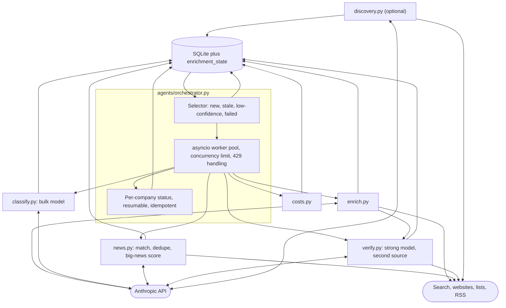

# Phase 5: Multi-agent pipeline (planned)

Part of the [Sprout architecture docs](README.md).



- The orchestrator is deterministic scheduling code, not an LLM supervisor (D4, see [decisions](decisions.md)).
- `HttpClient` is synchronous and not thread-safe: one client per worker, locking, or `asyncio.to_thread`.
- **[AMBIGUOUS]** Verifier ordering: run after the enricher, only for companies with a funding or stage claim.
- **[AMBIGUOUS], resolved by the renumbering:** "add an agent only if evals improve" needs evals first, and evals are now Phase 4, before this phase. Nothing needs pulling forward; judge each added agent by its Phase 4 eval deltas (D9).

## Planned modules (interfaces are proposals; the [Phase 4](phase-4-evals-guardrails.md) modules are specified there)

```python
# agents/classify.py
def classify(company, deps) -> Classification
# agents/news.py
def collect_news(company, deps) -> list[ScoredNews]
# agents/verify.py
def verify_funding(company, claims, deps) -> list[Verification]
# agents/orchestrator.py
async def run(limit, concurrency, budget, force=False) -> RunSummary
# sprout/queries.py (extracted from app/queries.py)
search_companies(...); get_company(name); latest_news(...)
```

- Agents receive a client through a `Deps` dataclass; tests inject a scripted fake client (see [Testing](cross-cutting.md#44-testing)).
- Tool handlers return error outcomes and never raise into the loop (`run_agent` also catches any handler exception and turns it into an error result).
- Move `app/queries.py` to `sprout/queries.py` (keep a re-export) before Phase 7 so MCP does not import from the UI package.

This phase reuses the generic agent loop, tool pattern and cost accounting built in [Phase 2](phase-2-enrichment.md) (D17), and must adopt the `BatchBudget` designed in [Phase 4](phase-4-evals-guardrails.md) (D24) before running 150 companies. The hooks Phase 3's step logging leaves for this phase are listed at the end of the [Phase 3 page](phase-3-observability.md#what-phase-5-needs-hooks-only-nothing-built).
