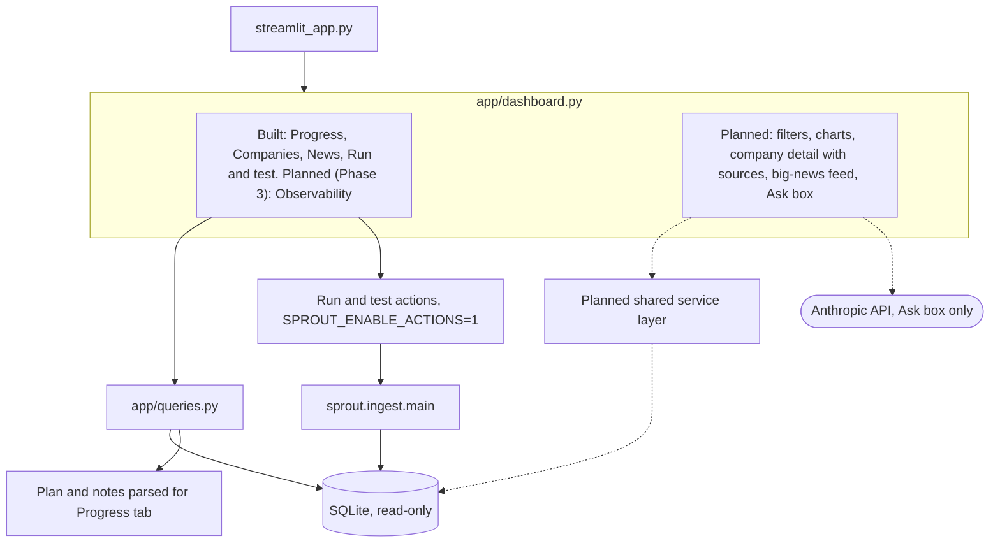

# Phase 6: Dashboard

Status: partial (progress and test console exists). Part of the [Sprout architecture docs](README.md).

The Observability tab planned for Phase 3 is specified on the [Phase 3 page](phase-3-observability.md#dashboard-tab-appdashboardpy). The winning-value rule (needed before this phase reads facts) and the service-layer extraction are D10 and A17 in the [overview](overview.md).
