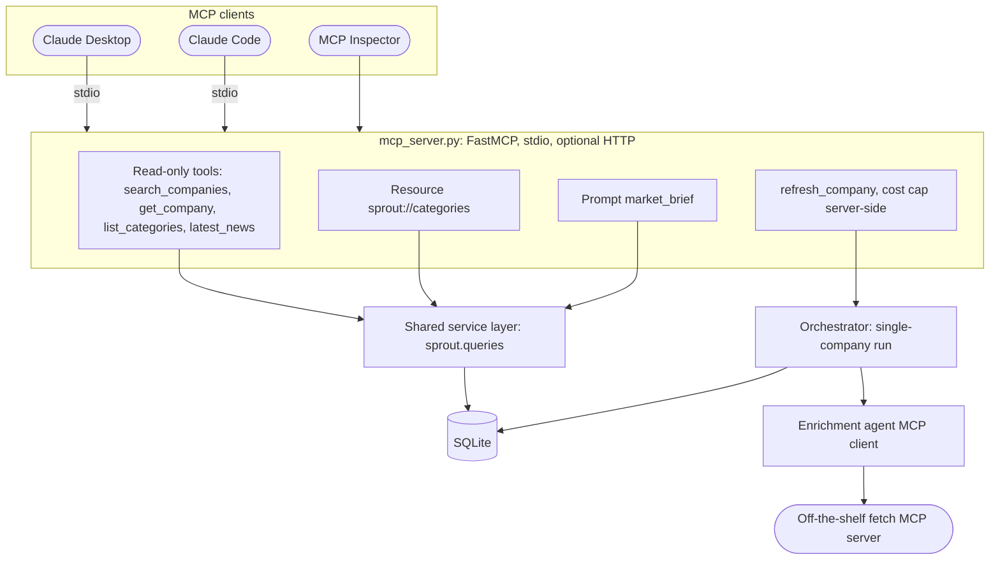

# Phase 7: MCP server (planned)

Part of the [Sprout architecture docs](README.md).

- A stdio server must never write to stdout; log to stderr.
- **[AMBIGUOUS]** Replacing `fetch_page` with a third-party MCP server discards `WebFetcher` protections (see A1 in [risks and ambiguities](risks.md)). Wrap `WebFetcher`, or keep the replacement behind a flag.
- **[AMBIGUOUS]** `refresh_company` is a model-invoked paid write (A14 in [risks and ambiguities](risks.md)). Keep it on the MCP server only, never in the enrichment agent's tools (D12 in [decisions](decisions.md)). Add a cooldown and return status plus cost rather than blocking.

`app/queries.py` moves to `sprout/queries.py` (built in [Phase 2](phase-2-enrichment.md), extended in [Phase 3](phase-3-observability.md)) before this phase, so MCP does not import from the UI package.
