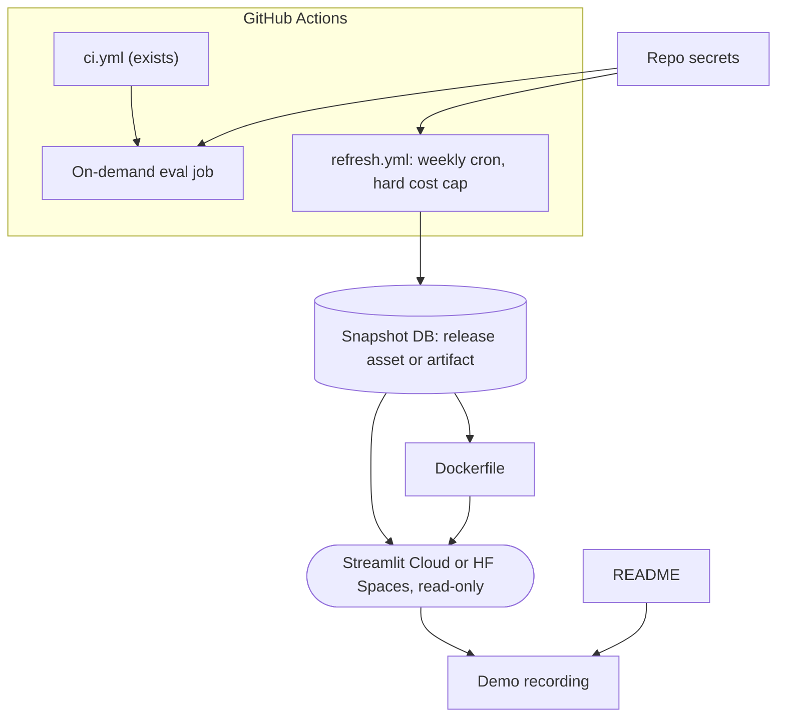

# Phase 8: Automation, deployment, docs (planned)

Part of the [Sprout architecture docs](README.md).

Snapshot delivery (A28 in [risks and ambiguities](risks.md)) and data licensing/robots recheck are open before this phase.
