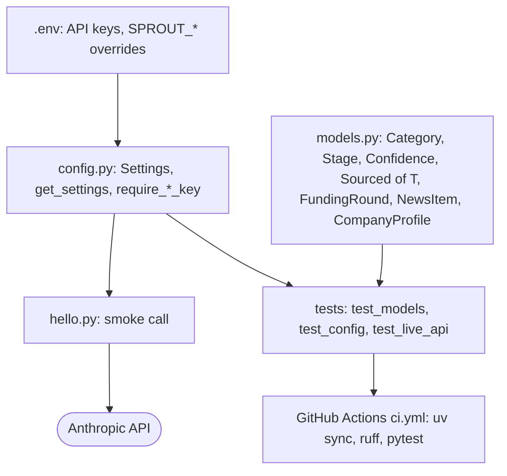

# Phase 0: Setup and definitions

Status: done. Part of the [Sprout architecture docs](../README.md).

The taxonomy, stage enum, `Sourced[T]` and `CompanyProfile` are the contract every later phase depends on.

| Name | What it is | Why it matters |
|---|---|---|
| `Category` (taxonomy) | Fixed 19-value enum (18 sectors plus `Other`), frozen in Phase 0 | Every profile's grouping; changing it after classifications or the golden set exist invalidates both, so it stays small and stable |
| `Stage` | Enum: Pre-seed through Series F, Growth, Unknown | Funding stage for the company and for each `FundingRound`; `Unknown` is a valid, sourced-or-not value |
| `Sourced[T]` | Generic wrapper: `value`, `source_url`, `retrieved_at`, `confidence`, optional `note` | Carries provenance for every fact. `value=None` means "not disclosed" and is always valid; a non-null value without `source_url` fails validation, enforcing "provenance over completeness" in code, not just in prompts |
| `Confidence` | Enum: `low`, `medium`, `high` | The `confidence` field on every `Sourced[T]`; defaults to `low`. A source seen only in a search snippet and never fetched is capped at `medium` (see [Phase 2](phase-2-enrichment.md)) |
| `CompanyProfile` | The top-level pydantic model (listed below) | The one object every enrichment run produces and every later phase (DB, dashboard, MCP) reads |

All four reject unknown fields (`extra="forbid"`), so malformed model output fails validation instead of being silently accepted.

### `Category` values (20, frozen)

| # | Category | | # | Category |
|---|---|---|---|---|
| 1 | Fintech and payments | | 11 | Semiconductors and AI hardware |
| 2 | Enterprise software and cloud | | 12 | Robotics and automation |
| 3 | Data, AI infrastructure and developer tools | | 13 | Defense, aerospace and space |
| 4 | Sales, marketing and customer experience software | | 14 | E-commerce and retail tech |
| 5 | HR and people software | | 15 | Consumer social, media and gaming |
| 6 | Cybersecurity | | 16 | Logistics and supply chain |
| 7 | Biotech and pharma | | 17 | Deep tech and quantum |
| 8 | Healthtech and digital health | | 18 | Consultancy and services |
| 9 | Electric vehicles and batteries | | 19 | Legal tech and compliance |
| 10 | Climate, energy and cleantech | | 20 | Other |

### `CompanyProfile` fields

| Field | Type | Notes |
|---|---|---|
| `name` | `str` | Required, non-empty |
| `website` | `Sourced[str]` | |
| `hq` | `Sourced[str]` | |
| `founded` | `Sourced[int]` | Bounded 1800-2100 |
| `category` | `Category` | Plain enum, not `Sourced`: a classification against the taxonomy, not a fact with a source. Defaults to `Other` |
| `stage` | `Sourced[Stage]` | |
| `total_raised_million_usd` | `Sourced[int]` | `>= 0` |
| `valuation_million_usd` | `Sourced[int]` | `>= 0` |
| `funding_rounds` | `list[Sourced[FundingRound]]` | Each round (stage, amount, announced date, investors) carries its own source, so rounds can come from different pages |
| `business_model` | `Sourced[str]` | |
| `target_user` | `Sourced[str]` | |
| `one_liner` | `Sourced[str]` | |
| `news` | `list[NewsItem]` | Not `Sourced`; each `NewsItem` carries its own `title`, `url`, `published`, `summary`, `source` |
