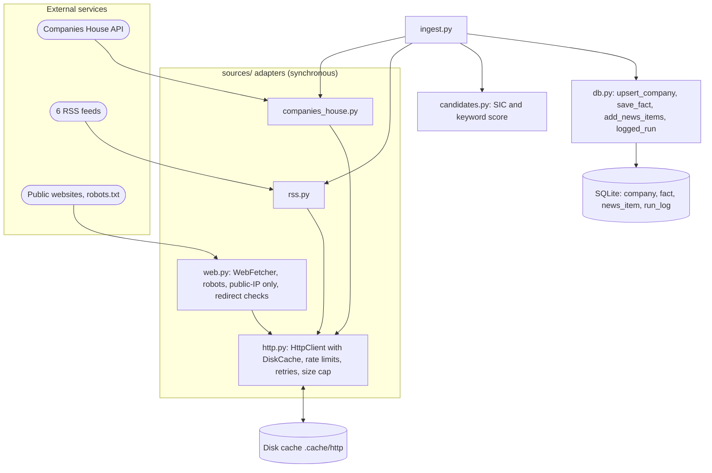

# Phase 1: Data foundations

Part of the [Sprout architecture docs](../README.md). Status: see [7. status.md](../7.%20status.md).

`WebFetcher` is not used by ingest; since Phase 2 it is called by the enrichment agent's `fetch_page` tool (see the [Phase 2 page](phase-2-enrichment.md)). Ingest writes two registry-sourced facts per company (`hq`, `founded`, confidence medium).

`db.py` grows past this phase: `funding_round` is added in Phase 2 (written by `save_profile`, see the [Phase 2 page](phase-2-enrichment.md)) and `run_log_step` in Phase 3 (written by `enrich.py` after a loop run, see the [Phase 3 page](phase-3-observability.md)). Ingest itself never writes to either table; the diagram above only shows what the Phase 1 flow touches.

## Key files

`ingest.py`

| Aspect | Detail |
| --- | --- |
| Entry point | <ul><li>One command, `python -m sprout.ingest`</li><li>Companies and news run as two independent pipelines; one failing doesn't block the other</li></ul> |
| Behaviour | <ul><li>Dedupes company numbers seen within the run</li><li>Filters each hit through `assess()` before upserting</li><li>Writes registry facts (HQ locality, founding year) sourced to the public register page</li></ul> |

`candidates.py`

| Aspect | Detail |
| --- | --- |
| Purpose | <ul><li>Heuristic filter only, produces *candidates*, not verified AI companies</li></ul> |
| Rules | <ul><li>Hard reject: non-active status, or incorporated before 2012-01-01</li><li>Strong keywords ("machine learning", "neural", etc.) qualify a company alone</li><li>Weak keywords ("ai", "analytics", etc.) only qualify alongside a tech SIC code</li></ul> |

`sources/companies_house.py`

| Aspect | Detail |
| --- | --- |
| Auth & limits | <ul><li>HTTP Basic, API key as username, empty password</li><li>Rate-capped at 550 calls/5min</li></ul> |
| Pagination | <ul><li>`iter_advanced_search` pages until a page comes back short, since the API reports no total count</li></ul> |
| 404s | <ul><li>Treated as "not found", not an error</li></ul> |

`sources/http.py`

| Aspect | Detail |
| --- | --- |
| Role | <ul><li>The one GET implementation shared by every source (Companies House, RSS, web fetcher)</li></ul> |
| Caching | <ul><li>Disk cache keyed by a hash of URL + params</li><li>Caches both 2xx and 404 responses</li></ul> |
| Resilience | <ul><li>Per-host sliding-window rate limiting</li><li>Retries with backoff, honouring a server's `Retry-After` header</li><li>Size cap aborts oversized responses</li></ul> |

`sources/rss.py`

| Aspect | Detail |
| --- | --- |
| Feeds | <ul><li>6 fixed sources (Sifted, UKTN, Tech.eu, Guardian AI, TechCrunch Startups, BBC Technology)</li></ul> |
| What's kept | <ul><li>Only title, link, and a short summary, never full article bodies</li></ul> |
| Dedup | <ul><li>Strips tracking params so the same article reached via different links dedupes to one URL</li></ul> |

`sources/web.py`

| Aspect | Detail |
| --- | --- |
| Role | <ul><li>General-purpose fetcher for untrusted URLs (scraped content, not RSS or Companies House)</li></ul> |
| SSRF protection | <ul><li>Resolves every host, and every redirect hop, to a public IP</li><li>Blocks localhost, private ranges, and link-local/metadata addresses</li></ul> |
| Politeness | <ul><li>Honours `robots.txt` per origin</li><li>Rate-limits per host</li></ul> |
| Output | <ul><li>Strips HTML to plain text with a size cap</li></ul> |

`db.py`

| Aspect | Detail |
| --- | --- |
| Role | <ul><li>SQLModel schema plus the write helpers ingestion needs (`upsert_company`, `save_fact`, `add_news_items`, `logged_run`)</li></ul> |
| Phase 1 tables | <ul><li>`company`, `fact`, `news_item`, `run_log`</li><li>`funding_round` and `run_log_step` also live here but are written only from Phase 2 and Phase 3 onward, not by ingest</li></ul> |
| Identity | <ul><li>`upsert_company` dedupes on Companies House `company_number`, not name (names change, numbers don't)</li></ul> |
| `save_fact` | <ul><li>Replaces an existing row for the same `(company_id, field, source_url)`; a NULL `value_json` means "researched, nothing found", not "never tried"</li></ul> |
| Migrations | <ul><li>`init_db` creates missing tables and adds missing nullable columns to an existing database via `ALTER TABLE`</li><li>Raises if a needed change is not a plain nullable column, so a schema break surfaces instead of silently corrupting data</li></ul> |
