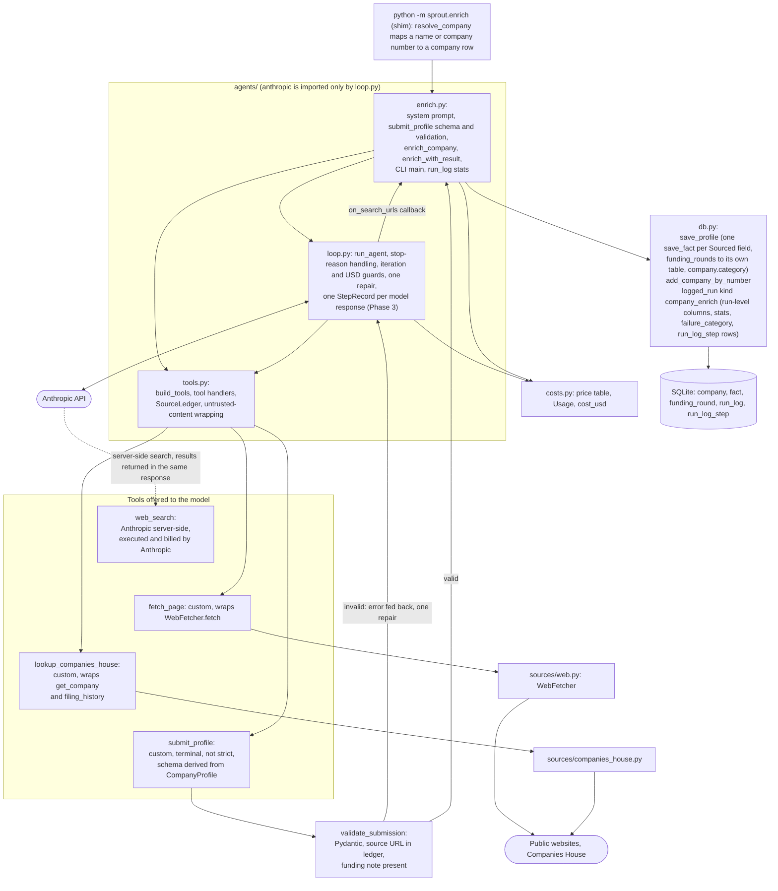
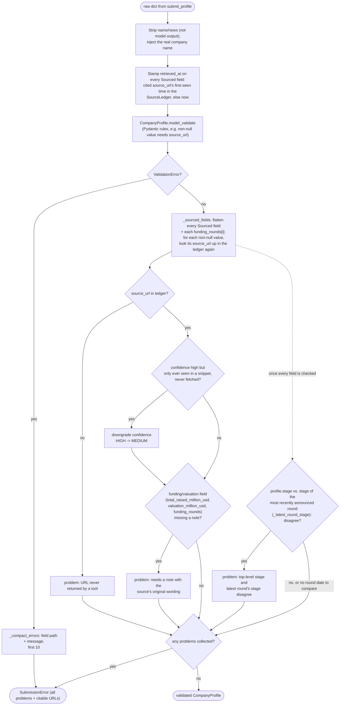
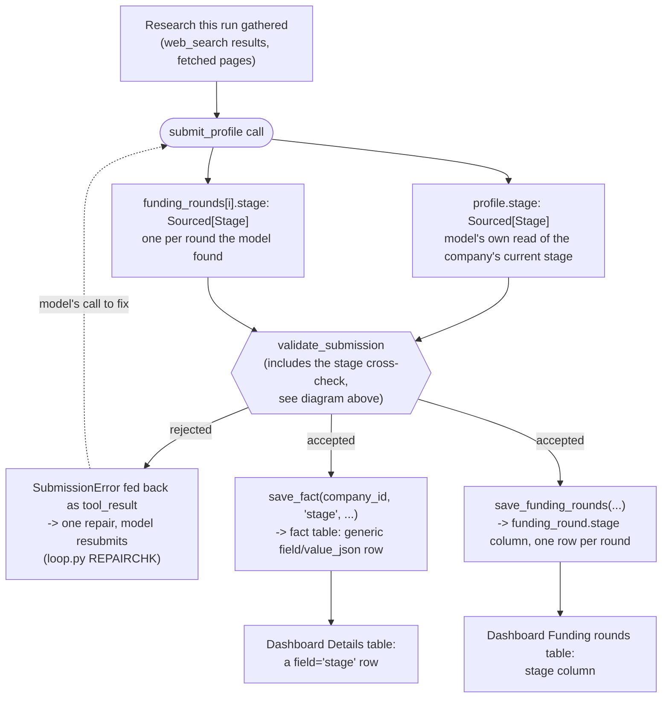
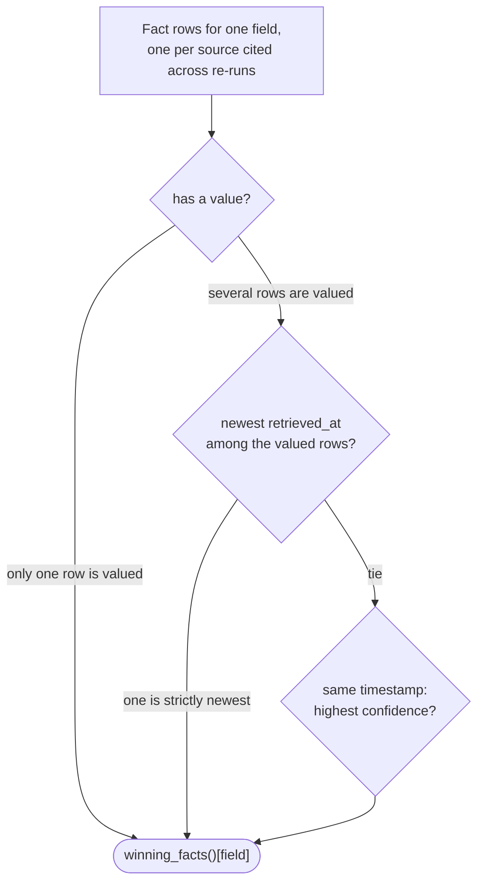
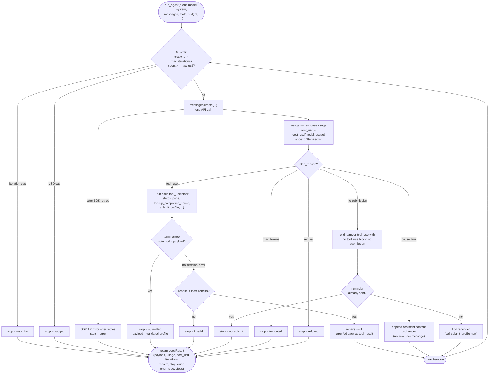

# Phase 2: Single-company enrichment agent

Status: done, with caveats (listed under [Outstanding](#outstanding)). Phase 3 later added step logging on top of this loop; where that changes a contract below it is marked. Part of the [Sprout architecture docs](../README.md).



## Design notes

- **Search backend (A2, D8).** Search is Anthropic's server-side `web_search` (`max_uses` 3). Any page the agent reads is fetched through our own `fetch_page`, so robots/SSRF/size/cache protections still apply; server-side `web_fetch` is not used, since it would bypass them. A custom search backend (Brave/Tavily) isn't needed while search cost stays well under target; the swap point is left open for Phase 7.
- **Swap point.** `build_tools(fetcher, ch, ledger)` in `agents/tools.py` builds the whole tool list in one place. Swapping the search tool touches only that function and the price table. The lever for lowering cost is `WEB_SEARCH_MAX_USES` (or caching search results), not the model.
- **Server-side search mechanics.** `server_tool_use` / `web_search_tool_result` blocks are appended to history unchanged (they carry encrypted content needed next turn). `pause_turn` appends the assistant content and calls again with no new user message, counting as an iteration. Search errors arrive as result blocks, not exceptions, so the model can still submit honest nulls. Search usage is added to cost, and search-result URLs reach the seen-URL ledger via an `on_search_urls` callback (the loop itself stays generic; `enrich.py` supplies the callback).
- **Models.** `claude-haiku-5-5` is the default; `claude-sonnet-5-5` via `--strong`. `tool_choice` is `auto`, with the system prompt naming `submit_profile` as the required final step. `submit_profile` is **not** `strict`, since the derived schema exceeds the API's parameter limit, so enforcement is Pydantic validation plus one repair attempt (D13). Thinking tokens count as output tokens, so they're inside the USD budget. Effort defaults to `low`, overridable with `--effort`.
- **Prompt caching.** The system block and the top-level call both set `cache_control: ephemeral`, so each iteration re-reads the growing conversation at the cheaper read price. The tool list order is fixed because it sits at the start of the cached prefix.
- **Prompt injection.** Every custom tool result is wrapped in `<untrusted_content source="URL">...</untrusted_content>` (delimiters inside the text neutralised, truncated at 8,000 characters), and the system prompt states that wrapped content is data, never instructions. Search snippets arrive unwrapped but are covered by the same system-prompt rule. No tool writes to the DB; that only happens in our code after validation. Open risk: a model-chosen URL in `fetch_page` could be used to leak context via a query string; an allow/deny list and injection fixtures are planned for Phase 4.
- **Provenance, beyond Pydantic (D11, in `validate_submission`).** `retrieved_at` is stamped by our code, never the model. `source_url` must match a URL a tool actually returned (ignoring tracking params, fragments, case, trailing slash); anything else is rejected with one repair attempt that lists citable URLs. Funding facts must carry a `note` with the original figure and currency. A source seen only in a snippet, never fetched, is capped at `medium` confidence. Null values with no source always pass. `profile.stage` disagreeing with the most recently announced round's stage is rejected the same way (see [`validate_submission`](#validate_submission) and [Stage](#stage-two-independent-fields-reconciled-by-one-repair-a3)).
- **`submit_profile` schema.** Generated from `CompanyProfile` via `submit_profile_schema()`: `$ref`s inlined, `name`/`news`/`retrieved_at` dropped, remaining fields made required, descriptive keywords (`title`, `default`, bounds, `format`) stripped, so numeric bounds are enforced by Pydantic only, not the schema.
- **Known non-determinism.** Occasional runs end `invalid` or `refused`. The model sometimes leaves non-USD funding amounts null despite the prompt, which is safe but understates funding coverage.

## `validate_submission`

Turns the model's raw `submit_profile` dict into a validated `CompanyProfile`, enforcing provenance in code rather than trusting the model's claims. Collects every problem it finds (not just the first) and raises them together as one `SubmissionError`, which `_submit_tool` turns into a `tool_result` error for the loop's single repair attempt (`loop.py` `REPAIRCHK`).



## Stage: two independent fields, reconciled by one repair (A3)

`CompanyProfile.stage` and each `funding_rounds[i].stage` are separate properties in the same `submit_profile` schema, filled by the model in one call from the same research, then stored and shown in different places. `validate_submission` (above) is the only place that ties them together: a mismatch against the most recently announced round costs the model its one allowed repair, rather than being derived or fixed deterministically in code.



This doesn't fix the mismatch for the model, it only refuses to accept one; the model still decides which side (or the round's `announced` date) was wrong, like every other repair in this loop. It also can't see a mismatch it has no leverage to resolve: if every round is missing `announced`, `_latest_round_stage` returns `None` and the check is skipped, so `profile.stage` is trusted as-is. A re-run can also move the two out of sync again afterwards, since `save_fact` only replaces the `stage` fact row cited by the same `source_url` while `save_funding_rounds` replaces the whole `funding_round` table wholesale for the company; the check only runs at submission time, not on read.

## The winning-value rule (A6)

`save_fact` is keyed on `(company_id, field, source_url)`, so a field with several sources across re-runs ends up with several `Fact` rows, and nothing marks the old ones as superseded. `db.winning_facts(facts)` picks the one a reader should treat as current, by the rule in [4.1 Sourcing and provenance](../4.%20cross-cutting.md#1-sourcing-and-provenance): a valued fact beats a NULL one, then the most recent `retrieved_at` wins, and `confidence` only breaks a tie on that timestamp.



It's a pure function over `Fact` rows already loaded, not a query or a write, nothing calls it yet: today's only reader (`dashboard.py`'s Details table) still lists every fact as history. It belongs wherever a feature needs "the current value of a field" rather than its full history.

## Built interfaces (signatures as in the code)

```python
# costs.py - pure: no I/O, no imports from sprout
@dataclass(frozen=True)
class Price: input: Decimal; output: Decimal; cache_write: Decimal; cache_read: Decimal  # USD per million tokens
PRICES: dict[str, Price]       # keyed by exact model ID (haiku-5-5, sonnet-5-5); WEB_SEARCH_USD_EACH = Decimal("0.01")
@dataclass
class Usage:                   # supports +, accumulated per run
    input_tokens: int; output_tokens: int; cache_read_tokens: int; cache_write_tokens: int; web_searches: int
def cost_usd(model: str, usage: Usage) -> Decimal   # raises UnknownModelError for an unpriced model

# agents/loop.py - the only pipeline module importing anthropic
class MessagesClient(Protocol):            # what the loop needs; the test seam
    messages: Any                          # .create(**kwargs) -> response with .content, .stop_reason, .usage
def make_client(api_key: str) -> MessagesClient       # real anthropic.Anthropic, 120 s timeout, SDK retries on
@dataclass(frozen=True)
class Budget: max_iterations: int; max_usd: Decimal; max_repairs: int = 1   # validated: iterations >= 1, usd > 0
@dataclass(frozen=True)
class Tool:
    spec: dict                             # sent to the API (custom tool or server-side tool type)
    handler: Callable[[dict], ToolOutcome] | None = None   # None for server-side tools
    terminal: bool = False                 # submit_profile
@dataclass(frozen=True)
class ToolOutcome: text: str; is_error: bool = False; payload: Any = None   # payload set => accepted submission
@dataclass
class StepRecord:                          # Phase 3: one per model response; tool inputs and thinking are not recorded
    iteration: int; at: datetime; stop_reason: str | None; tool_names: tuple[str, ...]
    tool_errors: int; usage: Usage; cost_usd: Decimal; response_text: str   # response_text capped at LOGGED_TEXT_MAX_CHARS (1,000)
@dataclass
class LoopResult:
    payload: Any | None; usage: Usage; cost_usd: Decimal; iterations: int; repairs: int; tool_calls: dict[str, int]
    stop: Literal["submitted","invalid","max_iter","budget","no_submit","truncated","refused","error"]
    error: str | None
    error_type: str | None                 # Phase 3: exception class name for an API failure, else None
    steps: list[StepRecord]                # Phase 3: len(steps) == iterations; the loop never reads it
def run_agent(client, *, model, system, messages, tools, budget, max_tokens, effort,
              on_search_urls: Callable[[list[str]], None] | None = None) -> LoopResult

# agents/tools.py - plain dicts and handlers; no SDK import
def build_tools(fetcher: WebFetcher, ch: CompaniesHouseClient | None, ledger: SourceLedger) -> list[Tool]
    # web_search (server-side, max_uses 3), fetch_page, lookup_companies_house (only if ch is not None); submit_profile is added by enrich.py
class SourceLedger:                               # URLs the tools returned, with first-seen time and fetched-or-snippet
    def add(url, *, fetched: bool, at: datetime | None = None); def get(url) -> LedgerEntry | None; def urls() -> list[str]
def wrap_untrusted(source_url: str, text: str, max_chars: int = 8_000) -> str    # delimiters, neutralise tags, truncate

# agents/enrich.py
DEFAULT_BUDGET = Budget(max_iterations=12, max_usd=Decimal("0.13"))   # MAX_OUTPUT_TOKENS = 6_000
@dataclass(frozen=True)
class Deps:
    client: MessagesClient
    fetcher: WebFetcher
    ch: CompaniesHouseClient | None
    settings: Settings
    model: str
    effort: str = "low"
def enrich_company(session, company, deps, budget=DEFAULT_BUDGET) -> CompanyProfile   # raises EnrichmentFailed(stop, cost)
def enrich_with_result(session, company, deps, budget=DEFAULT_BUDGET) -> tuple[CompanyProfile, LoopResult]
def main(argv) -> int        # python -m sprout.enrich NAME_OR_NUMBER...  --strong  --max-usd  --max-iterations  --effort  --show

# db.py additions
def save_profile(session, company, profile: CompanyProfile) -> None     # save_fact per Sourced field; company.category
def save_funding_rounds(session, company_id, rounds) -> None            # replaces the company's funding_round rows
def delete_profile(session, company) -> int                              # clears fact, funding_round and category (CLI --reset)
def add_company_by_number(session, number: str, data: dict) -> Company   # for pilot companies absent from the 876
def winning_facts(facts: Iterable[Fact]) -> dict[str, Fact]                # A6: one current Fact per field name
```

`run_agent` has no `on_step` callback: steps accumulate on `LoopResult.steps` and `enrich_with_result` persists them afterwards. An optional `on_step` for live per-worker progress is a possible Phase 5 addition (see the [Phase 3 page](phase-3-observability.md#what-phase-5-needs-hooks-only-nothing-built)).

`tools.py` does not import `Deps` from `enrich.py`; `build_tools` takes the fetcher, an optional Companies House client and the ledger directly. `SourceLedger.add` takes an optional `at` so a fetched page keeps the fetcher's `retrieved_at`. The CLI also offers `--effort`, `--show` and a Companies House name search for "did you mean" hints. `Deps.ch` is `CompaniesHouseClient | None` and is dropped for a company with no number, which also drops `lookup_companies_house` from the tool list.

## Loop contract (stop-reason handling, covered by scripted-client tests)

Each iteration: check the guards, call `messages.create`, add `usage` to the running total, append a `StepRecord` (Phase 3), then act on `stop_reason`. A custom tool result with `is_error` increments that step's `tool_errors`, including a rejected `submit_profile`.

| Condition | Action |
|---|---|
| `tool_use` | Run each custom `tool_use` block; return all results in one user message (`tool_result`, `is_error` for failures). Handler exceptions become error strings, never raised. A terminal tool that returns a payload ends the run (`submitted`). A terminal tool that returns `is_error` is the repair path: one allowed (`max_repairs`), a second failure ends the run (`invalid`). |
| `pause_turn` | Append the assistant content unchanged and call again; counts as an iteration. |
| `end_turn` without a submission (also `tool_use` with no `tool_use` block) | One reminder to call `submit_profile`, otherwise `no_submit`. Any other unknown stop reason gives `error`. |
| `max_tokens` | `truncated` (a cut-off `tool_use` input is not trusted). |
| `refusal` | `refused`. |
| SDK `APIError` after the SDK's own retries | `error`; usage so far is still returned. |
| Guards | Checked before every call: iterations used >= `max_iterations` gives `max_iter`; spent >= `max_usd` gives `budget`. On the last allowed iteration, or once spend reaches 80 percent of the cap, the next user message adds "budget nearly used, call submit_profile now". The USD cap is soft by at most one response (cost is known only after a call); `max_tokens` bounds that overshoot, and tests assert the exact call count with a tiny cap. |

Only a validated `submit_profile` carries facts, so on any non-`submitted` stop nothing is written to `fact` or `category`; the cost, `failure_category` (from `failures.failure_category_for(stop)`) and step rows are still recorded. The only per-run caps are iterations, USD, search `max_uses` (3) and the tool-result character cap.

There is no per-run fetch cap beyond the iteration cap (the prompt's "at most 4 pages" is advice, not enforced), and no partial profile is ever written on a cap stop. There is also no batch-level USD cap: the CLI enforces `--max-usd` per company and only prints the total, so a long target list can spend `n * max_usd`. A `BatchBudget` is planned for Phase 4 (see the [Phase 4 page](phase-4-evals-guardrails.md), D24) so the evals have a batch cap, and the Phase 5 orchestrator must reuse it.

## Inside `loop.py`: the iteration state machine

The table above as a flowchart, one pass per iteration; "next iteration" loops back to the guard check at the top.



## Business status

`CompanyProfile.business_status` is a `Sourced[BusinessStatus]` field, filled by the model like
`stage` (not a plain classification like `category`): a non-null value needs a `source_url` and
is stored as a `fact` row (`field="business_status"`), through the same generic loop as every
other `Sourced` field in `save_profile`. It is distinct from `company.status`, the Companies
House legal status given to the model as input context; `company.status="active"` says only that
the legal entity still exists, not that the business is operating, independent, or still private.

| Option | Meaning |
|---|---|
| Active | Trading normally, no sign of acquisition, closure or dormancy |
| Stagnant or distressed | Still registered but no recent activity (no news, funding, hiring, or a working site in a long time) |
| Public | Listed on a stock exchange |
| Acquired or merged | Bought by, or merged into, another company |
| Subsidiary | Operates as part of a parent company's group, not through a recent acquisition |
| Closed | Dissolved, liquidated, in administration, or otherwise ceased trading |
| Dormant (shell) | Companies House marks it dormant, or it has no real operations |
| Unclear | Genuinely conflicting or insufficient signals after researching; cite whatever was checked, at low confidence |

`app/queries.py:business_status_counts` picks the winning fact per company (same rule as
`stage_counts`, A6) and the dashboard's companies page charts the distribution next to stage and
valuation.

## Other notes

- Agents receive a client through a `Deps` dataclass; tests inject a scripted fake client (see [Testing](../4.%20cross-cutting.md#4-testing)).
- Tool handlers return error outcomes and never raise into the loop (`run_agent` also catches any handler exception and turns it into an error result).
- `enrich_with_result` writes facts and the `company_enrich` run_log row in one session: it assigns `run.stats` and the run-level columns (`company_id`, `model`, `effort`, `iterations`, `repairs`, `max_iterations`, `max_usd`, `tool_calls`, `error_message`), sets `run.failure_category` and adds the `run_log_step` rows, then **commits before raising** on failure, because `logged_run` rolls back on exceptions and would otherwise discard the record of what a failed run cost; on success it then calls `save_profile`. On failure `logged_run` also marks the row `status="error"`, filling in `error_message` only if it is still null. The status therefore means "run did not produce a profile", and `stats.stop` and `failure_category` say why.
- `agents/enrich.py` (about 510 lines: agent, schema, CLI, `resolve_company`) should be split when Phase 5 adds an orchestrator.
- Move `app/queries.py` to `sprout/queries.py` (keep a re-export) before Phase 7 so MCP does not import from the UI package.

## Outstanding

Work that is not done or not verified, as of the end of Phase 3. Nothing here blocks Phase 4.

| Item | Detail |
|---|---|
| User review of the pilot profiles | The 10-company pilot (10/10 submitted) was reviewed by the implementing agent only |
| Search price unconfirmed | US$0.01 per search is an assumption from the `claude-api` skill; check it against the first console invoice (search is about 70 percent of a run's cost) |
| No `-m live` enrichment test | Deliberate, so a plain `pytest` with a key never spends money. The tiny-cap criterion is verified with mocks only |
| Never run live | `--strong` (Sonnet 5.5), forced `tool_choice` on Haiku 5.5, the over-100K-token price tier, the 512-token minimum cacheable prefix. `pause_turn` has only mock evidence |
| No per-run fetch cap, no batch-level USD cap | `BatchBudget` (Phase 4, D24) closes the second; the first is bounded only by the iteration cap |
| No winning-value rule | A re-run can leave both a valued and a NULL-value fact for a field, and stale facts from URLs no longer cited remain (A6). Must exist before Phase 6 reads facts. `--reset` is the manual workaround |
| Non-USD funding amounts sometimes left null | Safe (null, not a guess) but understates funding coverage; the note carries the original figure |
| Snippet-only claims cannot be audited | Search results arrive encrypted; the code caps them at `medium` and requires a note; the Phase 5 verifier is the real check |
| Claimed website can be wrong | Stored at medium confidence with a caveat in the note (Airborne Robotics returned another company's content) |
| Latent nit in `_simplify` | It drops any dict key named `title`, `default`, `minimum`, `format` and so on, including a `CompanyProfile` field with such a name inside `properties`. No current field collides |
| Older facts under superseded field or stage names | Re-run `sprout.enrich <number> --reset` to refresh |

Planned Phase 5/7 modules that build on this phase are on the [Phase 5 page](phase-5-multi-agent.md).
