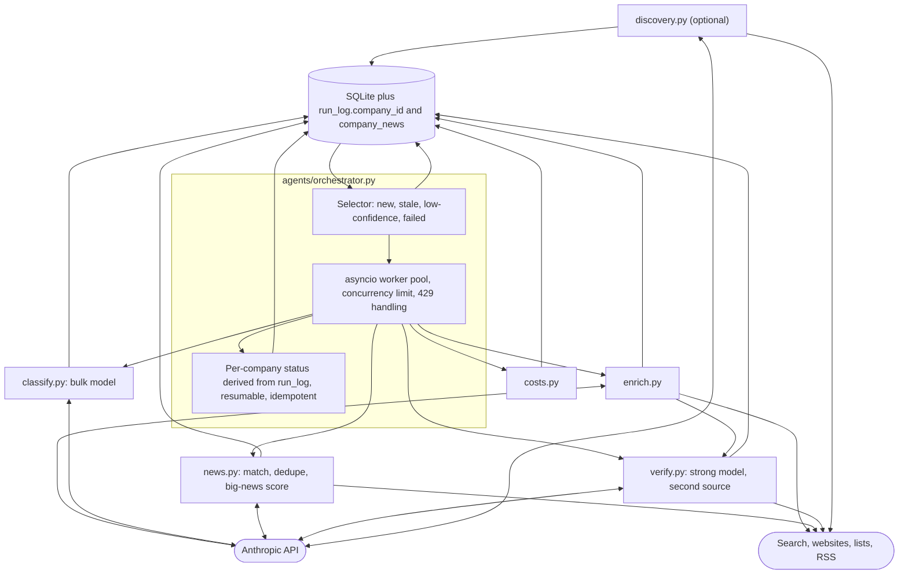

# Phase 5: Multi-agent pipeline (planned)

Part of the [Sprout architecture docs](../README.md).



- The orchestrator is deterministic scheduling code, not an LLM supervisor (D27, see [decisions](../6.%20decisions.md)).
- `HttpClient` is synchronous and not thread-safe: one client per worker, locking, or `asyncio.to_thread`.
- **Schema (D32, D33):** both schema items this phase needs, `run_log.company_id` and `company_news`, are already built; this phase only writes to them (status derived from `run_log`, no `enrichment_state` table) and adds the news matcher that populates `company_news`. Enable WAL and a busy timeout in `get_engine` first. Details and the items cut from the earlier plan are in the [data model](../2.%20data-model.md#per-company-status-derived-not-stored).
- **Open:** verifier ordering: run after the enricher, only for companies with a funding or stage claim.
- Each added agent is judged by its Phase 4 eval deltas before being kept (D28); Phase 4 evals exist before this phase runs. The eval runner keeps its per-company call in one function (`_enrich_entry`) so the orchestrator can be swapped in and measured against the same golden set.
- Retry of failed enrichment runs and any partial-facts behaviour are owned by this phase (selector retries a failed latest attempt, D32); Phase 4 changes neither: a failed run persists only its `run_log` row.
- What Phase 4 leaves for the orchestrator: `BatchBudget` (add a lock for concurrent workers; same object caps enrichment, judge and any verifier spend), `enrich_with_result(..., extra_context=...)`, `stats["sources"]` (the verifier's list of already-read pages), and `ALLOWED_ENRICHMENT_TOOLS`, which covers the enrichment agent only; classify, news and verify define their own tool sets.

## Planned modules (interfaces are proposals; the [Phase 4](phase-4-evals-guardrails.md) modules are specified there)

```python
# agents/classify.py
def classify(company, deps) -> Classification
# agents/news.py
def collect_news(company, deps) -> list[ScoredNews]
# agents/verify.py
def verify_funding(company, claims, deps) -> list[Verification]
# agents/orchestrator.py
async def run(limit, concurrency, budget, force=False) -> RunSummary
# sprout/queries.py (extracted from app/queries.py)
search_companies(...); get_company(name); latest_news(...)
```

- Agents receive a client through a `Deps` dataclass; tests inject a scripted fake client (see [Testing](../4.%20cross-cutting.md#4-testing)).
- Tool handlers return error outcomes and never raise into the loop (`run_agent` also catches any handler exception and turns it into an error result).
- Move `app/queries.py` to `sprout/queries.py` (keep a re-export) before Phase 7 so MCP does not import from the UI package.

This phase reuses the generic agent loop, tool pattern and cost accounting built in [Phase 2](phase-2-enrichment.md) (D12), and must adopt the `BatchBudget` built in [Phase 4](phase-4-evals-guardrails.md) (D24) before running 150 companies. The hooks Phase 3's step logging leaves for this phase are listed at the end of the [Phase 3 page](phase-3-observability.md#what-phase-5-needs-hooks-only-nothing-built).
