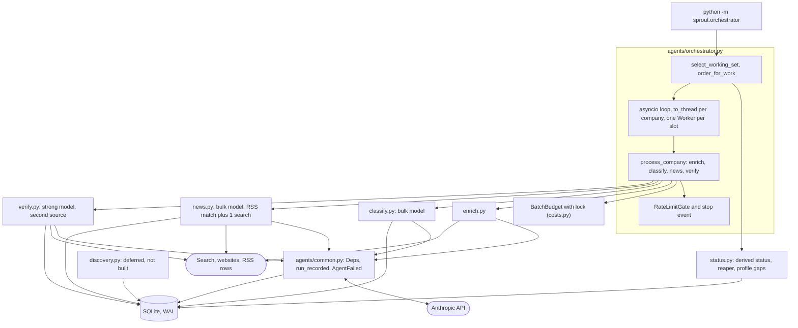
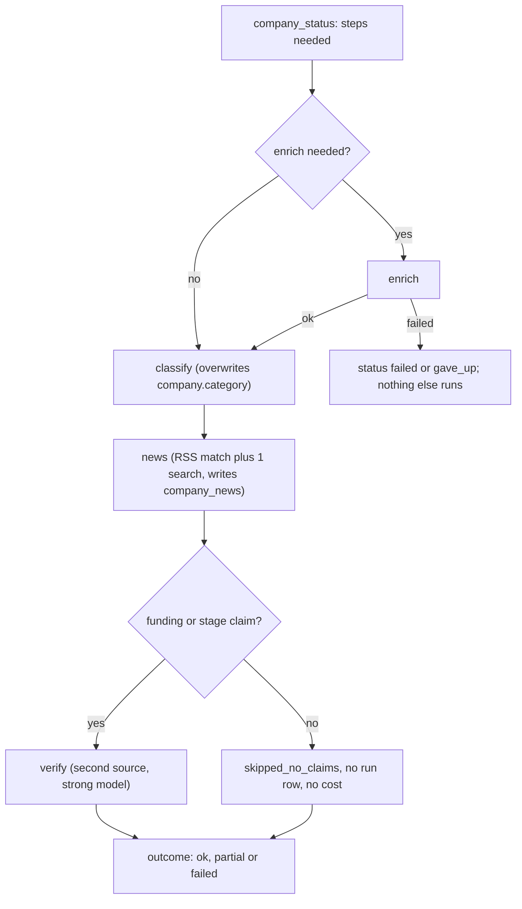

# Phase 6: Multi-agent pipeline

Part of the [Sprout architecture docs](../README.md). Status: see [7. status.md](../7.%20status.md). What was built, measured and decided: [implementation-notes.md](../../implementation-notes.md#phase-6---multi-agent-pipeline-at-scale).

Scope: a classifier, a news agent, a verifier and a deterministic orchestrator, run over a working set of about 50 companies. The discovery agent (`discovery.py`) was **intentionally deferred by the user** (not built, not wired in; it is first on the plan's cut list and A26 stays open). Nothing below depends on it.



Per-company flow (one worker thread, steps run in this order; a step that is fresh is skipped):



## Per-company pipeline

| # | Step | Run `kind` | Depends on | Runs when |
|---|---|---|---|---|
| 1 | enrich | `company_enrich` | nothing | never enriched, enrichment older than `stale_days`, or latest attempt failed |
| 2 | classify | `company_classification` | an ok enrich | no ok classification newer than the newest ok enrich, or latest attempt failed |
| 3 | news | `company_news_match` | an ok enrich (uses its website and one-liner to disambiguate) | no ok news run in `news_stale_days`, or latest attempt failed |
| 4 | verify | `company_verification` | an ok enrich | no ok verification newer than the newest ok enrich and `build_claims` is non-empty, or latest attempt failed |

- **Nothing runs in parallel inside a company.** Parallelism is across companies (D38). Order is cheapest and most acceptance-critical first, so a budget stop drops verify before news before classify.
- Step failures are isolated: a failed classify does not skip news or verify. Only a failed, stopped or budget-skipped enrich stops the company (no profile to work from). A company that has no usable enrichment and whose enrich is not due (running elsewhere, or excluded by `--steps`) ends `failed`.
- A successful enrich in the same invocation re-derives the needed steps, so classify and verify (which describe an enrichment) are due again.
- Verify with no funding or stage claim is `skipped_no_claims`: no run row, no model call, counts as done.

## Interfaces (as built)

```python
# agents/common.py  (extracted from agents/enrich.py)
@dataclass(frozen=True)
class Deps: client; fetcher; ch: CompaniesHouseClient | None; settings; model: str; effort: str = "low"
class AgentFailed(RuntimeError):              # per-agent subclasses set `label`
    stop: str; cost_usd: Decimal; error_type: str | None   # LoopResult.error_type, e.g. "RateLimitError"
    # EnrichmentFailed, ClassificationFailed, NewsFailed, VerificationFailed
def run_recorded(session, company, kind: RunKind, deps, *, system, messages, tools, budget, ledger,
                 max_tokens, persist: Callable[[Any], Mapping | None], failed=AgentFailed) -> LoopResult
    # logged_run + run_agent + stats (incl. error_type, sources) + run-level columns + run_log_step rows,
    # committed BEFORE raising `failed` on any non-submitted stop. On success persist(payload) runs
    # inside the run block; a mapping it returns is merged into run.stats.

# agents/tools.py
ALLOWED_CLASSIFY_TOOLS = {"fetch_page", "submit_classification"}
ALLOWED_NEWS_TOOLS     = {"web_search", "fetch_page", "submit_news"}
ALLOWED_VERIFY_TOOLS   = {"web_search", "fetch_page", "submit_verification"}
assert_tools_allowed(tools, allowed, label)       # RuntimeError before logged_run; all four agents call it
build_tools(fetcher, ch, ledger, *, max_searches=3)   # 0 omits web_search

# agents/classify.py
class Classification(BaseModel): category: Category; rationale: str       # <= 300 chars, trimmed not rejected
CLASSIFY_BUDGET = Budget(max_iterations=4, max_usd=0.01, max_repairs=1)
classify_company(session, company, deps, budget) -> Classification
classify_with_result(...) -> (Classification, LoopResult)                  # both raise ClassificationFailed

# agents/news.py
NEWS_BUDGET = Budget(8, 0.05, max_repairs=1); NEWS_WINDOW_DAYS = 365; MAX_NEWS_PER_COMPANY = 5; MAX_CANDIDATES = 15
class NewsEntry(BaseModel): url; title; published: date | None; big: bool; kind: NewsKind | None; summary
match_name(name) -> str | None                  # None for a too short or generic name: no RSS candidates, search still runs
match_rss_candidates(session, company, *, window_days, now) -> list[NewsItemRow]   # deterministic
dedupe_near_duplicates(items, *, threshold=0.8) -> list                            # pure, title-token Jaccard
collect_news(...) -> list[NewsEntry]; collect_with_result(...) -> (entries, LoopResult)   # NewsFailed

# agents/verify.py
ClaimName = Literal["stage", "latest_round", "total_raised"]               # valuation excluded (D35)
ClaimInput(name, text, source_url, confidence); Verdict(claim, verdict, second_source_url, observed, quote)
VERIFY_BUDGET = Budget(8, 0.10, max_repairs=1); VERIFY_MAX_SEARCHES = 2
build_claims(session, company) -> list[ClaimInput]          # uses db.claim_row (winning fact or D22 latest round); [] means skip
verify_funding(session, company, deps, claims, budget) -> list[Verdict]; verify_with_result(...) -> (verdicts, LoopResult)

# status.py  (reads db only; the Phase 8 cooldown and Phase 7 reuse it)
STEPS = ("enrich", "classify", "news", "verify"); STEP_KINDS: step -> RunKind
StatusPolicy(enrich_stale_days=30, news_stale_days=7, max_attempts=3, running_timeout=30 min)
StepStatus(step, state: fresh|stale|never|failed|exhausted|running, last_ok_at, failed_attempts, last_failure_category)
CompanyStatus(company_id, steps, cost_usd).needs(*, force=False) -> list[str]         # STEPS order
company_statuses(session, company_ids, policy, now) -> dict[int, CompanyStatus]       # one query over run_log
reap_abandoned(session, now, policy) -> int
profile_gaps(session, company_id) -> list[str]     # missing: category, stage, funding, business_model, target_user, news

# agents/orchestrator.py  (src/sprout/orchestrator.py is a three-line shim, like sprout/enrich.py)
Worker(session, fetcher, ch); open_worker(settings, engine, stack) -> Worker
RateLimitGate(pause_seconds): trip(), wait(stop), trips
RunContext(client, settings, batch: BatchBudget, gate, stop: threading.Event, policy, now)
StepOutcome(step, state: ok|failed|skipped_fresh|skipped_no_claims|skipped_budget|stopped, cost_usd, failure_category, error)
CompanyOutcome(company_id, result: ok|partial|failed|gave_up|skipped_budget|stopped, steps, cost_usd)
process_company(worker, company_id, steps, ctx, *, force=False) -> CompanyOutcome   # sync, never raises, never prints
select_working_set(session, *, limit, only, prescreen, ch) -> list[int]
order_for_work(ids, statuses, steps, *, force) -> list[int]
async run(settings, args, *, client=None, stop=None) -> RunSummary(exit_code, text, error, stats); main(argv) -> int
```

- **`process_company` is the seam.** `steps` is the set of steps allowed; the function reads the company's status itself and runs those that are due, so callers do not compute the needed steps. It never raises (an unexpected exception rolls the session back and is recorded as `internal_error`) and never prints, so Phase 8's `refresh_company` can call it from an MCP stdio server. The eval runner does **not** go through it: `run_evals._enrich_entry` still calls `enrich_with_result` directly (it needs a `Worker`, a `RunContext` and a cost-breakdown rework), and `_run_entry` chains the classify and verify agents itself.
- **Per-agent `Deps`:** `_run_step` builds one `Deps` per step from the worker's fetcher and Companies House client, with the bulk model, or the strong model for verify. Classify, news and verify get no Companies House client. Routing, effort and caps are in [cross-cutting 9](../4.%20cross-cutting.md#9-phase-6-agent-caps-and-run-budget).
- **Classifier input is independent.** It sees name, SIC codes, locality and the winning `one_liner`, `business_model`, `target_user`, `website`, `hq` and `business_status` facts (wrapped as untrusted), and **not** enrichment's category. `fetch_page` is allowed so a thin profile can be classified from the company's own site. The prompt's evidence rule answers `Other` unless the facts or fetched pages show what the company does (name and SIC codes alone are not evidence). An out-of-taxonomy label gets one repair, then is stored as `Other`.
- **News input.** Candidates are `news_item` rows whose title or summary contains the normalised company name (legal suffix stripped, whole words) within `NEWS_WINDOW_DAYS` (an undated item counts by `first_seen_at`), near-duplicate-collapsed in code, newest 15 shown. A name that is one generic word yields no candidates. The model rejects same-name false matches, may run the one allowed `web_search` and `fetch_page`, and submits at most 5 entries (big first). RSS candidate URLs are seeded into the run's `SourceLedger` as `fetched=False`; an entry whose URL no tool returned gets one repair, then is dropped. "Big news" is the rubric in the prompt (leadership only for C-suite changes, own-site posts only for funding, acquisition or a named-partner partnership). There is no RSS-only fallback: the agent is the only news writer.
- **Verifier input and independence (A33).** Claims are built from winning facts and the D22 latest round, each with its source URL and confidence. Code accepts a `confirmed` or `disagrees` verdict only if `second_source_url` was returned by a tool **and fetched**, its host (without `www.`) differs from the claim's source host, it is not in the latest ok enrichment run's `stats["sources"]`, and `quote` and `observed` are given. A verdict that fails this gets one repair; if still invalid (or missing) it is stored as `unverified` with the reason in `observed`, so the run does not fail. Amounts within 10 percent and equal stages agree (D22). Residual: two outlets syndicating one press release pass the host check.

## What each agent writes

| Agent | Writes | Never writes |
|---|---|---|
| enrich | `fact` rows, `funding_round` rows (replaced wholesale), `company.category` | news |
| classify | `company.category`; run row `stats`: `category`, `previous_category` (enrichment's label, kept across re-classification), `rationale` | `fact` rows (D33: no rationale column) |
| news | `news_item` rows for URLs found by search (`source="web_search"`, empty summary), then `company_news` rows via `db.link_company_news` (`news_kind` set only when `big`, one-sentence `summary`); upsert on the primary key, never deletes; run `stats`: `rss_candidates`, `stored`, `big` | `fact` |
| verify | `verification:<claim>` fact rows via `db.apply_verification` (D40); in-place `confidence` and `note` changes on the claim's existing `fact` or `funding_round` row; run `stats`: `verdicts` | a different value for a claim |

Verifier effects (D40): `confirmed` raises the claim's confidence to `high`; `disagrees` lowers it one step (high to medium, medium to low), appends `Disputed by <url>: <observed>` to the note once and **keeps the value**; `unverified` changes nothing. Each claim has one `verification:<claim>` fact, replaced on every verification: `value_json` is `{"verdict", "observed"}` (NULL for `unverified`), `source_url` the second source, `note` the quote, confidence `medium` (`low` for `unverified`). Phase 7 and 8 read a verdict from `winning_facts` like any other field and must skip the prefix (`db.VERIFICATION_PREFIX`) in generic fact lists. A re-enrich replaces `funding_round` rows and makes `verify` due again by the status rule.

## Selector, status and retry

Status is derived from `run_log` (D32, [data model](../2.%20data-model.md#per-company-status-derived-not-stored)). Constants live in `StatusPolicy`. Decisions: D39.

**Working set.** Candidates are companies with `passes_prescreen(active_officers)` (D34), ranked by `candidate_score` descending then `id`. `--limit N` takes the first N: it bounds the working set, not the amount of new work, so rerunning with the same N completes the same set instead of growing it, and a pilot of 12 is a prefix of the full 50. `--only NAME_OR_NUMBER...` bypasses the pre-screen and the limit (companies not yet in the DB are added through `resolve_company`; an unresolvable target exits 2); `--no-prescreen` disables the pre-screen.

**Per step.** `StepStatus.state` for a step with kind K:

| State | Condition | Selected |
|---|---|---|
| `fresh` | newest ok row (`status='ok'`, `failure_category IS NULL`) is within the TTL (enrich 30 days, news 7 days; classify and verify have none) and, for classify and verify, not older than the newest ok enrich | no |
| `never` | no ok row and no attempts | yes |
| `stale` | newest ok row older than the TTL, or older than the newest ok enrich (classify, verify) | yes |
| `failed` | newest attempt failed and `failed_attempts < max_attempts` (3) | yes, ahead of everything else |
| `exhausted` | `failed_attempts >= max_attempts` | no (`gave_up`), unless `--force` |
| `running` | newest row `status='running'` and younger than 30 minutes | no (another process owns it) |

`failed_attempts` counts failed rows newer than the newest ok row for that company and kind, **excluding `api_error` rows**: an API or network failure is not the company's fault, so it never exhausts a company (it is still retried once per invocation and visible in the Observability tab).

**Order of work** (`order_for_work`) within the working set: failed retries, then partial companies (enrich fresh, later steps due), then never-enriched, then stale, ties by rank, companies with nothing due last. Cheap tails finish before new enrichment spend, so a budget stop leaves the fewest half-done companies. There is no low-confidence-first ordering: the verifier is the fix for snippet-capped and single-source claims, but the selector does not rank by confidence.

**Retry policy.** At most one attempt per company and step per invocation, retried by the next invocation (a failed latest attempt is selected, D32) up to 3 failed attempts across runs. The only in-run retry is the one 429 re-run below.

**Stale `running` rows.** A killed process leaves a `running` row with no stats. At startup `reap_abandoned` turns every per-company row still `running` after 30 minutes into `status='error'`, `failure_category='internal_error'`, `error_message='abandoned: process ended before the run finished'`, so it counts as a failed attempt. Batch kinds (`companies_ingest`, `news_ingest`, `pipeline_run`) are never reaped. Two orchestrator processes at once are unsupported: startup refuses (exit 2) if a `pipeline_run` row is `running` and younger than 30 minutes, unless `--force`.

**Company result** (one per working-set company; the acceptance rate is `ok` over the working-set size):

| Result | Meaning |
|---|---|
| `ok` | every step is fresh, ran ok, or was `skipped_no_claims` |
| `partial` | enrich ok but at least one later step failed, was stopped or skipped for budget |
| `failed` | enrich failed, or there is no usable profile to work from |
| `gave_up` | a needed step is `exhausted` |
| `skipped_budget`, `stopped` | enrich skipped for the batch cap, or interrupt before the company finished |

## Concurrency (D38)

- `run()` pre-creates `concurrency` workers (default 4, clamp 1 to 8) in an `asyncio.Queue`. Each company task takes a worker, runs `await asyncio.to_thread(process_company, ...)`, and returns it. Each worker owns its own `HttpClient`, `WebFetcher`, Companies House client and `Session` (`HttpClient` is not thread-safe, D3); the Anthropic client is thread-safe and shared. Sessions and ORM objects never cross threads. Politeness and the Companies House window are therefore per worker.
- `BatchBudget` is charged from worker threads under a `threading.Lock`. Each agent call first takes `batch.try_slice(cap)`, which atomically returns `min(cap, remaining)` or `None` (then `skipped_budget`); the call runs with that slice as its `max_usd`. Spend overshoots the cap by at most one response per in-flight call.
- `get_engine` enables WAL and a 30 s busy timeout. No write transaction is open across an API call (`logged_run` commits the row first; results are written after the call), so writers queue only for short commits.
- **429 handling.** The SDK client is built with `max_retries=5`. A step that still ends `stop="error"` with `error_type=="RateLimitError"` trips the shared `RateLimitGate` (all workers wait 30 s before starting any step) and is re-run once; that re-run is not an extra attempt in the policy because `api_error` rows are excluded. After 5 trips the orchestrator stops launching companies (they end `stopped`), finishes in-flight ones and exits 1 with `rate_limited`.
- **Interrupt.** The first SIGINT sets `ctx.stop`: no new step or company starts, in-flight agent calls finish, the summary prints, exit 1. A second SIGINT hard-exits (`os._exit(130)`), leaving the `pipeline_run` row `running`, which blocks a restart for 30 minutes unless `--force`; abandoned per-company `running` rows are reaped on the next start. Each agent run commits its row first and its results at the end in one transaction, so an interrupted run leaves either nothing or a complete step.

## CLI

`python -m sprout.orchestrator [--limit 50] [--concurrency 4] [--max-total-usd 5.00] [--stale-days 30] [--news-stale-days 7] [--steps enrich,classify,news,verify] [--only NAME_OR_NUMBER ...] [--no-prescreen] [--force] [--dry-run]`

- `--dry-run` selects, prints each company's status, needed steps and an estimate (`ESTIMATED_STEP_USD` in `orchestrator.py`, planning means that price verify on every company that needs it, so it overstates), and spends nothing; it needs no API key and takes no run lock.
- `--steps` restricts which steps may run (for example `news` alone).
- `--force` ignores freshness and the 3-attempt cap for the selected companies, and the single-run lock; it never takes over a step another process is running.
- `--max-total-usd` is the single cap over enrichment, classify, news and verify spend. The default US$5.00 is the acceptance ceiling.
- Output: one stderr line per finished company (result, per-step state and cost), a final summary on stdout, and one batch `run_log` row, kind `pipeline_run`, `company_id` NULL, `stats`: `limit`, `concurrency`, `max_total_usd`, `selected`, `results` (counts per company result), `spent_usd`, `by_kind`, `rate_limit_trips`, `incomplete_profiles` (company id to missing parts, ok companies only), `stopped_early` (`interrupted`, `rate_limited`, `budget` or null). The spend key is `spent_usd`, **not** `cost_usd`, because the Observability queries sum `stats.cost_usd` over every kind and would count the batch twice.
- Exit codes: 0 when not stopped early and `ok / working set >= 0.85`; 1 below that or stopped early (budget, rate limit, interrupt); 2 for configuration (no Anthropic key, another run in progress, unresolvable `--only` target). Phase 9 maps these to job outcomes.

## Evaluating each agent (D28, D41)

Each agent is to be measured against the Phase 5 evals before it stays in the default pipeline. Runs go through `run_evals`; each paid invocation is confirmed with the user first. **No D28 run has been made, so no keep-or-merge result exists for any agent.**

Runner support (built): `--agents classify,verify` (default none, which is the enrichment-only baseline; news has no eval flag) and `--reuse-enrichment` (skip `delete_profile` and enrichment for entries that already have an ok enrichment run in `data/eval.db`, run only the listed agents on top). Reusing one enrichment pass isolates the agent from enrichment run-to-run noise and costs only the agent. Report rows added: category accuracy before the classifier, classifier corrected and broken, classifier and verifier cost, verifier flagged-wrong, confirmed-right and flagged-right. `results.md` headers record the agent set, and `previous_counts` compares only against recorded runs with the same agent set.

| Agent | Measured by | Keep if (pre-registered proposal) | If not |
|---|---|---|---|
| classify | Category accuracy before (`stats.previous_category`) vs after (`company.category`) on the same 32 enrichments; the existing gate still applies to the post-classifier value | net corrected minus newly broken is at least 2 of 32 (one company is 3.1 points, inside the 3.5 point noise), the 80 percent gate holds, mean cost at most US$0.005 | Remove classify from the default `--steps`, keep enrichment's own category, and record that the classifier did not measurably help, with the counts and cost |
| verify | Of golden-wrong funding or stage claims (baseline: 9 of 22 funding claims off), how many the verifier marks `disagrees`; of golden-right claims, how many it marks `confirmed` and how many it wrongly marks `disagrees` | flags at least a third of the wrong claims, wrongly flags at most 1 right claim, mean cost at most US$0.06 per verified company | Drop it from the default steps; say it neither caught errors nor was cheap enough |
| news | No golden labels exist. Hand-check 15 to 20 items: same company, not a duplicate, `big` and `kind` match the rubric, URL in the ledger (code-enforced) | at least 90 percent of items about the right company | Fall back to a deterministic RSS-only matcher (not built) and say so |

`verify` and `news` change no profile value, so the category, business-status and fabricated-funding gates cannot move because of them; only the verifier rows can show their effect. The classifier overwrites `company.category`, which the golden set's category accuracy reads, so a classifier regression shows up directly in the gate.

## Changes to existing code (built)

| File | Change |
|---|---|
| `src/sprout/db.py` | `get_engine`: 30 s busy timeout, WAL and `synchronous=NORMAL` on connect (a read-only file keeps its mode); `RunKind.PIPELINE_RUN`; `link_company_news`; `latest_round` (the D22 rule, shared with `evals/metrics.py` as `last_round`); `claim_row`, `apply_verification`, `VERIFICATION_PREFIX` |
| `src/sprout/costs.py` | `BatchBudget` gains a `threading.Lock` around `charge` and `clamp` and the new `try_slice(cap)`. `enrichment_batch_size`, `COST_PER_COMPANY_USD` and `BUDGET_PER_RUN_USD` remain, unused by the orchestrator (only `tests/test_costs.py` calls them) |
| `src/sprout/agents/loop.py` | `make_client(api_key, *, max_retries=2)`; no `on_step` callback |
| `src/sprout/agents/tools.py` | the three `ALLOWED_*` sets, `assert_tools_allowed`, `build_tools(max_searches=)` |
| `src/sprout/agents/enrich.py` | `Deps`, run recording and the failure base class moved to `agents/common.py`; `EnrichmentFailed` subclasses `AgentFailed`; `UNTRUSTED_CONTENT_RULE` and `CATEGORY_GUIDANCE` extracted as shared prompt constants (`SYSTEM_PROMPT` hash unchanged) |
| `src/sprout/sources/http.py` | `DiskCache.put` writes to a unique temp name (pid and thread id) |
| `src/sprout/models.py` | `NewsKind` |
| `evals/run_evals.py`, `evals/metrics.py` | `--agents`, `--reuse-enrichment`; `Observed` gains `previous_category`, classification and verification fields; classifier and verifier rows; `previous_counts` keyed by split and agent set |
| `.gitignore` | `*.db-wal`, `*.db-shm` |

No table or column changes (D10 is not triggered): the Phase 6 data lands in existing tables ([data model](../2.%20data-model.md)).

## Key files

`agents/orchestrator.py`

| Aspect | Detail |
| --- | --- |
| Role | <ul><li>Supervisor: working-set selection, worker pool, `process_company`, 429 gate, interrupt handling, `pipeline_run` row</li></ul> |
| Gotchas | <ul><li>`process_company` is sync, never raises and never prints, so Phase 8 can call it</li><li>Each worker owns its own session and HTTP clients; only the Anthropic client is shared</li><li>A second SIGINT hard-exits and leaves the `pipeline_run` row `running`</li></ul> |

`status.py`

| Aspect | Detail |
| --- | --- |
| Role | <ul><li>Derives per-step state from `run_log` in one query; `reap_abandoned` closes stale `running` rows</li></ul> |
| Gotchas | <ul><li>`api_error` rows never count towards the 3-attempt cap</li><li>Reads `db` only, so Phases 7 and 8 can reuse it</li></ul> |

`agents/common.py`

| Aspect | Detail |
| --- | --- |
| Role | <ul><li>`run_recorded` is the shared run wrapper for all four agents; `AgentFailed` carries `error_type`</li></ul> |
| Gotchas | <ul><li>The run row is committed before any failure is raised</li><li>`persist` runs inside the run block and may return extra stats</li></ul> |

`agents/verify.py`

| Aspect | Detail |
| --- | --- |
| Role | <ul><li>Second-source check on stage and funding claims; never changes a value</li></ul> |
| Gotchas | <ul><li>Independence rules (fetched, different host, not an enrichment source) live in code, not the prompt</li><li>An invalid verdict after one repair is stored as `unverified`</li></ul> |

`agents/news.py` and `agents/classify.py`

| Aspect | Detail |
| --- | --- |
| Role | <ul><li>News: deterministic RSS name match, near-duplicate collapse, one search, writes `company_news`</li><li>Classify: cheap-model category from the profile, overwrites `company.category`</li></ul> |
| Gotchas | <ul><li>`match_name` returns `None` for generic names, so only the search runs</li><li>Classifier rationale lives on the run's `stats`, not a column</li></ul> |

## Known weak spots and open items

- **Pre-screen too loose (A1, D34):** validated live and found too loose, not too strict; details in [implementation-notes](../../implementation-notes.md#d34-pre-screen-validation-a1). Whether to tighten the pool is undecided.
- **Verifier:** a turn that mixes `web_search` and `submit_verification` has its searches dropped by the loop, so verdicts come out `unverified` without any search being read (safe, but the check does not happen).
- **News:** near-duplicates from different outlets survive the title-token collapse, the big-news rubric over-flags, and some items have no published date.
- **`profile_gaps`** treats an explicit "not disclosed" (NULL) fact as a gap, so most ok companies are reported incomplete.
- **Not exercised live:** a SIGINT mid-run and the 429 gate (unit tests only). A stale `running` batch row (for example `companies_ingest`) is never reaped.
- **A33, A34:** the independence heuristic and the absence of news labels stay as in [risks](../5.%20risks.md).
- **Deferred:** the discovery agent (A26). **Not built:** `on_step` callback, live per-iteration progress, an `enrichment_state` table, a sub-category field (A25), an RSS-only news fallback, low-confidence-first ordering.

This phase reuses the generic loop, tool pattern and cost accounting from [Phase 3](phase-3-enrichment.md) (D12), `BatchBudget` from [Phase 5](phase-5-evals-guardrails.md) (D24), `enrich_with_result(extra_context=)` and `stats["sources"]`. Step records are written per run by the worker's own session after `run_agent` returns, as described in the [Phase 4 page](phase-4-observability.md#what-phase-6-uses-from-this-phase).
