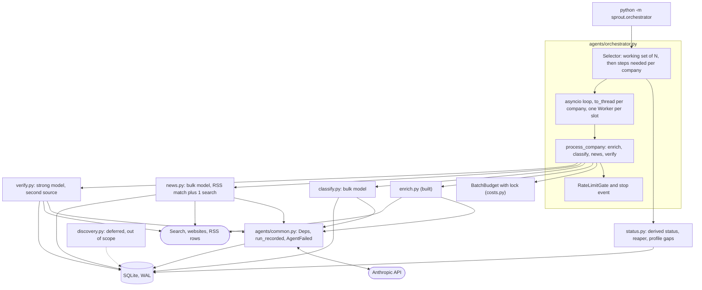
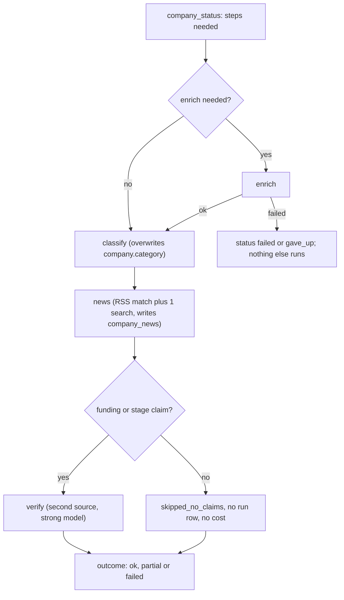

# Phase 6: Multi-agent pipeline (designed, not built)

Part of the [Sprout architecture docs](../README.md). Status: see [7. status.md](../7.%20status.md).

Scope: a classifier, a news agent, a verifier and a deterministic orchestrator, run over a working set of about 50 companies. The discovery agent (`discovery.py`) is **intentionally out of scope this phase** (deferred by the user, not forgotten; it is first on the plan's cut list and A26 stays open). Nothing below depends on it.



Per-company flow (one worker thread, steps run in this order; a step that is fresh is skipped):



## Per-company pipeline

| # | Step | Run `kind` | Depends on | Runs when |
|---|---|---|---|---|
| 1 | enrich | `company_enrich` | nothing | never enriched, enrichment older than `stale_days`, or latest attempt failed |
| 2 | classify | `company_classification` | an ok enrich | no ok classification newer than the newest ok enrich, or latest attempt failed |
| 3 | news | `company_news_match` | an ok enrich (uses its website and one-liner to disambiguate) | no ok news run in `news_stale_days`, or latest attempt failed |
| 4 | verify | `company_verification` | an ok enrich | no ok verification newer than the newest ok enrich and `build_claims` is non-empty, or latest attempt failed |

- **Nothing runs in parallel inside a company.** Parallelism is across companies (D38). After enrich the other three are independent and could run side by side, but at 4 workers the wall time of 50 companies is already about 15 minutes, so the extra concurrency would buy little for more thread and session handling. Order is cheapest and most acceptance-critical first, so a budget stop drops verify before news before classify.
- Step failures are isolated: a failed classify does not skip news or verify. Only a failed or budget-skipped enrich stops the company (no profile to work from).
- Verify with no funding or stage claim is `skipped_no_claims`: no run row, no model call, counts as done.

## Interfaces (proposals the implementer follows; names may shift, contracts should not)

```python
# agents/common.py  (extracted from agents/enrich.py; enrich re-exports Deps, EnrichmentFailed)
@dataclass(frozen=True)
class Deps:                                   # same fields as today
    client: MessagesClient; fetcher: WebFetcher; ch: CompaniesHouseClient | None
    settings: Settings; model: str; effort: str = "low"
class AgentFailed(RuntimeError):              # EnrichmentFailed becomes a subclass
    stop: str; cost_usd: Decimal; error_type: str | None   # error_type: LoopResult.error_type, e.g. "RateLimitError"
def run_recorded(session, company, kind: RunKind, deps, *, system, messages, tools, budget,
                 ledger, max_tokens, persist: Callable[[Any], None]) -> LoopResult
    # The block now inside enrich_with_result, lifted verbatim: logged_run, run_agent, stats
    # (adds error_type), run-level columns, run_log_step rows, commit BEFORE raising AgentFailed
    # on any non-submitted stop; on success calls persist(payload) inside the logged_run block.

# agents/tools.py  (additions)
ALLOWED_CLASSIFY_TOOLS = frozenset({"fetch_page", "submit_classification"})
ALLOWED_NEWS_TOOLS     = frozenset({"web_search", "fetch_page", "submit_news"})
ALLOWED_VERIFY_TOOLS   = frozenset({"web_search", "fetch_page", "submit_verification"})
def assert_tools_allowed(tools, allowed, label) -> None   # RuntimeError before logged_run; all four agents call it
def build_tools(fetcher, ch, ledger, *, max_searches: int = WEB_SEARCH_MAX_USES)  # 0 omits web_search

# agents/classify.py
class Classification(BaseModel): category: Category; rationale: str      # rationale <= 300 chars
CLASSIFY_BUDGET = Budget(max_iterations=4, max_usd=Decimal("0.01"), max_repairs=1)
def classify_company(session, company, deps, budget=CLASSIFY_BUDGET) -> Classification   # raises AgentFailed

# agents/news.py
class NewsKind(StrEnum)   # in models.py: funding, acquisition, partnership, regulatory, leadership, other
class NewsEntry(BaseModel): url: AnyHttpUrl; title: str; published: date | None; big: bool; kind: NewsKind | None; summary: str
NEWS_BUDGET = Budget(max_iterations=8, max_usd=Decimal("0.05"), max_repairs=1)
NEWS_WINDOW_DAYS = 365; MAX_NEWS_PER_COMPANY = 5
def match_rss_candidates(session, company, *, window_days=NEWS_WINDOW_DAYS, now=None) -> list[NewsItemRow]   # deterministic
def dedupe_near_duplicates(items, *, threshold=0.8) -> list                                                # pure, title-token Jaccard
def collect_news(session, company, deps, budget=NEWS_BUDGET) -> list[NewsEntry]                            # raises AgentFailed

# agents/verify.py
ClaimName = Literal["stage", "latest_round", "total_raised"]          # valuation excluded (D35 reasoning)
@dataclass(frozen=True) class ClaimInput: name: ClaimName; text: str; source_url: str; confidence: str
class Verdict(BaseModel): claim: ClaimName; verdict: Literal["confirmed", "disagrees", "unverified"]; second_source_url: AnyHttpUrl | None; observed: str | None; quote: str | None
VERIFY_BUDGET = Budget(max_iterations=8, max_usd=Decimal("0.10"), max_repairs=1)
def build_claims(session, company) -> list[ClaimInput]      # winning facts and the D22 latest round; [] means skip the step
def verify_funding(session, company, deps, claims, budget=VERIFY_BUDGET) -> list[Verdict]   # raises AgentFailed

# status.py  (new, reads db only; the Phase 8 cooldown and Phase 7 reuse it, no agent imports)
STEPS = ("enrich", "classify", "news", "verify")
@dataclass(frozen=True) class StatusPolicy: enrich_stale_days=30; news_stale_days=7; max_attempts=3; running_timeout=timedelta(minutes=30)
@dataclass(frozen=True) class StepStatus: step; state: Literal["fresh","stale","never","failed","exhausted","running"]; last_ok_at; failed_attempts: int; last_failure_category
@dataclass(frozen=True) class CompanyStatus: company_id; steps: dict[str, StepStatus]; cost_usd: Decimal
    def needs(self, *, force=False) -> list[str]                  # STEPS order
def company_statuses(session, company_ids, policy, now) -> dict[int, CompanyStatus]   # one grouped query over run_log
def reap_abandoned(session, now, policy) -> int                    # running rows older than the timeout become error/internal_error
def profile_gaps(session, company_id) -> list[str]                 # acceptance check: missing category, stage row, funding row, business_model, target_user, news

# agents/orchestrator.py  (src/sprout/orchestrator.py is a three-line shim, like sprout/enrich.py)
@dataclass
class Worker: session: Session; fetcher: WebFetcher; ch: CompaniesHouseClient | None
def open_worker(settings, engine, stack: ExitStack) -> Worker      # own HttpClients (web, Companies House), own Session
@dataclass class RunContext: client; settings; batch: BatchBudget; gate: RateLimitGate; stop: threading.Event; policy: StatusPolicy; now: datetime
@dataclass class StepOutcome: step; state: Literal["ok","failed","skipped_fresh","skipped_no_claims","skipped_budget","stopped"]; cost_usd; failure_category
@dataclass class CompanyOutcome: company_id; result: Literal["ok","partial","failed","gave_up","skipped_budget","stopped"]; steps: list[StepOutcome]; cost_usd
def process_company(worker, company_id, steps: Sequence[str], ctx, *, force=False) -> CompanyOutcome   # sync, never raises, never prints
def select_working_set(session, *, limit, only, prescreen=True) -> list[int]
async def run(settings, args) -> RunSummary
def main(argv=None) -> int
```

- **Per-agent `Deps`:** the orchestrator builds one `Deps` from the worker's fetcher and Companies House client and derives the others with `dataclasses.replace(deps, model=settings.strong_model)`. Routing, effort and caps are in [cross-cutting 9](../4.%20cross-cutting.md#9-phase-6-agent-caps-and-run-budget).
- **`process_company` is the seam.** It never raises (an unexpected exception rolls the session back and is recorded as `internal_error`) and never prints (Phase 8's `refresh_company` calls it from an MCP stdio server). `run_evals._enrich_entry` becomes a thin call to it with `steps=("enrich", *agents)` and `force=True`, so the eval path and the production path are one code path per company.
- **Classifier input is independent.** It sees name, SIC codes, locality and the winning `one_liner`, `business_model`, `target_user`, `website` and `hq` facts (wrapped as untrusted: they were extracted from scraped pages), and **not** the enrichment agent's category, so it cannot just echo it. `fetch_page` is allowed so a thin profile can be classified from the company's own site (the baseline's `Other` misses such as Wayve had thin profiles). An out-of-taxonomy label gets one repair, then is stored as `Other`, the same rule as enrichment.
- **News input.** Candidates come from `news_item` rows whose title or summary contains the normalised company name (case-insensitive, whole words, legal suffix stripped) within `NEWS_WINDOW_DAYS`, near-duplicate-collapsed in code before the model sees them. The model rejects same-name false matches, optionally runs the one allowed `web_search` and `fetch_page`, and submits at most 5 entries. RSS candidate URLs are seeded into the run's `SourceLedger` as `fetched=False`; every submitted URL must be in the ledger (provenance by code, D11). "Big news" is the rubric in the prompt: funding round, acquisition or merger, major partnership or customer, regulatory event, leadership change; product updates, awards, opinion and hiring are not.
- **Verifier input and independence (A33).** Claims are built from winning facts and the D22 latest round, each with the source URL and confidence it already has. Code rejects a `confirmed` or `disagrees` verdict unless `second_source_url` was returned by a tool **and fetched**, its host (without `www.`) differs from the claim's source host, it is not in the enrichment run's `stats["sources"]`, and a `quote` is given. Amounts within 10 percent and equal stages count as agreement (D22). Residual: two outlets syndicating one press release pass the host check.

## What each agent writes

| Agent | Writes | Never writes |
|---|---|---|
| enrich | `fact` rows, `funding_round` rows (replaced wholesale), `company.category` (as today) | news |
| classify | `company.category`; run row `stats`: `category`, `previous_category`, `rationale` | `fact` rows (D33: no `category_rationale` column; the rationale lives on the run row) |
| news | `news_item` rows for URLs found by search (`source="web_search"`, empty summary), then `company_news` rows (`news_kind` set only when `big`, one-sentence `summary`); upsert on the primary key, never deletes; run `stats`: `rss_candidates`, `stored`, `big` | `fact` |
| verify | `verification:<claim>` fact rows (D40); in-place `confidence` and `note` changes on the claim's existing `fact` or `funding_round` row; run `stats`: `verdicts` | a different value for a claim |

Verifier effects (D40): `confirmed` raises the claim's confidence to `high` and adds a corroborating row; `disagrees` lowers it one step (high to medium, medium to low), appends `Disputed by <url>: <observed>` to the note and **keeps the value**; `unverified` changes nothing and records a NULL-value `verification:<claim>` fact (searched, nothing found). The verification fact's `value_json` is `{"verdict", "observed"}`, its `source_url` the second source, so Phase 7 and 8 read a verdict from `winning_facts` like any other field. A re-enrich (which replaces `funding_round` rows) makes `verify` needed again by the status rule.

## Selector, status and retry

Status is derived from `run_log` (D32, [data model](../2.%20data-model.md#per-company-status-derived-not-stored)). Constants live in `StatusPolicy`. Decisions: D39.

**Working set.** Candidates are companies with `passes_prescreen(active_officers)` (D34), ranked by `candidate_score` descending then `id`. `--limit N` takes the first N: it bounds the working set, not the amount of new work, so rerunning with the same N completes the same set instead of growing it, and a pilot of 12 is a prefix of the full 50. `--only NAME_OR_NUMBER...` bypasses the pre-screen and the limit (companies not yet in the DB are added through `resolve_company`); `--no-prescreen` disables the pre-screen.

**Per step.** `StepStatus.state` for a step with kind K:

| State | Condition | Selected |
|---|---|---|
| `fresh` | newest ok row (`status='ok'`, `failure_category IS NULL`) is within the TTL (enrich 30 days, news 7 days; classify and verify have none) and, for classify and verify, not older than the newest ok enrich | no |
| `never` | no ok row and no attempts | yes |
| `stale` | newest ok row older than the TTL, or older than the newest ok enrich (classify, verify) | yes |
| `failed` | newest attempt failed and `failed_attempts < max_attempts` (3) | yes, ahead of everything else |
| `exhausted` | `failed_attempts >= max_attempts` | no (`gave_up`), unless `--force` |
| `running` | newest row `status='running'` and younger than 30 minutes | no (another process owns it) |

`failed_attempts` counts failed rows newer than the newest ok row for that company and kind, **excluding `api_error` rows**: an API or network failure is not the company's fault, so it never exhausts a company (it is still retried once per invocation and visible in the Observability tab).

**Order of work** within the working set: failed retries, then partial companies (enrich ok, later steps missing, stale or failed; low-confidence ones first, meaning some claim below `high`), then never-enriched, then stale, ties by rank. Failures clear and cheap tails finish before new enrichment spend, so a budget stop leaves the fewest half-done companies. "Low-confidence" is therefore a priority inside the verify step, not a separate selection class: the verifier is the fix for snippet-capped and single-source claims.

**Retry policy.** At most one attempt per company and step per invocation, retried by the next invocation (a failed latest attempt is selected, D32) up to 3 failed attempts across runs. The only in-run retry is the one 429 retry below. Worst case for one stubborn company is 3 enrichment attempts, about US$0.39 at the per-run cap.

**Stale `running` rows.** A killed process leaves a `running` row with no stats. At startup `reap_abandoned` turns every per-company row still `running` after 30 minutes (the 12-iteration enrich worst case is about 24 minutes of request time) into `status='error'`, `failure_category='internal_error'`, `error_message='abandoned: process ended before the run finished'`, so it counts as a failed attempt. Batch kinds (`companies_ingest`, `news_ingest`) are not reaped. Two orchestrator processes at once are unsupported: startup refuses (exit 2) if a `pipeline_run` row is `running` and younger than 30 minutes, unless `--force`.

**Company result** (one per working-set company; the acceptance rate is `ok` over the working-set size):

| Result | Meaning |
|---|---|
| `ok` | every step is fresh, ran ok, or was `skipped_no_claims` |
| `partial` | enrich ok but at least one later step failed, was stopped or skipped for budget |
| `failed` | enrich failed or was skipped |
| `gave_up` | a needed step is `exhausted` |
| `skipped_budget`, `stopped` | batch cap or interrupt before the company finished |

## Concurrency model (open item A, decided as a proposal)

| Option | For | Against |
|---|---|---|
| Shared `HttpClient`, `to_thread`, add locks | One politeness budget per host | Edits the security-critical `HttpClient`, both limiters and `DiskCache`; the lock either serialises slow fetches or needs fine-grained locking |
| **One resource bundle per worker, `asyncio.to_thread`** (chosen) | No change to `sources/*` except one cache fix; each worker has its own `HttpClient`, `WebFetcher`, Companies House client and `Session`; the Anthropic client is thread-safe and shared | Rate limits are per worker: shared-host politeness is up to `concurrency` times looser, and the Companies House 550 per 300 s window is per worker (a run makes at most about 3 calls per company, cached 7 days, so about 150 calls for 50 companies, far from the 600 limit) |
| Process pool | Hard isolation | Pickling, one DB writer per process, and nothing here is CPU bound |

Mechanics (D38):

- `run()` pre-creates `concurrency` workers (default 4, clamp 1 to 8) in an `asyncio.Queue`. Each company task takes a worker, runs `await asyncio.to_thread(process_company, worker, company_id, ...)`, and returns the worker. The queue size is the concurrency limit. A company task holds one worker at a time, so the pool cannot deadlock.
- Sessions and ORM objects never cross threads: `process_company` loads the company by id in its worker's session.
- `BatchBudget` is charged from worker threads, so its lock is a `threading.Lock` (not an asyncio lock). Each agent call first takes `batch.try_slice(cap)`, which atomically returns `min(cap, remaining)` or `None` when nothing is left (then `skipped_budget`), because `Budget` rejects a zero cap. Spend overshoots the cap by at most one response per in-flight call, about `concurrency x US$0.02` in the worst case.
- `get_engine` enables WAL and a 30 s busy timeout. No write transaction is open across an API call (`logged_run` commits the row first; results are written after the call), so writers queue only for short commits.
- **429 handling.** The SDK client is built with `max_retries=5` (backoff, honours `retry-after`). A step that still ends `stop="error"` with `error_type=="RateLimitError"` trips the shared `RateLimitGate` (all workers wait 30 s before starting any step) and is re-run once; that retry is not an extra attempt in the policy because `api_error` rows are excluded. After 5 trips in one invocation the orchestrator stops launching companies, finishes in-flight ones and exits 1 with `rate_limited` in the summary.
- **Interrupt.** The first SIGINT sets `ctx.stop`: no new step or company starts, in-flight agent calls finish, the summary prints, exit 1. A second SIGINT is a hard exit; the abandoned `running` rows are reaped on the next start. Each agent run commits its row first and its results at the end in one transaction, so an interrupted run leaves either nothing or a complete step.

## CLI

`python -m sprout.orchestrator [--limit 50] [--concurrency 4] [--max-total-usd 5.00] [--stale-days 30] [--news-stale-days 7] [--steps enrich,classify,news,verify] [--only NAME_OR_NUMBER ...] [--no-prescreen] [--force] [--dry-run]`

- `--dry-run` selects, prints each company's status and needed steps and an estimated cost (`needs x` the per-step means in cross-cutting 9), and spends nothing.
- `--steps` restricts which steps may run (a later phase can run `news` alone).
- `--force` ignores freshness and the 3-attempt cap for the selected companies and the single-run lock; `--only` and `--no-prescreen` are described under the working set.
- `--max-total-usd` is the single cap over enrichment, classify, news and verify spend. The default US$5.00 is the acceptance ceiling; the planned runs pass explicit smaller caps (below).
- Output: one stderr line per finished company (result, per-step cost), a final summary on stdout, and one batch `run_log` row, kind `pipeline_run`, `company_id` NULL, `stats`: `limit`, `concurrency`, `max_total_usd`, `selected`, `results` (counts per company result), `spent_usd`, `by_kind`, `rate_limit_trips`, `incomplete_profiles` (from `profile_gaps`). The spend key is `spent_usd`, **not** `cost_usd`, because the Observability queries sum `stats.cost_usd` over every kind and would count the batch twice.
- Exit codes: 0 when `ok / working set >= 0.85`, 1 below that or stopped early (budget, rate limit, interrupt), 2 for configuration (no Anthropic key, another run in progress). Phase 9 maps these to job outcomes.

## Evaluating each agent (D28, D41)

Each agent is measured against the Phase 5 evals before it stays in the default pipeline. Runs go through `run_evals`; each paid invocation is confirmed with the user first.

Runner support (changes table below): `--agents classify,news,verify` (default none, which is today's enrichment-only baseline) and `--reuse-enrichment` (skip `delete_profile` and enrichment for entries that already have an ok enrichment run in `data/eval.db`, run only the listed agents on top). Reusing one enrichment pass isolates the agent from the enrichment run-to-run noise (repair rate 21/32, stage and funding swings of several points) and costs only the agent.

| Agent | Measured by | Keep if (pre-registered proposal) | If not |
|---|---|---|---|
| classify | Category accuracy before (`stats.previous_category`) vs after (`company.category`) on the same 32 enrichments; the existing gate still applies to the post-classifier value | net corrected minus newly broken is at least 2 of 32 (one company is 3.1 points, inside the 3.5 point noise), the 80 percent gate holds, mean cost at most US$0.005 | Remove classify from the default `--steps`, keep enrichment's own category, and write in `implementation-notes.md` that the classifier did not measurably help, with the counts and cost |
| verify | New report-only rows: of golden-wrong funding or stage claims (baseline: 9 of 22 funding claims off), how many the verifier marks `disagrees`; of golden-right claims, how many it marks `confirmed` and how many it wrongly marks `disagrees` | flags at least a third of the wrong claims, wrongly flags at most 1 right claim, mean cost at most US$0.06 per verified company | Drop it from the default steps; say it neither caught errors nor was cheap enough |
| news | No golden labels exist. Hand-check 15 to 20 pilot items: same company, not a duplicate, `big` and `kind` match the rubric, URL in the ledger (code-enforced); plus coverage (companies with at least one item) against an RSS-only deterministic matcher | at least 90 percent of items about the right company and coverage better than RSS-only | Fall back to the RSS-only matcher (no model, no search, no cost) and say so |

`verify` and `news` change no profile value, so the category, business-status and fabricated-funding gates cannot move because of them; only the verifier rows above can show their effect. The classifier overwrites `company.category`, which is what the golden set's category accuracy reads, so a classifier regression shows up directly in the gate.

Header and history: `results.md` headers record the agent set, and `previous_counts` compares only against recorded runs with the same agent set.

## Changes to existing code (planned)

| File | Change | Why |
|---|---|---|
| `src/sprout/db.py` | `get_engine`: busy timeout always, `PRAGMA journal_mode=WAL` and `synchronous=NORMAL` on connect (a read-only file keeps its mode); `RunKind.PIPELINE_RUN`; `apply_verification`; `link_company_news`; the D22 latest-round rule as a helper shared with `evals/metrics.py` | Concurrent workers; new writers |
| `src/sprout/costs.py` | `enrichment_batch_size`, `COST_PER_COMPANY_USD` and `BUDGET_PER_RUN_USD` (D34) are left as they are but not called by the orchestrator (N is `--limit`, the cap is `--max-total-usd`); delete them if still unused after this phase. `BatchBudget` gains a `threading.Lock` around `charge`, `clamp` and the new `try_slice(cap)` (returns a `Decimal` or `None`) | Concurrent charging, atomic skip |
| `src/sprout/agents/loop.py` | `make_client(api_key, *, max_retries=2)`; no other change (no `on_step`: per-company completion lines are the progress signal) | 429 absorption |
| `src/sprout/agents/tools.py` | the three `ALLOWED_*` sets, `assert_tools_allowed`, `build_tools(max_searches=)` | Per-agent tool restriction (D26 pattern) |
| `src/sprout/agents/enrich.py` | Move `Deps`, run recording and `EnrichmentFailed` base to `agents/common.py`; `_stats` gains `error_type`; behaviour unchanged | The planned split; three more users of the same block |
| `src/sprout/sources/http.py` | `DiskCache.put` writes to a unique temp name (pid and thread id) | Two workers writing the same URL currently share one `.tmp` path and can fail the second `os.replace` |
| `src/sprout/models.py` | `NewsKind` | News rubric vocabulary |
| `evals/run_evals.py`, `evals/metrics.py` | `--agents`, `--reuse-enrichment`; `_enrich_entry` calls `process_company`; `Observed` gains `previous_category` and verdicts; verifier rows; `previous_counts` keyed by split and agent set | D28 measurement |
| `.gitignore` | add `*.db-wal`, `*.db-shm` | WAL sidecar files |

No table or column changes (D10 is not triggered): the Phase 6 data lands in existing tables ([data model](../2.%20data-model.md)).

## Build order and live verification

Each step is one small commit with tests, `uv run pytest` and `uv run ruff check` green.

| # | Step | Offline tests |
|---|---|---|
| 1 | Foundations: `get_engine` WAL/busy, `BatchBudget` lock and `try_slice`, `make_client(max_retries)`, `DiskCache` temp name, `build_tools(max_searches)`, `NewsKind`, `RunKind.PIPELINE_RUN` | Threaded `charge` totals; two threads writing one SQLite file; concurrent `DiskCache.put` of one key |
| 2 | `agents/common.py` extraction | All existing enrich, eval and injection tests pass unchanged |
| 3 | `status.py` | One test per state in the table, `api_error` excluded from attempts, reaper |
| 4 | `classify.py`, runner flags; paid `--agents classify --reuse-enrichment` run (ask first) | Scripted client; independence (prompt lacks the prior category); repair then `Other` |
| 5 | `verify.py`, `build_claims`, `apply_verification`; eval rows; paid run (ask first) | Host and ledger rules, `disagrees` keeps the value, idempotent re-apply |
| 6 | `news.py`; matcher and dedupe unit tests | Same-name false match, near-duplicate collapse, ledger rejection of an unreturned URL |
| 7 | `orchestrator.py` and shim | A routing fake client (dispatch by company in the user message) with 3 workers; resume after a simulated kill; failed-then-retried; `gave_up`; budget `skipped_budget`; 429 gate; stop event; exit codes |
| 8 | Live: `--dry-run`, pilot, full run, written note | See below |

**Live plan.** The user's total ceiling is about US$5; expected spend is about US$3.9 (cross-cutting 9).

1. `--dry-run` (free): check the pre-screen leaves at least 50 candidates (601 of 1,672 on 2026-11-08) and read the estimate.
2. Pilot: `--limit 12 --concurrency 3 --max-total-usd 1.50`. This validates D34 (A1): record, for the 12, how many end `Other`, `Dormant (shell)`, `Closed` or `Unclear` (target 2 or fewer), and enrich the 5 highest-scored pre-screen rejects with `sprout.enrich` (about US$0.13) as a control; if 2 or more are real startups with one officer, relax the pre-screen. Also read cost per step against the table, the 429 count, and the news sample.
3. Full: `--limit 50 --max-total-usd 3.50`. The pilot's 12 are a prefix of the 50 and are skipped as fresh. Then interrupt-and-rerun once to confirm no completed work repeats (count ok rows per company and kind in `run_log`).
4. Written note (acceptance): in `implementation-notes.md`, why multi-agent (specialisation of prompts and models, failure isolation, per-agent caps and evals) versus where one agent would do (a single enrichment call already produces category, stage and funding; classify, news and verify each earn their place only by the measurements above), with the measured per-agent cost and quality deltas.

## Open items

- **A. Concurrency model:** decided above (D38) as a proposal; the implementer may revise it with a reason in `implementation-notes.md`.
- **B. Pre-screen validity (A1, D34):** decided but unvalidated until the pilot in step 2 above.
- **C. Verifier independence (A33):** host difference plus enrichment-ledger exclusion is a heuristic; syndicated copies can pass.
- **D. News quality has no golden labels (A34):** judged by the hand-checked sample above.
- **Deferred:** the discovery agent (A26). **Not built:** `on_step` callback, live per-iteration progress, an `enrichment_state` table, a sub-category field (A25).

This phase reuses the generic loop, tool pattern and cost accounting from [Phase 3](phase-3-enrichment.md) (D12), `BatchBudget` from [Phase 5](phase-5-evals-guardrails.md) (D24), `enrich_with_result(extra_context=)`, `stats["sources"]` and the `_enrich_entry` seam. Step records are written per run by the worker's own session after `run_agent` returns, as described in the [Phase 4 page](phase-4-observability.md#what-phase-6-uses-from-this-phase).
