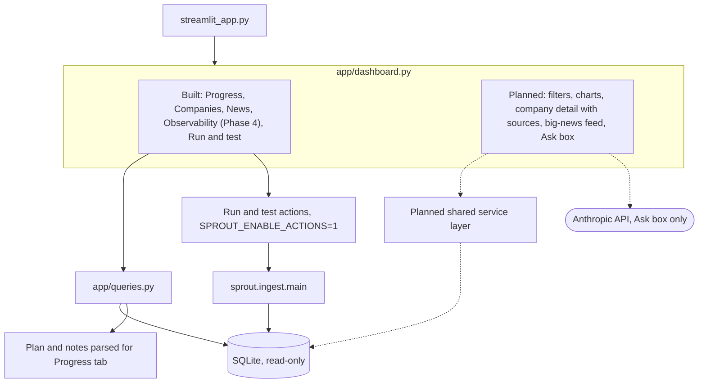

# Phase 7: Dashboard

Part of the [Sprout architecture docs](../README.md). Status: see [7. status.md](../7.%20status.md).

The Observability tab (built in Phase 4) is specified on the [Phase 4 page](phase-4-observability.md#dashboard-tab-appdashboardpy). The winning-value rule (needed before this phase reads facts) and the service-layer extraction are A6 in [risks and ambiguities](../5.%20risks.md) and D29 in [decisions](../6.%20decisions.md).
