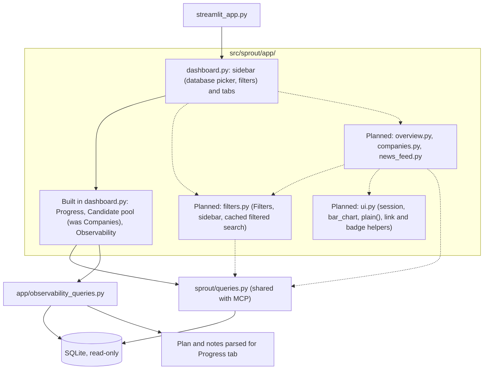

# Phase 7: Dashboard

Part of the [Sprout architecture docs](../README.md). Status: see [7. status.md](../7.%20status.md).

Dotted boxes and arrows are planned; solid ones are built.

The dashboard has no Anthropic node, no key and no write or spend path (A29; a test checks it imports no ingest, hello, agents or `anthropic` code). The optional natural-language "Ask" box from the plan is deliberately skipped: the plan marks it optional, and the [MCP server (Phase 8)](phase-8-mcp-server.md) already provides natural-language access to the same data.

The Observability tab (built in Phase 4) is specified on the [Phase 4 page](phase-4-observability.md#dashboard-tab-appdashboardpy). The shared read layer is `sprout/queries.py` (D29 in [decisions](../6.%20decisions.md), winning-value rule A6 in [risks and ambiguities](../5.%20risks.md)); the pages below add read functions there rather than SQL in the UI.

## Data the design must fit

The committed snapshot (`data/sprout_snapshot.db`, also the default when `data/sprout.db` does not exist) is thin, so every page is built around coverage, not around the happy path:

| Fact | Consequence |
|---|---|
| 1,672 candidates but only the enriched ones (`category IS NOT NULL`, 84) have a profile | The pages below work over enriched companies only (`enriched_only`); the unenriched pool stays on the Candidate pool tab |
| `category` holds values outside the `Category` enum (6 legacy "AI models and applications"), 47 of 84 are `Other` | Category options come from the data (`category_counts`), never from the enum |
| Winning `stage` is known for 5 of 84; funding rounds exist for 8 companies (12 rounds, 11 with an amount, US$1m to US$1.2bn); total raised and valuation are known for 3 and 5 | Coverage strip on every chart; charts are bars over rounds, not a stage-by-category heatmap (too sparse to read) |
| `one_liner` known for 69 of 84, `business_model` 40, `target_user` 35, `website` 32 | Every field renders "Not disclosed" for a NULL winner and "Not researched" for no fact |
| 24 news rows for 7 companies, 16 with a `news_kind`, 9 without `published` | "Date not found" is shown; the feed is short and must say so |
| `fact` also holds `verification:*` rows (legacy, no code writes them now) | The detail page shows an allowlist of `CompanyProfile` fields, never every `fact.field` |

## Module layout

Keep `dashboard.py` as the shell and move nothing else into it; the new pages are small modules next to it (the file is already about 820 lines). Pages take a `Filters` and read through `queries.py`.

| Module | Responsibility |
|---|---|
| `app/dashboard.py` | `main`: page config, sidebar (database picker first, then filters), tab list. Keeps `render_progress`, `render_pool` (the current `render_companies`, minus its per-company drill-down, which the Companies page replaces) and `render_observability`. Progress shows a message when `docs/` is absent |
| `app/ui.py` | Moved from `dashboard.py`: `bar_chart`, `_engine`, `session`. New: `db_version(path)` (file mtime, part of every cache key), `plain(text)`, `source_link(url)`, `confidence_badge(level)`, `money(value_million_usd)` |
| `app/filters.py` | `Filters` (frozen dataclass, hashable, so it is a cache key), `render_sidebar() -> Filters`, `filtered(filters)` (cached: returns `CompanySearch`-derived plain data, not ORM rows) |
| `app/overview.py` | `render_overview(filters)` |
| `app/companies.py` | `render_companies(filters)`: filtered list and the company detail |
| `app/news_feed.py` | `render_news_feed(filters)`; replaces the old News tab |

Tabs, in order: Overview, Companies, News feed, Candidate pool, Progress, Observability. The sidebar filters apply to the first three; the sidebar says so. The database picker moves from the Progress tab to the top of the sidebar, so every tab reads the same database in the same run.

No new package or framework: tabs, not Streamlit's multi-page routing, because the existing tests, the `streamlit_app.py` entry point and the Streamlit Cloud deployment already assume one script.

## Sidebar filters

`Filters`: `category`, `stage`, `funding_min`, `funding_max` (US$m), `founded_from`, `founded_to`, `text`. Each maps to a `search_companies` keyword.

| Filter | Widget | Meaning |
|---|---|---|
| Category | selectbox, options from `category_counts` with counts, "Any" | `company.category` |
| Stage | selectbox, options from the data in `Stage` order | Winning `stage` fact |
| Latest round (US$m) | `select_slider` range over fixed steps (0, 1, 5, 10, 25, 50, 100, 250, 500, 1000+) | Amount of the D22 latest round. Labelled "Latest round", not "funding raised", because total raised is nearly always unknown |
| Founded | year slider over the data's min and max | Winning `founded` fact |
| Search | text input | Name or winning `one_liner`, case-insensitive |

A filter left at its default is not passed (`None`). A company whose value is unknown never matches a filter on it (existing `search_companies` rule), and the sidebar says how many are excluded, from `Coverage` ("funding known for 8 of 84").

## Read functions

All in `sprout/queries.py`, which still imports only `db`, `models` and `status`. New parameters are keyword-only with defaults that keep today's behaviour, because the MCP tools reuse them ([Phase 8](phase-8-mcp-server.md)). A `company_ids` of `None` means no restriction; an empty collection means no companies.

| Function | Purpose |
|---|---|
| `search_companies(..., enriched_only: bool = False, max_funding_million_usd: int \| None = None)` | Existing function plus an upper funding bound and the enriched-only switch. `text` now also matches the winning `one_liner` |
| `company_cards(session, company_ids: Sequence[int]) -> list[CompanyCard]` | List rows in the order given. `CompanyCard(company, one_liner, stage, founded: ProfileFact \| None, latest_round: FundingRoundRow \| None)`, so a card's one-liner and stage keep their source link and confidence. One winning-fact query and one rounds query |
| `funding_by_stage(session, company_ids: Collection[int] \| None = None) -> FundingByStage` | Rounds grouped by the round's stage in `Stage` order, only stages that have a round. `StageFunding(stage, rounds, amount_known, total_million_usd, median_million_usd)`; the two amounts are `None` when no round of that stage has one, never 0. `FundingByStage(stages, companies, companies_with_rounds)` carries the coverage |
| `recent_rounds(session, company_ids: Collection[int] \| None = None, *, limit: int = 10) -> list[RecentRound]` | Newest announced rounds first, undated last, amount `None` kept. `RecentRound(company_id, company_name, round)` |
| `search_news(..., big_only: bool = False, category: str \| None = None, since: date \| None = None, company_ids: Collection[int] \| None = None)` | Existing function plus filters; `big_only` is `news_kind IS NOT NULL`. `since` and `category` are what the MCP `latest_news(category, days)` needs |

Category counts for the Overview come from counting the filtered companies in Python, not a new query. Other pool-wide counts stay as they are.

## Pages

**Overview.** A coverage strip first (companies matched; stage known for X of N; funding known for X of N; rounds with an amount), then counts per category (horizontal bar, labels truncated with the full name in the tooltip so it fits a narrow window), funding by round stage (bar of `total_million_usd` with `rounds` and `amount_known` in the tooltip and the median beside it; a stage with no amount is listed as "Not disclosed", not drawn as zero), and the top recent rounds (a list with stage, amount or "Not disclosed", date, investors, source link, confidence). The funding chart sits above a "Rounds behind this chart" table with one source link per round, so each displayed figure traces to its source. Category counts are a model classification, not a sourced fact (D6), and say so in their caption.

**Companies.** A list from `company_cards` (name, category, one-liner, stage, latest round, founded; each unknown value the text "Not disclosed"). A single-row selection opens the detail below it, from `get_profile`:

- Header: name, category, a link to the Companies House page (`companies_house_url`), website if disclosed.
- Fields in a fixed order (one_liner, business_model, target_user, hq, founded, stage, total_raised_million_usd, valuation_million_usd, business_status): value or "Not disclosed" or "Not researched", confidence badge, retrieved date, source link, and the fact's `note` for funding figures.
- Funding history: every `funding_round`, newest first, each with its own source link and confidence; "No funding rounds found" otherwise.
- News timeline: the company's `company_news`, newest first, big items marked with their `news_kind`.
- Officers (from `company_officers`): role, birth year, nationality, each with its source link.

**News feed.** `search_news(big_only=True, company_ids=...)` under the sidebar filters, with a toggle to include items that are not big news and a `news_kind` filter. Each item: company, kind badge, date or "Date not found", title and model-written summary (labelled as such), and a link to the article. News rows carry no confidence; the article URL is its own source ([cross-cutting 1](../4.%20cross-cutting.md#1-sourcing-and-provenance)). The Phase 6 weak spots apply (cross-outlet duplicates, some undated items; see the [Phase 6 page](phase-6-multi-agent.md#known-weak-spots-and-open-items)).

## Rendering rules

- Model-written or scraped text (fact values, news titles and summaries, round notes, investors, officer names) reaches `st.markdown` only through `ui.plain()`, or goes to `st.text`, `st.code` or a dataframe cell; `unsafe_allow_html` is never used (D41 in [decisions](../6.%20decisions.md)).
- A link is a fixed-label control (`st.link_button`, `LinkColumn`) over a URL that starts with `http://` or `https://`; a failing check renders no link.
- A NULL winner shows `NOT_DISCLOSED`; a field with no fact shows "Not researched". No chart or table plots or formats a missing value as 0 or blank.
- Every displayed figure either carries its own source link or sits beside the rows that do; derived aggregates say what they are computed over.
- No wide tables on the Companies page detail: facts are stacked rows, not columns, and layouts use at most two columns, so a narrow laptop window reflows. Streamlit collapses the sidebar there on its own.

## Performance and caching

`search_companies` over all 1,672 candidates took about 0.03 s on the snapshot and `get_profile` about 2 ms, so the one-second filter budget is met by the query layer; caching only avoids repeating it per rerun. `st.cache_resource` holds the engine. `st.cache_data` wraps the filtered search, `company_cards`, `funding_by_stage` and `recent_rounds`, keyed on `(db_path, db_version(db_path), Filters)`, and returns plain data (dataclasses, DataFrames), not ORM rows. `get_profile` is not cached. The indexed columns (`fact.company_id`, `fact.field`, `funding_round.company_id`) already exist; no schema change.

## Tests and acceptance

- `tests/test_queries.py`: the new parameters and functions against a temp DB, including empty `company_ids`, a NULL amount staying `None`, and the import-allowlist test still passing.
- `tests/test_dashboard.py` (`AppTest`): tab labels, an empty database, and a hostile-text case on the Companies and News feed pages (no Markdown image, link or script from a fact value or news title); the no-spend-path import test still passes.
- Not checked by code and left for a manual look: the narrow-window layout and the first run against the bundled snapshot in a browser.

## What Phase 6 leaves for this phase

Read-side only, no schema work. The news timeline and feed read `company_news`; per-company status and cost come from `status.py`, not from new SQL. `get_engine` turns on WAL for every caller, and it must tolerate a read-only snapshot file (see the snapshot risk in [risks](../5.%20risks.md)). The deployed app holds no keys. The live data is thin (see the table above), so the coverage indicators the plan asks for matter, and "not disclosed" must render as such.
