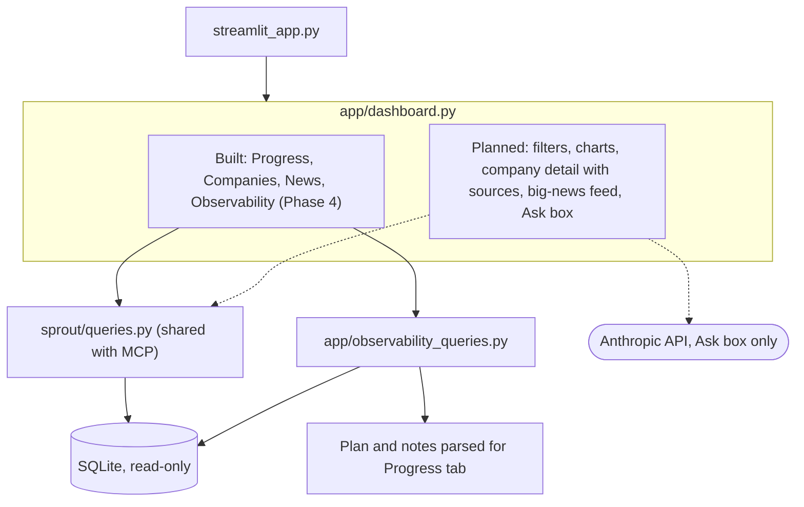

# Phase 7: Dashboard

Part of the [Sprout architecture docs](../README.md). Status: see [7. status.md](../7.%20status.md).

The Observability tab (built in Phase 4) is specified on the [Phase 4 page](phase-4-observability.md#dashboard-tab-appdashboardpy). The shared read layer is `sprout/queries.py` (D29 in [decisions](../6.%20decisions.md), winning-value rule A6 in [risks and ambiguities](../5.%20risks.md)): `get_profile` for the company detail page, and `search_companies` with its `Coverage` for the filters and the "known for X of N" captions. Never plot a missing value as zero.

What Phase 6 leaves for this phase (read-side only, no schema work): the news timeline and big-news feed read `company_news` (`search_news` already joins it to `company`; `news_kind IS NOT NULL` is big news); per-company status and cost come from `status.py`, not from new SQL; the category chart reads `company.category` (see the [data model](../2.%20data-model.md#profile-persistence) on the categories in the existing data). `get_engine` turns on WAL for every caller, and it must tolerate a read-only snapshot file. The deployed app holds no keys and has no write or spend path (A29). The live 50-company data is thin (most companies `Other`, few with funding rounds or news; see the [notes](../../implementation-notes.md#phase-6---multi-agent-pipeline-at-scale)), so the coverage indicators the plan asks for matter, and "not disclosed" must render as such.
