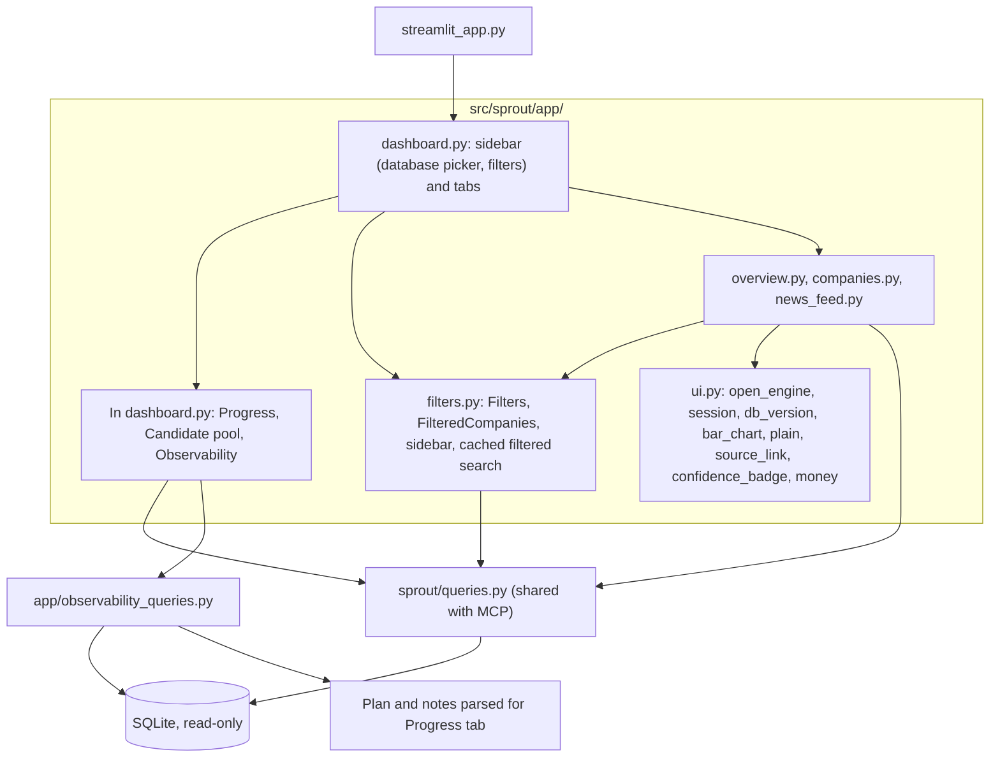

# Phase 7: Dashboard

Part of the [Sprout architecture docs](../README.md). Status: see [7. status.md](../7.%20status.md).

The dashboard has no Anthropic node, no key and no write or spend path (A29; a test checks it imports no ingest, hello, agents or `anthropic` code). The optional natural-language "Ask" box from the plan is deliberately skipped: the plan marks it optional, and the [MCP server (Phase 8)](phase-8-mcp-server.md) already provides natural-language access to the same data.

The Observability tab (built in Phase 4) is specified on the [Phase 4 page](phase-4-observability.md#dashboard-tab-appdashboardpy). The shared read layer is `sprout/queries.py` (D29 in [decisions](../6.%20decisions.md), winning-value rule A6 in [risks and ambiguities](../5.%20risks.md)); the pages below read through it rather than running SQL in the UI.

## Data the design must fit

The committed snapshot (`data/sprout_snapshot.db`, also the default when `data/sprout.db` does not exist) is thin, so every page is built around coverage, not around the happy path:

| Fact | Consequence |
|---|---|
| 1,672 candidates but only the enriched ones (`category IS NOT NULL`, 84) have a profile | The pages below work over enriched companies only (`enriched_only`); the unenriched pool stays on the Candidate pool tab |
| `category` holds values outside the `Category` enum (6 legacy "AI models and applications"), 47 of 84 are `Other` | Category options come from the data (`category_counts`), never from the enum |
| Winning `stage` is known for 5 of 84; funding rounds exist for 8 companies (12 rounds, 11 with an amount, US$1m to US$1.2bn); total raised and valuation are known for 3 and 5 | Coverage strip on every chart; charts are bars over rounds, not a stage-by-category heatmap (too sparse to read) |
| `one_liner` known for 69 of 84, `business_model` 40, `target_user` 35, `website` 32 | Every field renders "Not disclosed" for a NULL winner and "Not researched" for no fact |
| 24 news rows for 7 companies, 16 with a `news_kind`, 9 without `published` | "Date not found" is shown; the feed is short and must say so |
| `fact` also holds `verification:*` rows (legacy, no code writes them now) | The detail page shows an allowlist of `CompanyProfile` fields, never every `fact.field` |

## Module layout

`dashboard.py` is the shell; each new page is a small module next to it. Pages take a `Filters` and read through `queries.py`.

| Module | Responsibility |
|---|---|
| `app/dashboard.py` | `main`: page config, sidebar (`render_db_picker` first, then `render_sidebar`), tab list. Also `render_progress`, `render_pool` (the candidate-pool tab, no per-company drill-down) and `render_observability`. Progress shows a message when `docs/` is absent |
| `app/ui.py` | `bar_chart(counts, *, category_title, value_title, percent_of, horizontal, full_labels, height, label_angle, details)` (`details` maps a key to extra tooltip fields), `open_engine(db_path)` (uncached) and the cached `_engine`, `current_db_path()`, `session()`, `db_version(path)` (latest mtime of the file or its `-wal`, part of every cache key), `plain(text)`, `source_link(url, label="Source", *, key) -> bool` (renders only for an http(s) URL and returns whether it did), `confidence_badge(level)`, `money(value_million_usd)` |
| `app/filters.py` | `Filters` (frozen, hashable, so it is a cache key), `FilteredCompanies(company_ids, coverage, enriched_total)` (plain data, no ORM rows), `render_sidebar() -> Filters`, `filtered(filters) -> FilteredCompanies` (cached on `(db_path, db_version, Filters)`), `FUNDING_STEPS` |
| `app/overview.py` | `render_overview(filters)`; `RoundView` and `OverviewData` are the cached plain data |
| `app/companies.py` | `render_companies(filters)`: filtered list (`CardRow`) and the company detail; `FIELDS` is the display allowlist |
| `app/news_feed.py` | `render_news_feed(filters)`; `FeedItem` is the cached plain data |

Tabs, in order: Overview, Companies, News feed, Candidate pool, Progress, Observability. The sidebar filters apply to the first three; the sidebar says so. The database picker is at the top of the sidebar, so every tab reads the same database in the same run.

No new package or framework: tabs, not Streamlit's multi-page routing, because the existing tests, the `streamlit_app.py` entry point and the Streamlit Cloud deployment already assume one script.

## Sidebar filters

`Filters`: `category`, `stage`, `funding_min`, `funding_max` (US$m), `founded_from`, `founded_to`, `text`. Each maps to a `search_companies` keyword.

| Filter | Widget | Meaning |
|---|---|---|
| Category | selectbox, options from `category_counts` with counts, "Any" | `company.category` |
| Stage | selectbox, options from `stage_counts` in `Stage` order (values outside the enum last), "Any" | Winning `stage` fact |
| Latest round (US$m) | `select_slider` range over fixed steps (0, 1, 5, 10, 25, 50, 100, 250, 500, 1000+) | Amount of the D22 latest round. Labelled "Latest round", not "funding raised", because total raised is nearly always unknown |
| Founded | year slider over the data's min and max, shown only when they differ | Winning `founded` fact |
| Search | text input | Name or winning `one_liner`, case-insensitive |

A filter left at its default is not passed (`None`). A company whose value is unknown never matches a filter on it (`search_companies` rule), and the sidebar caption says so with the counts from `Coverage` ("N of M enriched companies match", "funding known for X of N", "stage known for X of N").

## Read functions

All in `sprout/queries.py`, which imports only `db`, `models` and `status` (a test enforces it). The new parameters are keyword-only with defaults that keep the earlier behaviour, because the MCP tools reuse them ([Phase 8](phase-8-mcp-server.md)). A `company_ids` of `None` means no restriction; an empty collection means no companies. Nothing is cached here; the pages cache.

| Function | Purpose |
|---|---|
| `search_companies(..., enriched_only: bool = False, max_funding_million_usd: int \| None = None)` | Existing function plus an upper funding bound and the enriched-only switch. `text` now also matches the winning `one_liner` |
| `company_cards(session, company_ids: Sequence[int]) -> list[CompanyCard]` | List rows in the order given; an unknown id is skipped. `CompanyCard(company, one_liner, stage, founded: ProfileFact \| None, latest_round: FundingRoundRow \| None)`, so a card's one-liner and stage keep their source link and confidence. One winning-fact query and one rounds query |
| `funding_by_stage(session, company_ids: Collection[int] \| None = None) -> FundingByStage` | Rounds grouped by the round's stage in `Stage` order, only stages that have a round; a round whose stage is outside the enum goes in the `Unknown` bucket. `StageFunding(stage, rounds, amount_known, total_million_usd, median_million_usd)`; the two amounts are `None` when no round of that stage has one, never 0. `FundingByStage(stages, companies, companies_with_rounds)` carries the coverage |
| `recent_rounds(session, company_ids: Collection[int] \| None = None, *, limit: int = 10) -> list[RecentRound]` | Newest announced rounds first, undated last, amount `None` kept. `RecentRound(company_id, company_name, round)` |
| `search_news(..., big_only: bool = False, category: str \| None = None, since: date \| None = None, company_ids: Collection[int] \| None = None)` | Existing function plus filters; `big_only` is `news_kind IS NOT NULL`. `since` and `category` are what the MCP `latest_news(category, days)` needs |

Category counts for the Overview come from counting the filtered `CompanyCard`s in Python, not a new query. `get_profile` and `company_officers` serve the detail; `ProfileFact` construction is shared (`_profile_fact`) between `get_profile` and `company_cards`.

## Pages

**Overview.** A coverage strip first (companies matched; stage known for X of N; funding known for X of N; rounds with an amount), then counts per category (horizontal bar, labels truncated with the full name in the tooltip so it fits a narrow window), funding by round stage (bar of `total_million_usd` with `rounds` and `amount_known` in the tooltip and the median beside it; a stage with no amount is listed as "Not disclosed", not drawn as zero), and the top recent rounds (a list with stage, amount or "Not disclosed", date, investors, source link, confidence). The funding chart sits above a "Rounds behind this chart" table with one source link per round, so each displayed figure traces to its source. Category counts are a model classification, not a sourced fact (D6), and say so in their caption.

**Companies.** A dataframe from `company_cards` (name, category, one-liner, stage, latest round, founded; each unknown value the text "Not disclosed"). A single-row selection (`on_select="rerun"`, `selection_mode="single-row"`) opens the detail below it, from `get_profile`. The dataframe key includes a hash of the shown company ids, so a filter change clears the selection instead of pointing it at another company; there is no selectbox fallback.

- Header: name, category, a link to the Companies House page (`companies_house_url`), website link if disclosed.
- Fields in a fixed order (`companies.FIELDS`: one_liner, business_model, target_user, hq, founded, stage, total_raised_million_usd, valuation_million_usd, business_status): value or "Not disclosed" or "Not researched", confidence badge, retrieved date, source link ("No source link" for a disclosed value without an http(s) URL), and the fact's `note` for the two funding figures.
- Funding history: every `funding_round`, newest first (undated last), each with its own source link and confidence and its note; "No funding rounds found." otherwise.
- News timeline: the company's `company_news`, newest first, big items marked with their `news_kind`.
- Officers (from `company_officers`): a dataframe of role, name, birth year, nationality and a source link.

**News feed.** `search_news(big_only=not include_not_big, company_ids=...)` under the sidebar filters, with a toggle to include items that are not big news and a `news_kind` filter over the kinds present. Each item: company, kind badge, date or "Date not found", title and model-written summary (labelled as such), and a link to the article. News rows carry no confidence; the article URL is its own source ([cross-cutting 1](../4.%20cross-cutting.md#1-sourcing-and-provenance)). The Phase 6 weak spots apply (cross-outlet duplicates, some undated items; see the [Phase 6 page](phase-6-multi-agent.md#known-weak-spots-and-open-items)).

## Rendering rules

- Model-written or scraped text (fact values, news titles and summaries, round notes, investors, officer names) reaches `st.markdown` only through `ui.plain()`, or goes to `st.text`, `st.code` or a dataframe cell; `unsafe_allow_html` is never used (D41 in [decisions](../6.%20decisions.md)).
- A link is a fixed-label control (`st.link_button` via `source_link`, or `LinkColumn`) over a URL that starts with `http://` or `https://`; a failing check renders no link, and `source_link` returns `False` so the caller can show "No source link".
- A NULL winner shows `NOT_DISCLOSED`; a field with no fact shows "Not researched". No chart or table plots or formats a missing value as 0 or blank.
- Every displayed figure either carries its own source link or sits beside the rows that do; derived aggregates say what they are computed over.
- The detail stacks facts as rows and uses at most two columns, so it reflows in a narrow window. The Companies list and the rounds table are dataframes that scroll inside their frame; with the sidebar open the list shows only its first column (open item in [risks](../5.%20risks.md#1-risks), measured in the [notes](../../implementation-notes.md#phase-7---dashboard)).

## Performance and caching

Timings against the one-second filter budget are in the [notes](../../implementation-notes.md#phase-7---dashboard). `st.cache_resource` holds the engine (`ui._engine`). `st.cache_data` wraps `filters._options`, `filters._filtered`, `overview._load` (cards, funding by stage and rounds in one call), `companies._load_list` and `news_feed._load_feed`, keyed on `(db_path, db_version(db_path), Filters)` plus the news toggle, and returns plain dataclasses, not ORM rows. `get_profile` and `company_officers` are not cached. No schema change.

## Tests and acceptance

- `tests/test_queries.py`: the new parameters and functions against a temp DB, plus the import-allowlist test.
- `tests/test_ui.py`: `plain`, `money`, `source_link`, `Filters`, `db_version`, `open_engine` (a WAL database in a read-only directory, and a writable path), the sidebar.
- `tests/test_overview.py`, `tests/test_companies.py`, `tests/test_news_feed.py` (`AppTest`): coverage text, "Not disclosed" versus "Not researched", per-item source links, an empty database, no-match messages, and a hostile-text case on each page (no Markdown image, link or script from scraped text).
- `tests/test_dashboard.py`: the no-spend-path import test, an empty read-only database, and the Progress message when `docs/` is missing.
- Not checked by code: the narrow-window layout in a headed browser, and whether a bare `https://` string still autolinks after `plain()` (see the notes' open items).

## Read-only database access

Read-side only, no schema work. The news timeline and feed read `company_news`. The dashboard shows no per-company pipeline status, so it does not import `status.py`. `get_engine` turns on WAL for every caller, so `ui.open_engine` opens a non-writable database file with a `mode=ro&immutable=1` URI and skips `init_db` (see the snapshot risk in [risks](../5.%20risks.md)); `db.get_engine` is unchanged. The deployed app holds no keys.
