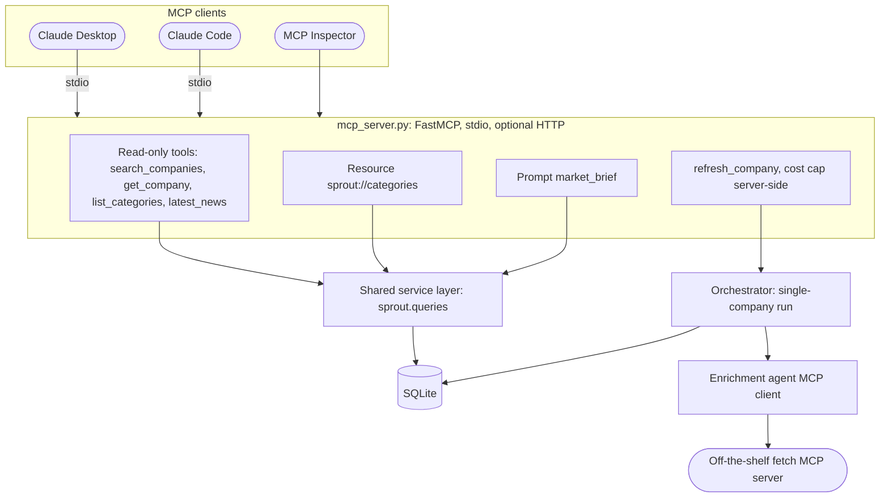

# Phase 8: MCP server (planned)

Part of the [Sprout architecture docs](../README.md).

- A stdio server must never write to stdout; log to stderr.
- **[AMBIGUOUS]** Replacing `fetch_page` with a third-party MCP server discards `WebFetcher` protections (see A2 in [risks and ambiguities](../5.%20risks.md)). Wrap `WebFetcher`, or keep the replacement behind a flag.
- Phase 5 consequences of the `fetch_page` swap: `ALLOWED_ENRICHMENT_TOOLS` is a fail-closed name check, so a differently named MCP fetch tool must be added to it deliberately; the MCP-backed handler must still feed `SourceLedger` (provenance, D11, and `stats["sources"]`) and apply `UrlPolicy`, size caps and robots; `fixture_fetcher` injection tests exercise only the `WebFetcher` path, so the swapped path needs its own fixture server or stays flagged; run the golden set on whichever path ships.
- **[AMBIGUOUS]** `refresh_company` is a model-invoked paid write (A31 in [risks and ambiguities](../5.%20risks.md)). Keep it on the MCP server only, never in the enrichment agent's tools (D30 in [decisions](../6.%20decisions.md)). Add a cooldown and return status plus cost rather than blocking. A server-side `BatchBudget` (Phase 5, D24) shared across calls is the natural cap.

`app/queries.py` moves to `sprout/queries.py` (built in [Phase 3](phase-3-enrichment.md), extended in [Phase 4](phase-4-observability.md)) before this phase, so MCP does not import from the UI package.
