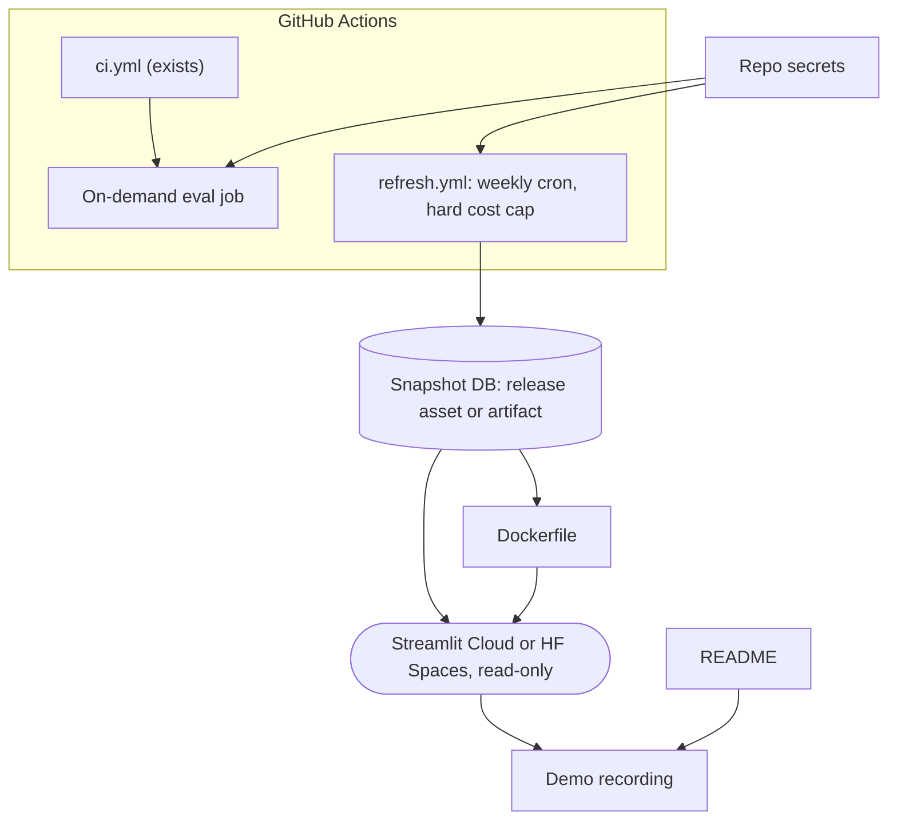

# Phase 9: Automation, deployment, docs (planned)

Part of the [Sprout architecture docs](../README.md).

The on-demand eval job runs `python -m evals.run_evals --max-total-usd N` (exit 0 pass, 1 gate failed, 2 incomplete or misconfigured) with the Anthropic and Companies House keys as secrets, so it cannot run for fork PRs. It starts with a cold `.cache/http`, so every cited page is refetched politely and the run is slower than a local one. Upload the table as an artifact; `evals/results.md` is committed by hand after a baseline or prompt change, and the README quotes its latest table.

Snapshot delivery (A28 in [risks and ambiguities](../5.%20risks.md)) and data licensing/robots recheck are open before this phase.
